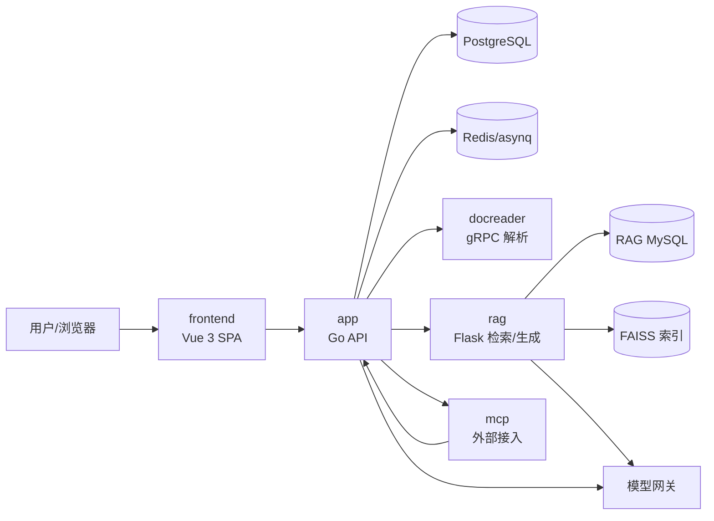
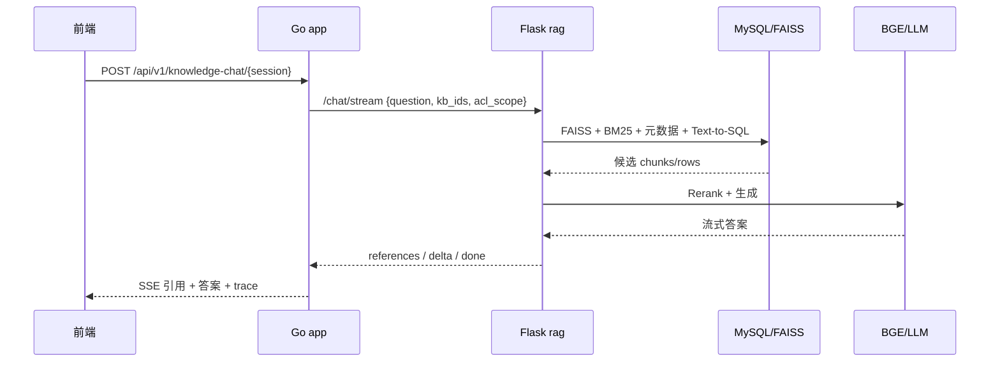
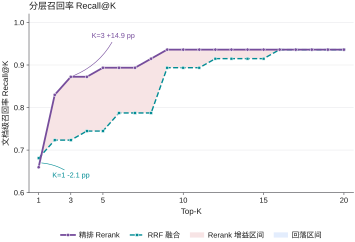
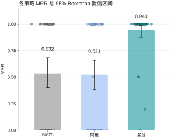

# WellRead

公司内部单租户、本地部署的企业知识库系统：把文档、检索、问答、精读、协作、部门权限、治理和运维放在同一套平台里。核心目标是在**数据不出内网**的前提下，让企业文档“找得到、答得准、改得可追溯、权限管得住”。

## 1. 定位与边界

WellRead 面向需要数据主权与权限治理的企业知识场景，不是公开 SaaS，也不是通用聊天机器人。

- **做**：部门知识库、文档解析与检索、带引用问答、交互式精读、CR 协作与版本、共享空间与 ACL、公司/部门治理、技术运维台、MCP/CLI 外部接入。
- **不做**：多租户 SaaS 运营、个人网盘同步、开放式通用 Agent、把页面可见性当授权边界。
- **权限底线**：部门、KB 共享、ACL、密级、CR reviewer/审计员、API Key capability 都由后端资源守卫判定；前端只做粗筛。

## 2. 核心能力

### 2.1 产品能力

| 层 | 能力 | 价值 |
|---|---|---|
| 治理层 | 公司/部门/六角色、能力契约、设置委派、审计 | 管人、管权限、管配置 |
| 知识生产 | 上传、解析、分块、标签/元数据、文件夹、共享/ACL、CR/版本 | 文档可维护、可追溯 |
| 知识消费 | 检索、问答、引用、精读、共享空间 | 找得到、答得准、看得懂 |
| 协作层 | issue、锚点评论、CR 审批/合并/关闭、版本对比/回滚 | 从个人文档到团队知识 |
| 运维层 | 模型/解析/存储/队列、系统审计、账号救援、MCP/CLI | 能部署、能排障、能集成 |

### 2.2 技术深度

- **四路检索**：FAISS 向量、BM25、元数据、Text-to-SQL，RRF 融合后 BGE 重排，再生成带引用答案。
- **权限进检索**：`acl_scope` 随请求进入 RAG，四路召回分别在召回前过滤，融合/重排/上下文组装后再复核；缺 scope fail-closed。
- **精读不是问答**：固定文档集合、独立阅读模型、受限 ReAct 动作集、增量 Reading Notes、逐步 ACL 复核、token 预算与阅读审计。
- **协作像 Git 但不是 Git**：保留 diff、审阅、合并、版本、回滚；不引入分支，用“当前版 + CR 快照”降低学习成本。
- **外部接入独立 principal**：MCP/API Key 不继承员工角色，按 capability + KB 白名单授权。



## 3. 服务地图

| 目录 | 生态位 | 一句话职责 |
|---|---|---|
| `app/` | Go 后端 | API、领域服务、权限守卫、文档/会话/治理、docreader、CLI、Go SDK、Swagger |
| `frontend/` | Vue 3 + Vite + TDesign | 页面、交互、能力路由投影；`design/` 为设计源 |
| `rag/` | Flask 侧车 | 分块/索引、混合检索、重排、生成、引用 |
| `mcp/` | MCP 接入层 | 用租户 API Key 把知识能力暴露给外部 Agent |
| `deployments/` | 部署 | 六服务 compose、hotreload overlay、systemd、env example |
| `scripts/` | 跨服务脚本 | 构建镜像、打包 Lite、环境检查、数据导入 |
| `docs/` | 文档 | 总览、需求与设计、进度、历史归档、演示 |

RAG 语料、模型和 FAISS 索引不进入 git/镜像，默认放在仓库内 `data/rag/`（gitignore）。

## 4. 快速开始

```bash
cp deployments/.env.example deployments/.env
# 按本地环境填写数据库、模型网关与 YLSW 配置
# 确认仓库内 data/rag/ 已准备 Data、models 与 faiss_index.bin
make up
make health   # http://localhost:6152/health
```

开发热重载：

```bash
make dev                        # 后端热重载，http://localhost:6152
cd frontend && npm run dev      # 前端开发服务器，http://localhost:5173
```

常用命令：

```bash
make test-app        # Go 构建与测试
make test-frontend   # type-check / 单测 / build
make test-rag        # RAG 语法检查与 compose config
make test-mcp        # MCP 测试
make images          # 构建全部镜像
make down            # 停止栈
```

部署、备份、升级与故障排查见[部署手册](deployments/README.md)。

## 5. 文档地图

项目文档只有一个总入口，即本 README；`docs/` 下不再放 README。

| 分类 | 入口 | 内容 |
|---|---|---|
| 项目总览 | [系统总览](docs/01-项目总览/系统总览.md) | 定位、服务生态、权限、问答/入库/协作链路、数据归属 |
| 术语 | [术语与约定](docs/01-项目总览/术语与约定.md) | 跨文档 canonical 术语与易混点 |
| 角色权限 | [角色生态位规定](docs/02-需求与设计/角色与权限/角色生态位规定.md) | 六角色边界、能力码、歧义裁定、测试账号 |
| 能力路由 | [能力与路由矩阵](docs/02-需求与设计/角色与权限/能力与路由矩阵.md) | caps、路由/菜单/403、设置委派 |
| 共享与 ACL | [共享空间与ACL](docs/02-需求与设计/角色与权限/共享空间与ACL.md) | 部门共享、文件夹 ACL、检索 ACL |
| 功能与交互 | [功能与交互](docs/02-需求与设计/功能与交互/知识库与文档管理.md) | 知识库、问答、协作、精读、技能、治理、管理、运维 8 份 |
| 界面与原型 | [界面规范](docs/02-需求与设计/界面与原型/界面规范.md) | UI 规范与协作/治理/运营/运维原型 |
| 进度 | [当前进度](docs/03-进度与交接/当前进度.md) | 已完成/进行中/待办/验证基线/风险 |
| 历史 | [归档索引](docs/04-历史归档/归档索引.md) | 旧需求、旧台账、交接快照、代码/数据备份 |
| 演示 | [演示指南](docs/05-演示与试用/演示指南.md) | 演示主线、角色路径、演示纪律 |
| RAG | [RAG 文档](rag/README.md) | 架构、检索/生成、入库元数据、接口、配置、评测 |
| MCP | [MCP 文档](mcp/README.md) | 安装运行、客户端接入、工具参考、调用示例 |
| 后端 | [app/README](app/README.md) | 目录、开发、子系统文档路由 |
| 前端 | [frontend/README](frontend/README.md) | 开发、构建、能力契约、设计源 |
| 部署 | [deployments/README](deployments/README.md) | compose、env、systemd、备份升级 |

功能与交互 8 份：[知识库与文档管理](docs/02-需求与设计/功能与交互/知识库与文档管理.md)、[问答与引用](docs/02-需求与设计/功能与交互/问答与引用.md)、[协作与版本控制](docs/02-需求与设计/功能与交互/协作与版本控制.md)、[交互式精读](docs/02-需求与设计/功能与交互/交互式精读.md)、[技能与问答注入](docs/02-需求与设计/功能与交互/技能与问答注入.md)、[治理台与审计](docs/02-需求与设计/功能与交互/治理台与审计.md)、[部门管理工作台](docs/02-需求与设计/功能与交互/部门管理工作台.md)、[系统运维台](docs/02-需求与设计/功能与交互/系统运维台.md)。

## 6. 按受众选择路径

| 受众 | 先读 | 再读 |
|---|---|---|
| 新同事/接手人 | [系统总览](docs/01-项目总览/系统总览.md) | [当前进度](docs/03-进度与交接/当前进度.md)、[术语与约定](docs/01-项目总览/术语与约定.md) |
| 产品/需求 | [角色生态位规定](docs/02-需求与设计/角色与权限/角色生态位规定.md) | 8 份功能与交互文档、[界面规范](docs/02-需求与设计/界面与原型/界面规范.md) |
| 前端 | [frontend/README](frontend/README.md) | [能力与路由矩阵](docs/02-需求与设计/角色与权限/能力与路由矩阵.md)、[界面规范](docs/02-需求与设计/界面与原型/界面规范.md) |
| 后端/RAG | [app/README](app/README.md)、[RAG 文档](rag/README.md) | [共享空间与ACL](docs/02-需求与设计/角色与权限/共享空间与ACL.md)、[术语与约定](docs/01-项目总览/术语与约定.md) |
| 测试/验收 | [角色生态位规定](docs/02-需求与设计/角色与权限/角色生态位规定.md) | [当前进度](docs/03-进度与交接/当前进度.md)、各功能文档“验收”节 |
| 运维/部署 | [部署手册](deployments/README.md) | [系统运维台](docs/02-需求与设计/功能与交互/系统运维台.md)、[当前进度](docs/03-进度与交接/当前进度.md) |
| 演示/售前 | [演示指南](docs/05-演示与试用/演示指南.md) | [常见问题](docs/05-演示与试用/常见问题.md)、[角色截图索引](docs/images/截图索引.md) |

## 7. 开发与验证



验证基线：

- 前端：`npm run type-check`、`npm test`、`npm run build`。
- 后端：`go build ./internal/...`、`go vet ./internal/...`；Windows 本机的 duckdb 静态链接与 gojieba CGO 属既有环境限制。
- RAG：`python -m compileall -q src`、`docker compose -f rag/docker-compose.yml config`。
- MCP：`uv sync --extra test`、`uv run pytest -q`。
- 运行时：六容器 `/health` 200；六角色测试账号登录 caps 一致。

RAG 检索质量评测示例（详见 [RAG 测试与评测](rag/docs/测试与评测.md)）：





## 8. 目录树

```text
WellRead/
├── app/                  # Go 后端、docreader、CLI、SDK、Swagger
├── frontend/             # Vue 3 SPA；design/ 为设计源
├── rag/                  # YLSW 检索/生成侧车
├── mcp/                  # MCP 接入层
├── deployments/          # compose、hotreload、systemd、env example
├── scripts/              # 跨服务构建/运维脚本
├── data/rag/             # 本地 RAG 数据（gitignore，不进入镜像）
├── backups/              # 本地迁移备份（gitignore）
├── docs/
│   ├── 01-项目总览/
│   ├── 02-需求与设计/
│   ├── 03-进度与交接/
│   ├── 04-历史归档/
│   ├── 05-演示与试用/
│   └── images/           # 按角色英文目录存放截图 + 截图索引
├── CLAUDE.md             # AI Agent 操作指南
├── Makefile
└── README.md
```

仓库内（gitignore，不进入镜像）：

```text
data/rag/
├── Data/                 # RAG 语料
├── models/               # 本地模型
└── faiss_index.bin       # 持久化索引
```

## 9. 数据与安全边界

- **部署形态**：公司内部单租户本地部署，不做 SaaS 多租户；数据留在内网。
- **数据归属**：业务文档/会话/成员/审计在 PostgreSQL；RAG 文档/chunks/表格在 RAG MySQL；向量在 FAISS；队列/缓存在 Redis。
- **权限**：company_admin 不进入 KB 正文；system_admin 不进入业务；共享入只读；ACL deny 优先；检索缺 `acl_scope` fail-closed。
- **审计**：共享、ACL、成员、角色、技能、CR 合并/关闭/回滚、文档删除、导出、系统配置、账号救援均留痕；治理不展示员工原始问题。
- **密钥**：`.env` 与模型凭据不提交；平台 API Key 只显示掩码；迁移前暴露的凭据应轮换。
- **外部接入**：MCP/API Key 是独立 principal，按 capability + KB 白名单授权，不继承员工角色。
- **备份**：迁移前有 `pre-monorepo` tag、bundle 与源码备份；RAG 本地数据需单独备份，不随 git 迁移。
- **已知限制**：检索审计只存 query hash；CR 四眼原则、版本回滚引用迁移、精读完整陪读 UI 仍在优化。
