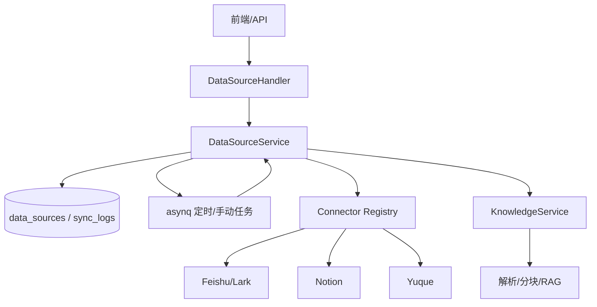
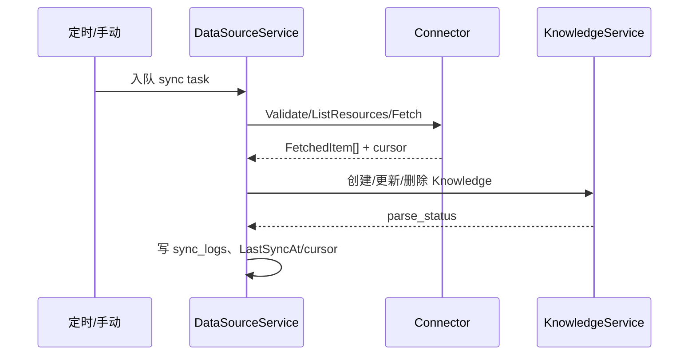

# 数据源同步框架

数据源同步框架把外部平台（飞书/Lark、Notion、语雀）的内容导入 WellRead 知识库，并支持增量同步、删除同步和定时任务。本文描述框架边界、组件、数据模型和 API；新增连接器步骤见[连接器开发指南](连接器开发指南.md)。

## 1. 边界

| 负责 | 不负责 |
|---|---|
| 外部平台认证、资源枚举、增量游标、删除检测 | 前端展示与用户权限 |
| 把 `FetchedItem` 转为 Knowledge | RAG 分块/embedding（由 ingestion 链路接管） |
| 同步日志、暂停/恢复、手动/定时触发 | 知识库 ACL 语义（由 app 资源守卫负责） |

同步目标始终是某个 `knowledge_base_id`，租户隔离由 `tenant_id` 保证。

## 2. 已注册连接器

当前容器注册：

- `feishu` / `lark`：飞书/Lark Wiki 空间。
- `feishu_drive` / `lark_drive`：飞书/Lark 云盘目录。
- `notion`
- `yuque`

`internal/types/datasource.go` 还保留了 Confluence、GitHub、Google Drive、OneDrive、DingTalk、Slack、IMAP、RSS、GitLab、IMA 等常量，但未在容器注册，不能当作已支持能力。

## 3. 架构



### 组件

| 组件 | 路径 |
|---|---|
| Connector 接口/注册表 | `internal/datasource/connector.go` |
| 连接器实现 | `internal/datasource/connector/<type>/` |
| 服务/仓储 | `internal/application/service/datasource_service.go`、`repository/datasource_repo.go` |
| HTTP | `internal/handler/datasource*.go` |
| 路由 | `internal/router/routes_infra.go` |
| 数据模型 | `internal/types/datasource.go` |

### 任务流



大同步优先使用 `StreamingConnector.FetchStream`：逐条 `Emit` 入库、按页 `Checkpoint` 游标；超时后从最后一个完整 checkpoint 恢复，而不是全量重来。未实现 Streaming 的连接器回退 `FetchAll`/`FetchIncremental`。

## 4. 数据模型

### DataSource

关键字段：

- `ID`、`TenantID`、`KnowledgeBaseID`
- `Type`、`Name`
- `Config`：AES-256-GCM 加密后的连接器配置
- `SyncSchedule`：cron
- `SyncMode`：`incremental` / `full`
- `Status`：`active` / `paused` / `error` / `deleted`
- `ConflictStrategy`：`overwrite` / `skip`
- `SyncDeletions`
- `LastSyncAt`、`LastSyncCursor`、`LastSyncResult`
- `SyncLogRetentionDays`

### SyncLog

记录每次同步：`running/success/partial/failed/canceled`、开始/结束时间、total/created/updated/deleted/skipped/failed 计数、错误信息和结果 JSON。

### Resource / FetchedItem

- `Resource`：外部平台可选资源（文档、空间、文件夹等）。
- `FetchedItem`：一次抓取的内容单元，带外部 ID、标题、Markdown/原始内容、元数据和删除标记。

## 5. API

前缀 `/api/v1/datasource`。读接口 Viewer+，写/同步/凭据 Admin+；API Key 需要 `manage_datasources` 或 full-access。

```text
GET    /types
POST   /validate-credentials
POST   /
GET    /
GET    /:id
PUT    /:id
DELETE /:id
PUT    /:id/credentials
DELETE /:id/credentials/:field
POST   /:id/validate
GET    /:id/resources
POST   /:id/resource-ancestors
POST   /:id/sync
POST   /:id/pause
POST   /:id/resume
GET    /:id/logs
GET    /logs/:log_id
```

`ListResources` 支持 `parentID` 懒加载树；`ResolveResourceAncestors` 用于回显已选深层资源。

## 6. 同步语义

- **全量**：`FetchAll`，重建该数据源映射；冲突按 `ConflictStrategy`。
- **增量**：`FetchIncremental` 使用 `LastSyncCursor`；只处理变化项。
- **删除**：`SyncDeletions=true` 时删除源端已删除的文档；关闭则保留。
- **冲突**：`overwrite` 覆盖已有内容，`skip` 保留目标。
- **暂停/恢复**：暂停停止新任务，恢复不补跑历史，只从当前游标继续。
- **失败**：写 `sync_logs` 和 `DataSource.ErrorMessage`；可重试。
- **幂等**：外部 ID 映射到 Knowledge；重复同步不重复建文档。

## 7. 前端/调用方注意

- 创建数据源必须绑定当前用户有权限的 KB。
- 凭据写入走 `/:id/credentials`，不会在读取接口回显明文。
- 同步是异步任务；API 返回后需要轮询 logs 或 KB 文档状态。
- 暂停/删除数据源不等于删除已导入文档；文档生命周期由 KB 管理。
- 大目录首次同步可能很久，优先用支持 streaming 的连接器。

## 8. 测试

```bash
cd app
go test ./internal/datasource/... ./internal/application/service/... ./internal/handler/...
```

覆盖连接器注册、配置校验、资源枚举、增量游标、删除同步、凭据加密/脱敏和任务取消。

## 9. 相关文档

- [连接器开发指南](连接器开发指南.md)
- [app README](../../README.md)
- [RAG 数据入库与元数据](../../../rag/docs/数据入库与元数据.md)
