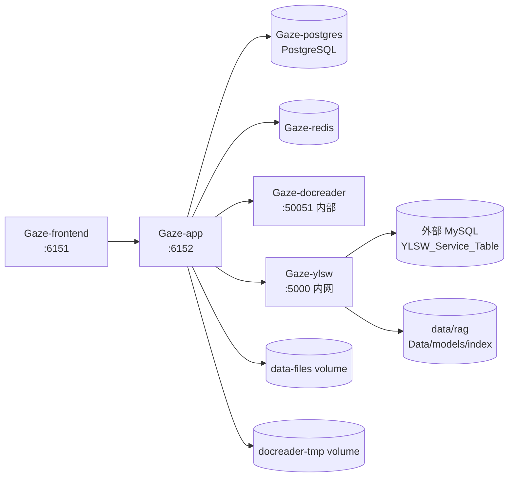

# 部署编排

`deployments/` 是 WellRead 全栈的本地/单机部署入口。compose 负责 frontend、app、docreader、postgres、redis、ylsw 六个服务，`.env` 是唯一栈级配置来源。

## 1. 服务拓扑



| 服务 | 镜像 | 端口 | 依赖 | 持久化 |
|---|---|---|---|---|
| frontend | `gaze-ui:<GAZE_VERSION>` | `${FRONTEND_PORT:-6151}:80` | app healthy | 无 |
| app | `gaze-app:<GAZE_VERSION>` | `${APP_PORT:-6152}:8080` | postgres/docreader/ylsw healthy，redis started | `data-files`、`docreader-tmp:ro` |
| docreader | `gaze-docreader:<GAZE_VERSION>` | 内部 `50051` | 无 | `docreader-tmp` |
| ylsw | `gaze-ylsw:<GAZE_VERSION>` | `expose 5000`（仅 Docker 内网） | 无 | 绑定 `data/rag` |
| postgres | `paradedb/paradedb:v0.22.2-pg17` | 内部 `5432` | 无 | `postgres-data` |
| redis | `redis:7.0-alpine` | 内部 `6379` | 无 | AOF 容器内 |

健康检查：

- app：`/health`，30s 间隔，start_period 60s。
- docreader：`grpc_health_probe`，30s，start_period 60s。
- ylsw：`/health`，30s，start_period 30s。
- postgres：`pg_isready`，10s，start_period 30s。

## 2. 文件说明

| 文件 | 作用 |
|---|---|
| `docker-compose.yml` | 六服务全栈编排 |
| `docker-compose.hotreload.yml` | app 热重载 overlay（dev 镜像 + 源码 bind mount + air） |
| `.env.example` | 栈配置模板；复制为 `.env` |
| `systemd/gaze-lite.service` | Lite 单二进制发行包的 systemd unit，不属于 compose |

`.env` 已被根 `.gitignore` 忽略，不能提交。

## 3. 首次启动

```bash
cd WellRead
cp deployments/.env.example deployments/.env
# 编辑 deployments/.env，至少填写 DB/YLSW/模型密钥
mkdir -p data/rag/{Data,models}
# 放入 RAG 语料与 BGE 模型

docker compose -f deployments/docker-compose.yml up -d --build
```

或使用根 Makefile：

```bash
make up          # 启动
make ps          # 状态
make logs        # 全栈日志
make down        # 停止
```

访问：

- 前端：`http://localhost:6151`（或 `FRONTEND_PORT`）
- 后端健康：`http://localhost:6152/health`（或 `APP_PORT`）
- YLSW 健康：容器内 `curl http://localhost:5000/health`，不发布宿主机端口

## 4. 关键配置

### 核心

| 变量 | 默认 | 说明 |
|---|---|---|
| `GAZE_VERSION` | `latest` | 镜像 tag |
| `FRONTEND_PORT` / `APP_PORT` | 6151 / 6152 | 宿主端口；ylsw 只在 Docker 内网 |
| `APP_BACKEND_PORT` | 8080 | 前端 nginx 代理到 app 的端口 |
| `APP_HOST` / `APP_SCHEME` | `app` / `http` | 前端 upstream |
| `TZ` | `Asia/Shanghai` | 时区 |
| `GIN_MODE` | `release` | Gin 模式 |
| `AUTO_MIGRATE` | `true` | app 启动自动迁移 |

### 数据库

app 使用 compose 内 PostgreSQL；ylsw 使用外部 MySQL。两者不是同一个库。

| 变量 | 说明 |
|---|---|
| `DB_DRIVER` | 默认 `postgres` |
| `DB_HOST` / `DB_PORT` / `DB_USER` / `DB_PASSWORD` / `DB_NAME` | app PostgreSQL |
| `YLSW_MYSQL_HOST` / `PORT` / `USER` / `PASSWORD` | 外部业务 MySQL |
| `YLSW_MYSQL_DATABASE` | RAG 库，默认 `YLSW_Service_Table` |
| `YLSW_EMPLOYEE_DB` | app 员工表库，默认 `ums_employee`；compose 注入为 app 的 `YLSW_MYSQL_DATABASE` |

`YLSW_MYSQL_HOST` 默认 `host.docker.internal`，compose 已配置 `extra_hosts` 映射到宿主。

### Redis

`REDIS_ADDR` 默认 `redis:6379`，`REDIS_PASSWORD` 必须与 compose 中 redis 启动参数一致。

### 认证与安全

| 变量 | 说明 |
|---|---|
| `JWT_SECRET` | 登录 token 签名，生产必须强随机 |
| `SYSTEM_AES_KEY` | 系统级 AES key |
| `DISABLE_REGISTRATION` | 是否关闭注册 |
| `GAZE_AUTH_COMPLEX_PASSWORD_ENABLED` | 复杂密码 |
| `GAZE_TENANT_*` | 单租户模式、邀请、配额、审计保留 |
| `SSRF_WHITELIST` / `SSRF_WHITELIST_EXTRA` | 解析/抓取的 SSRF 白名单 |

不要把 `.env` 或任何密钥提交到仓库；泄露后轮换 `JWT_SECRET`、`SYSTEM_AES_KEY`、模型 key 和 DB 密码。

### YLSW 与 RAG

| 变量 | 说明 |
|---|---|
| `YLSW_ENGINE_TOKEN` | app ↔ ylsw 共享密钥；两侧必须同值，空=不启用 |
| `YLSW_BGE_EMBEDDING_URL` / `YLSW_BGE_API_KEY` | BGE embedding |
| `YLSW_BGE_RERANKER_URL` | BGE reranker |
| `YLSW_DEEPSEEK_*` / `YLSW_QWEN_*` | RAG 生成/多模态 |
| `YLSW_API_TIMEOUT` / `YLSW_API_MAX_RETRIES` | RAG 外部 API |

RAG 语料、模型、FAISS 索引不在镜像内。compose 固定：

```text
../data/rag → /app/external
RAG_DATA_DIR=/app/external/Data
LOCAL_MODELS_DIR=/app/external/models
RUN_OFFLINE_INGEST=0
```

app 上传文档后通过 `/ingest` 推送，不在容器启动时跑全量离线摄取。

### 前端

| 变量 | 说明 |
|---|---|
| `FRONTEND_PORT` | 宿主访问端口，默认 6151 |
| `DEFAULT_LOCALE` | 默认语言 |
| `MAX_FILE_SIZE_MB` | 上传上限，前端 nginx 与后端共用 |
| `APP_HOST` / `APP_PORT` / `APP_SCHEME` | nginx 代理目标 |

前端镜像构建需要 named context：

```bash
docker build \
  --build-context contracts=app/contracts \
  -f frontend/Dockerfile \
  frontend/
```

## 5. 构建上下文

| 服务 | context | Dockerfile |
|---|---|---|
| frontend | `../frontend` | `frontend/Dockerfile`，额外 context `contracts=../app/contracts` |
| app | `../app` | `docker/Dockerfile.app` |
| docreader | `../app` | `docker/Dockerfile.docreader` |
| ylsw | `../rag` | `rag/Dockerfile` |

单独重建：

```bash
docker compose -f deployments/docker-compose.yml build app
docker compose -f deployments/docker-compose.yml build frontend
docker compose -f deployments/docker-compose.yml build ylsw
docker compose -f deployments/docker-compose.yml build docreader
```

## 6. 热重载开发

```bash
docker compose -f deployments/docker-compose.yml \
  -f deployments/docker-compose.hotreload.yml up -d --build app
docker compose -f deployments/docker-compose.yml \
  -f deployments/docker-compose.hotreload.yml logs -f app
```

overlay 会把 `../app` 挂到 `/app`，使用 `gaze-app-dev:latest` + air；首次构建较慢，后续 Go 编译走 named volume 缓存。

切回正式镜像：

```bash
docker compose -f deployments/docker-compose.yml up -d app
```

## 7. 项目名与卷兼容

compose 顶层固定：

```yaml
name: app
```

这会保持原有卷名 `app_postgres-data`、`app_data-files`、`app_docreader-tmp`。**不要随意改项目名**，否则 Compose 会创建新卷，表现为数据库/上传文件“消失”。

## 8. 生命周期

```bash
# 启动/更新
docker compose -f deployments/docker-compose.yml up -d --build

# 只重建某个服务
docker compose -f deployments/docker-compose.yml up -d --build app

# 状态/日志
docker compose -f deployments/docker-compose.yml ps
docker compose -f deployments/docker-compose.yml logs -f app

# 停止（保留容器与卷）
docker compose -f deployments/docker-compose.yml stop

# 删除容器和网络（保留卷）
docker compose -f deployments/docker-compose.yml down

# 连数据卷一起删：会丢 PostgreSQL/上传文件，生产禁用
docker compose -f deployments/docker-compose.yml down -v
```

改代码后 `restart` 不会换镜像；必须 `build` + `up -d`（必要时 `--force-recreate`）。

## 9. 备份与升级

必须一起备份：

- `app_postgres-data`：业务库。
- `app_data-files`：上传文件。
- 外部 RAG 目录：`Data`、`models`、`faiss_index.bin`。
- 外部 MySQL：RAG 库 `YLSW_Service_Table` 与员工库 `ums_employee`。

升级顺序：

```bash
docker compose -f deployments/docker-compose.yml build
docker compose -f deployments/docker-compose.yml up -d
docker compose -f deployments/docker-compose.yml ps
```

app 启动会按 `AUTO_MIGRATE` 执行迁移；迁移前先备份 PostgreSQL。

## 10. 故障排查

| 现象 | 排查 |
|---|---|
| 前端 502 | app 是否 healthy；`APP_HOST/APP_PORT` 是否正确；`docker compose logs app` |
| app unhealthy | DB/Redis 连接；迁移失败；`/health` 日志 |
| ylsw 403 | `YLSW_ENGINE_TOKEN` 在 app/ylsw 两侧不一致 |
| ylsw unhealthy | RAG 本地数据目录权限；MySQL 连通；FAISS 索引；`docker logs Gaze-ylsw` |
| postgres 启动失败 | 旧数据卷版本/密码不匹配；不要直接删卷，先备份 |
| 端口被占用 | 改 `FRONTEND_PORT`/`APP_PORT`，或清理旧容器；ylsw 不占宿主端口 |
| 上传大文件失败 | `MAX_FILE_SIZE_MB`、nginx `client_max_body_size`、后端限制 |
| RAG 检索为空 | `data/rag/Data` 是否有语料；是否通过 `/ingest` 推送；索引是否生成 |
| 修改后仍是旧代码 | 未 build 或未 force-recreate |

## 11. 安全边界

- 内网生产默认只暴露 frontend `6151` 和 app `6152`；ylsw 只在 Docker 内网。
- 不要将 postgres/redis/docreader 端口发布到公网。
- `.env` 权限收紧；CI/日志中不要打印密钥。
- `YLSW_ENGINE_TOKEN` 为空会关闭 RAG 鉴权，仅限本地开发。
- `docker compose down -v` 会删除数据卷，禁止在生产随手执行。

## 12. 相关文档

- 根项目说明：`../README.md`
- RAG 部署与运维：`../rag/docs/配置与运维.md`、`../rag/docs/服务器部署.md`
- 前端构建与能力契约：`../frontend/README.md`
- 后端开发：`../app/README.md`
