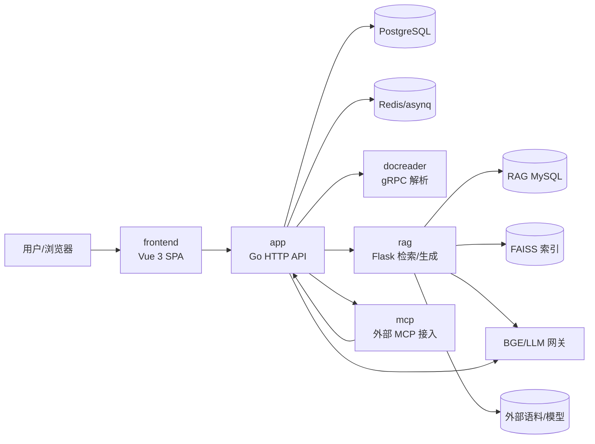
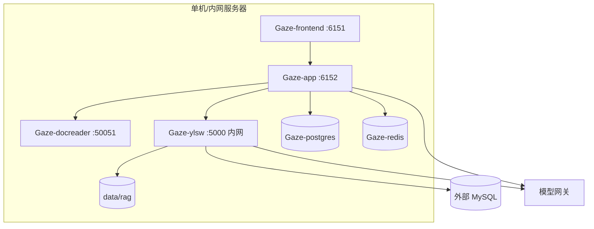
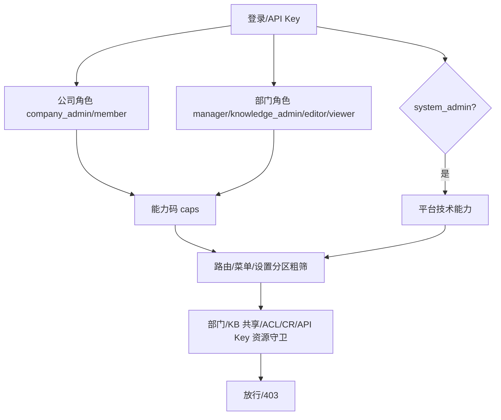
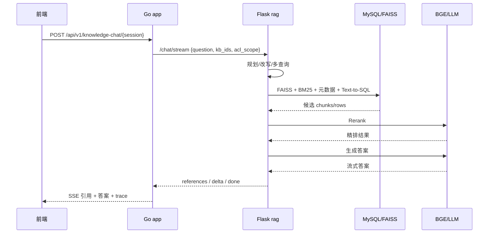
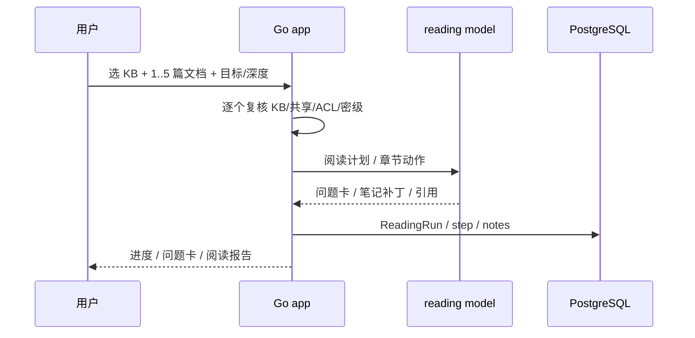
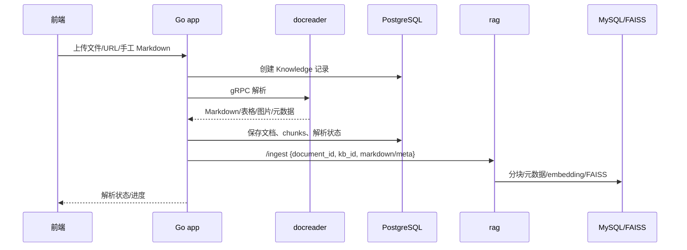
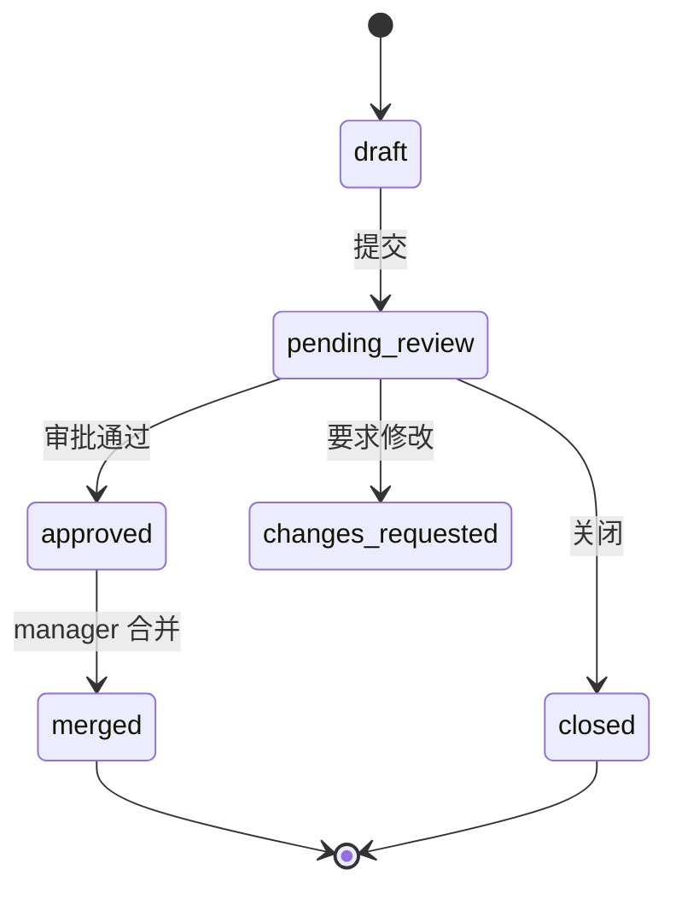
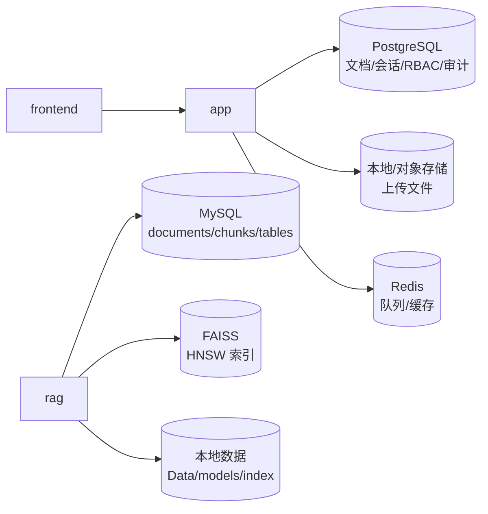

# 系统总览

> 状态：当前
> 最后更新：2026-10-26
> 目标读者：新入职工程师、产品/需求、运维、AI Agent
> 关联：[术语与约定](术语与约定.md)、[角色生态位规定](../02-需求与设计/角色与权限/角色生态位规定.md)、[部署手册](../../deployments/README.md)

WellRead 是公司内部单租户、本地部署的知识库系统：把文档、检索、问答、精读、协作、部门权限、治理和运维放在同一套平台里。它既不是公开 SaaS，也不是通用聊天机器人；核心目标是在**数据不出内网**的前提下，让企业文档“找得到、答得准、改得可追溯、权限管得住”。

## 1. 系统定位与边界

### 1.1 解决什么问题

- 企业文档分散在网盘、群文件和个人目录，版本和权限靠人工维护。
- 通用 RAG 能回答，但缺少部门权限、引用、审计、版本和协作。
- 受监管文档需要明确“谁在什么范围、基于哪份材料、给出了什么结论”。
- 本地部署要求数据主权，不能依赖外部 SaaS 的租户隔离。

### 1.2 当前能力层次

| 层 | 能力 | 主要价值 |
|---|---|---|
| 治理层 | 公司/部门/角色、能力契约、设置委派、审计 | 管人、管权限、管配置 |
| 知识生产 | 上传、解析、分块、标签、元数据、CR/版本 | 文档可维护、可追溯 |
| 知识消费 | 检索、问答、引用、精读、共享空间 | 找得到、答得准、看得懂 |
| 协作层 | issue、评论、CR 审批/合并、版本回滚 | 从个人文档到团队知识 |
| 运维层 | 模型/解析/存储/队列/MCP/CLI | 能部署、能排障、能集成 |

### 1.3 不做什么

- 不做公开 SaaS 多租户运营；当前是公司内部单租户本地部署。
- 不做通用个人笔记、网盘同步或开放式聊天。
- 不让“页面可见”替代后端授权；所有写操作仍走资源守卫。
- 不把员工原始问题写入治理看板；检索只做聚合，不展示原始 query 文本。

### 1.4 核心设计原则

- **能力是角色的投影**：路由、菜单、设置分区从 `contracts/capabilities.json` 派生，不写角色 if-else。
- **后端是最终边界**：部门、KB、ACL、CR、API Key 守卫在后端执行。
- **app 管业务，rag 管检索生成**：文档入口唯一，检索链路独立演进。
- **高风险动作留痕**：共享、ACL、成员、RBAC、导出、CR 合并等写审计。

## 2. 服务生态与仓库布局

| 目录 | 生态位 | 一句话职责 |
|---|---|---|
| `app/` | Go 后端 | API、领域服务、权限守卫、文档/会话/治理 |
| `frontend/` | Vue 3 | 页面、交互、能力路由投影 |
| `rag/` | Flask 侧车 | 分块/索引、混合检索、重排、生成、引用 |
| `mcp/` | MCP 接入 | 用租户 API Key 把知识能力暴露给外部 Agent |
| `deployments/` | 部署 | 六服务 compose、env、systemd |
| `docs/` | 文档 | 总览、需求、进度、归档、演示 |

详细子系统说明见 [app/README](../../app/README.md)、[frontend/README](../../frontend/README.md)、[rag/README](../../rag/README.md)、[mcp/README](../../mcp/README.md)、[deployments/README](../../deployments/README.md)。

## 3. 部署拓扑与运行形态

- 内网生产默认暴露 frontend 6151、app 6152；ylsw 5000 只走 Docker 内网。
- PostgreSQL 存业务数据；RAG 使用独立 MySQL 和 FAISS 索引。
- RAG 语料、模型、索引在仓库内 `data/rag/`（gitignore），不进入镜像。
- 生产部署、备份、升级见[部署手册](../../deployments/README.md)。

## 4. 身份、角色与权限判定

- **公司角色**：`company_admin`（治理）与 `member`（普通成员）。
- **部门角色**：`manager`、`knowledge_admin`、`editor`、`viewer`，决定部门内业务权限。
- **系统管理员**：独立平台身份，管技术配置，不进入业务内容；可与公司 membership 并存，但工作台分离。
- **能力码**：`contracts/capabilities.json` 是前后端共享真源；页面/菜单只是投影。
- **资源守卫**：部门归属、KB 共享、ACL deny、CR reviewer/审计员、API Key capability 是最终边界。

完整角色职责、歧义和测试账号见[角色生态位规定](../02-需求与设计/角色与权限/角色生态位规定.md)；能力/路由/403/设置映射见[能力与路由矩阵](../02-需求与设计/角色与权限/能力与路由矩阵.md)；共享与 ACL 规则见[共享空间与ACL](../02-需求与设计/角色与权限/共享空间与ACL.md)。

## 5. 问答与检索链路

- 普通问答和 Agent 检索最终都走 RAG 引擎；RAG 不可用时问答不可用，不做静默降级。
- 检索包含向量、BM25、元数据、Text-to-SQL 四路，RRF 融合后重排。
- `acl_scope`、密级、部门过滤在检索分支和融合后执行；缺 `acl_scope` fail-closed。
- 回答引用带文档、章节、原文片段、文号/机构/生命周期等元数据；前端可悬浮/跳转。
- 检索质量与性能数据见[测试与评测](../../rag/docs/测试与评测.md)。
- 问答与引用规则见[问答与引用](../02-需求与设计/功能与交互/问答与引用.md)；技能注入见[技能与问答注入](../02-需求与设计/功能与交互/技能与问答注入.md)。

### 5.1 精读链路

精读不走普通 RAG 检索，使用独立 reading model 与固定内置 `grill-with-docs`；文档集合固定、逐步复核权限，失败不回退到未过滤全文。详见[交互式精读](../02-需求与设计/功能与交互/交互式精读.md)。

## 6. 文档上传、解析与入库链路

- 文档入口唯一：所有文档从 app 上传/推送，不允许 RAG 自行扫描业务语料。
- docreader 负责格式解析；扫描 PDF 渲染图片后由 app 侧 OCR/VLM 处理。
- RAG 是检索索引的维护者，不是文档主数据源；删除/对账由 app 驱动的 `/ingest`、`/delete_document`、`/documents/ids` 完成。
- 分块、元数据、生命周期、密级、部门字段的细节见[数据入库与元数据](../../rag/docs/数据入库与元数据.md)。
- 文档上传、解析状态、文件夹与设置规则见[知识库与文档管理](../02-需求与设计/功能与交互/知识库与文档管理.md)。

## 7. 协作、治理与审计链路

- 文档内容编辑走协作 CR，不直接改正式内容；issue/评论/锚点评论记录讨论。
- reviewer 由提交者指定；部门审计员由 manager 维护，可审批/驳回本部门 CR；合并前需至少一名其他审阅者/审计员批准，提交人不能自审；只有 manager 可合并。
- 版本快照/对比/回滚保留文档变更；chunk 锁和引用统计辅助并发与审计。
- 治理台分为部门/公司看板与审计查询；company_admin 只看聚合与审计元数据，不进入 KB 正文。
- 部门管理工作台负责成员、审计员和 KB 设置入口；治理台负责数据，不负责写成员动作。

详见[协作与版本控制](../02-需求与设计/功能与交互/协作与版本控制.md)、[治理台与审计](../02-需求与设计/功能与交互/治理台与审计.md)、[部门管理工作台](../02-需求与设计/功能与交互/部门管理工作台.md)。

## 8. 数据存储与数据归属

| 数据 | 归属 | 说明 |
|---|---|---|
| 业务文档、会话、成员、RBAC、审计 | PostgreSQL | app 主库 |
| 上传原文件 | app 文件存储 | local/对象存储 |
| RAG 文档/chunks/表格/schema | RAG MySQL | 检索专用，反范式 KB/元数据 |
| 向量索引 | FAISS | HNSW；删除靠映射过滤/重建 |
| 队列/缓存 | Redis | asynq、会话流、缓存 |
| 本地语料/模型 | `data/rag/`（gitignore） | 不进入 git/镜像 |

## 9. 外部依赖、模型网关与降级边界

- BGE embedding/reranker、DeepSeek/Qwen 等模型网关是外部依赖；凭据由 system_admin 运维台配置。
- RAG 独立 MySQL 可以是宿主机服务或独立容器；与 app PostgreSQL 不是同一个库。
- 模型/解析/存储不可用时，相关功能明确失败；不在前端伪造结果，不把未过滤内容兜底给用户。
- RAG 的 planner/rerank/生成都有超时回退策略；`acl_scope` 缺失直接拒绝。
- 外部 MCP/CLI/API Key 是独立 principal，不继承员工角色；权限按 API Key capability + KB 白名单。

## 10. 当前阶段、限制与相关文档

当前处于核心功能收敛阶段，文档/目录重构已完成：

- 角色、权限、KB、问答、协作、治理、运维已形成闭环。
- 协作与精读仍在优化/重构：协作版本控制需要继续收口，精读将采用独立阅读模型 + 固定 `grill-with-docs` + 受限 ReAct。
- RAG 检索质量已评测，但相关/不相关区分度、指代消解和部分多文档题仍待优化。
- 生产镜像/E2E、检索审计保留期、FAISS 原生 selector 等仍在待办。

当前进度和阶段记录见[当前进度](../03-进度与交接/当前进度.md)；需求与功能见 `02-需求与设计/`；演示见[演示指南](../05-演示与试用/演示指南.md)。
