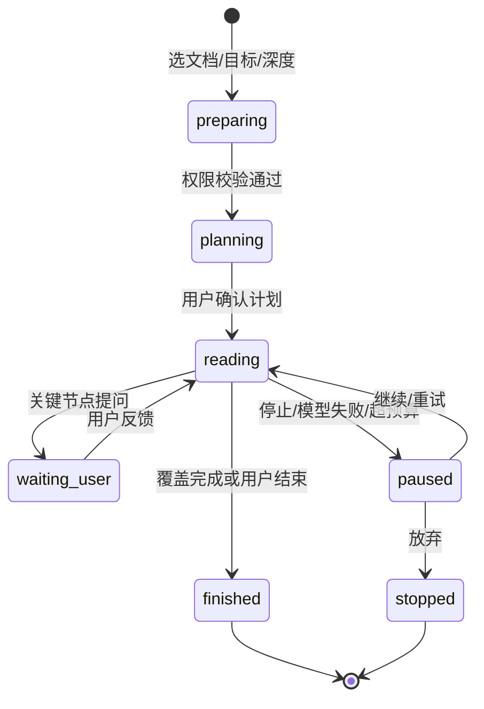

# 交互式精读

> 状态：优化中
> 最后更新：2026-10-28
> 目标读者：部门成员、知识库管理员、部门负责人
> 关联：[问答与引用](问答与引用.md)、[知识库与文档管理](知识库与文档管理.md)、[技能与问答注入](技能与问答注入.md)、[系统运维台](系统运维台.md)

## 1. 为什么需要

普通问答是“检索若干片段再回答”，适合定位事实，不适合完整理解一批文档：

- 回答只覆盖被召回的几个 chunk，用户无法确认全文有没有相反结论。
- 多份文档之间的术语冲突、数值矛盾、条件例外，聊天框里说不清。
- 用户想知道“这份合同到底约束了什么”，而不是“某一段提到了什么”。
- 通用 Agent 能读全文，但会自行扩大范围、调用外部工具、成本和结果都不可控。

交互式精读要解决的是“对用户明确选择的一批文档，做一次可追问、可回溯、可导出的完整阅读”。它不替代问答，也不负责修改文档。

## 2. 谁在什么场景用

| 角色 | 场景 | 说明 |
|---|---|---|
| manager / knowledge_admin / editor / viewer | 精读合同、制度、方案、研究报告；核对多版本差异 | 只要能读该 KB，就能发起精读 |
| 部门负责人 | 让系统先读一遍长文档，带着结论和疑点来决策 | 精读报告不是正式结论，仍需人工确认 |
| 知识库管理员 | 检查一批文档是否自洽、有无过期条款 | 精读只读，不修改文档 |
| company_admin | 不进入精读 | 只读公司治理聚合 |
| system_admin | 配置精读专用模型，不参与业务精读 | 在运维台维护模型可用性 |

前置条件：

- 用户对目标 KB 有读权限；共享入 KB 可精读，但只读。
- 目标文档已解析成功且有可读文本；解析中、失败、删除中的文档不可选。
- 精读使用独立阅读模型；模型不可用时精读不可用，不回退到普通问答模型。

## 3. 用户怎么用

### 3.1 三个入口

| 入口 | 路径 | 结果 |
|---|---|---|
| 精读页 | 选择 KB → 勾选文档 → 填写阅读目标、选择深度 → 开始 | 新建精读会话 |
| 问答引用面板 | 多选引用 → “精读这些文档” | 新建精读会话，不污染原问答 |
| 问答新会话 | 输入区切换“精读”模式 → 选文档 | 新建精读会话 |

- 每次精读绑定一个会话，会话列表显示“精读”标识，与普通问答分开。
- 从引用跳转时新建会话；原问答的上下文、引用和追问不受影响。
- 一次精读固定一个 KB，最多 5 篇文档；按整篇文档选择，不按章节/chunk 挑选。
- 知识库、精读文档、添加文档选择器支持关键词搜索；当前列表最多加载 500 篇。

### 3.2 阅读过程



1. 用户选文档、写阅读目标、选深度。
2. 系统逐个重校验权限，生成阅读计划（章节顺序、重点、预计提问点）。
3. 用户确认计划一次；也可以调整目标或移除文档。
4. 系统按计划连续读取，内部执行受限动作，不逐步打断用户。
5. 到关键节点暂停提问；用户回答后继续，必要时重读当前章节。
6. 覆盖完成或用户结束，生成阅读报告。

### 3.3 深度档位

| 深度 | 适合 | 行为 |
|---|---|---|
| 快速通读 | 先判断这份文档值不值得细看 | 抓结构、结论、风险，少量提问 |
| 标准 | 默认；多数合同/制度/方案 | 按章节或逻辑单元推进，关键节点确认 |
| 逐条精读 | 条款、数值、责任边界必须逐项核对 | 术语、条件、例外、数值逐项核对，提问最密 |

深度影响阅读步数、提问密度和 token 预算，不影响权限与文档范围。

### 3.4 阅读动作与暂停点

精读内部由引擎驱动逐轮循环，不开放模型自由调用工具；引擎只提供以下能力：

```text
读取窗口              读取本轮章节/窗口原文
文档内检索            仅在已选文档内定位相关原文
写入沉淀              写术语、结论、矛盾、问题（引擎校验后落库）
提出问题              提出一个待用户确认的问题
结束                  生成阅读报告
```

规则：

- 系统在轮内连续执行读取、检索、沉淀，不必每步都找用户；每轮生成理解与 2~4 个问题，能自答的先自答。
- 只在存在未决问题时暂停：计划确认、术语/概念歧义、跨段或跨文档矛盾、需要用户裁定的结论。
- 一次只问一个问题，必须附推荐解读和依据；能通过读文档回答的，先读再引用，不问用户。
- 不允许引入选中文档以外的资料，不允许外部搜索、调用任意工具或修改文档。
- 每轮受最大步数、token 预算和超时约束；超限时暂停并说明原因，不静默降级。

### 3.5 阅读笔记

增量维护，不等到最后一次性生成：

| 分区 | 内容 |
|---|---|
| Confirmed | 已确认事实，附出处 |
| Terms | 关键术语、定义、易混词 |
| Open Questions | 尚未解决的问题 |
| Contradictions | 前后或跨文档矛盾，列两个出处 |
| Decisions | 用户裁定的取舍及理由 |
| Citations | 文档名、章节、原文片段 |

- 只有“难以逆转、未来会问为什么、存在真实取舍”的决定才进入 Decisions；其余只记笔记。
- 笔记随步骤持久化；停止或失败后保留，可继续。
- 优化后术语、结论、未决问题、矛盾分别落库并在右栏四个 tab 展示；Decisions 作为用户裁定确认的结论保留在结论 tab，引用作为各条目的出处字段，不再单独分区（见 §10.3、§10.8）。

### 3.6 阅读报告与导出

报告固定包含：阅读范围、结论摘要、已确认事实、术语、矛盾、未决问题、决策、引用、覆盖与局限。

- 支持导出 Markdown（人读）和 JSON（机读/二次处理）。
- 导出时重新校验文档权限；已失效文档不导出正文，只保留标题与“权限已变更”标记。
- 报告不是公司正式文件；对外使用前仍需人工确认。

### 3.7 停止、恢复与失败

- 用户可随时停止；已读进度、笔记、引用保留，可继续。
- 刷新页面后恢复当前 active 精读。
- 模型失败暂停在当前步，可重试；不回退到普通 RAG，不拼接未过滤全文，不编造结论。
- 文档被删除、权限被收回时，精读暂停并明确提示；用户移除该文档后才能继续。
- 持久化动作、章节、问题、反馈、笔记补丁、引用、状态和每轮模型思考；思考内容仅本 run 可见，不进入报告正文、检索审计或导出 JSON。

## 4. 业务规则

- **文档范围固定**：开始后文档集合固定；中途添加必须用户显式操作并重新过权限，模型不能自行扩范围。
- **权限**：每次读取前复核 KB 部门/共享/ACL/密级；任一文档无权或 deny，拒绝整个精读并提示移除；不做静默过滤。
- **只读**：精读不修改文档、不写 CR、不改变 ACL；引用统计与普通问答一致。
- **模型独立**：阅读模型由 system_admin 在运维台配置，租户级；只允许 active 的 `KnowledgeQA` 模型；不参与普通 RAG，不挤占普通问答并发。
- **策略固定**：精读固定使用内置 `grill-with-docs` 策略，不替换、不可部门编辑、不受 per-skill grant 影响；问答技能与精读无关。
- **会话隔离**：精读会话与普通问答会话分开；从引用进入精读必须新建会话。
- **失败**：模型、解析或权限不可用时明确失败；不伪造全文、不越过 ACL。

## 5. 用完得到什么

- 一份覆盖全文、带出处的阅读结论，而不是几个召回片段。
- 术语、矛盾、未决问题被单独列出，方便评审和决策。
- 用户的问题与文档原文绑定，事后可以复核“当时依据哪一段”。
- 报告可导出、可分享；权限变化后导出内容不会泄露已失权文档。
- 部门负责人可以让系统先读、自己再判断，减少通读长文档的时间。

## 6. 界面与交互意图

精读工作台为三栏布局，左右栏可折叠：

| 区域 | 内容 |
|---|---|
| 顶部栏 | 文档集合、深度、阅读模型标识、阅读进度、停止/继续/导出 |
| 左栏 | 文档列表、阅读计划、已读章节与覆盖进度；可折叠 |
| 中栏 | 消息流、问题卡、用户反馈、阶段小结；主要操作区 |
| 右栏 | Reading Notes 六个分区；可折叠，支持按分区筛选 |

- 问题卡显示：问题、推荐解读、依据引用、“接受/纠正/跳过”；一次只出现一个。
- 引用可打开原文抽屉并定位章节；共享入文档带只读标识。
- 导出前提示权限复核结果；有失效文档时列明影响。
- 空态：未选文档、无可读文档、解析中、模型不可用分别提示，不显示空白工作台。
- 历史上精读会话带标识；打开后恢复到停止/完成时的状态。
- 右栏六个分区在一期优化中收敛为术语 / 结论 / 未决 / 矛盾四个 tab，见 §10.8。

## 7. 与替代方案对比

| 维度 | 本系统 | 通用聊天机器人 | 通用文档阅读工具 | 通用 Agent |
|---|---|---|---|---|
| 阅读范围 | 用户选定的 1–5 篇全文 | 召回片段 | 单篇或少量文档 | 模型自行决定 |
| 权限 | 部门 + KB + ACL + 密级，逐步复核 | 账号级 | 文件级 | 常无企业权限 |
| 过程控制 | 固定动作集、步数与 token 预算、可暂停 | 单轮 | 手动翻页 | 工具与成本不可控 |
| 产出 | 结构化笔记 + 报告 + 引用，可导出 | 聊天记录 | 标注/摘要 | 不定 |
| 数据位置 | 本地单租户 | SaaS | 本地或 SaaS | 视部署 |
| 代价 | 比问答慢，需要模型与人工确认 | 快但不可追溯 | 无结构化结论 | 灵活但不可审计 |

## 8. 当前实现与差距

已实现：

- 结构化精读引擎（新 run）：问题、结论、术语、矛盾四张结构化表；逐轮五拍；轮内有界检索循环（每轮最多 3 次检索词）；结论、问题、反馈按轮事务落库。
- 计划按深度切窗：快速通读约 8000 字、标准约 4000 字、逐条精读约 1500 字；超长 chunk 拆段并保留 chunk 出处，引用可定位到原文。
- 三道门收敛：引用充分、无冲突、跨文档一致；未过门的结论停在候选，自动回答标「推断」，矛盾必须给双方出处。
- 中栏「当前轮追问流 + 累积理解」，右栏术语 / 结论 / 未决 / 矛盾四个 tab；出处可跳转原文；待确认问题一次只抛一个，支持跳过。
- 引用悬浮锚定：悬停证据时加载 chunk 原文并高亮引用句，点击仍跳转文档定位。
- 矛盾双列对照与用户裁定：A/B 两列原文对照；支持以 A 为准、以 B 为准或自定义裁定；选择一边后，该边支持的结论提升为已确认，裁定写入用户裁定。
- 报告整篇编辑：Markdown 草稿单独存储；编辑器支持加载、保存、重置；Markdown 导出优先使用编辑版，JSON 导出仍投影四表。
- 相关性预筛与检索并行：已确认结论超过 12 条时，用知识库 embedding 模型按语义相似度选 top10 进入状态摘要；检索词并行执行；轮次耗时写入步骤日志。embedding 失败时回退最近 20 条。
- 引用语义检索：自答检索在关键词之外接入 YLSW `/search` 的 `document_ids` 白名单（四路召回 + 重排），结果按选中文档 chunk 校验后合并；YLSW 不可用或结果无法映射时回退关键词检索。
- 报告并发版本：编辑草稿带 `version`，保存/重置携带 `base_version` 乐观锁；版本冲突返回 409 并自动加载最新版。
- 历史 run 迁移：完工的历史 run 在首次读取时把 notes 懒迁移到四表（结论标「历史笔记」、无结构化出处）；提供运维批量接口 `POST /reading/admin/migrate-legacy`；活动/停止的旧 run 继续走旧渲染。
- 看板细口径：部门看板增加任务/完成/停止/失败、问题总数与自答率、已确认/总结论（排除历史笔记）、术语、待裁定/总矛盾、平均轮次/token/轮次耗时。
- 精读模型强制思考：创建与每轮推进前校验模型有效思考控制；不支持思考的模型明确拒绝，不静默降级；阅读调用统一 `Thinking=true`，非流式响应解析 `reasoning_content`。
- 每轮思考链路：步骤日志持久化 `reasoning`、`search_trace`（检索词/命中数/证据 chunk）和耗时；中栏展示「读取窗口 → 模型思考 → 提问 → 检索与自答 → 沉淀」，待确认问题卡上方同样展示本轮思考。
- 左栏完整文档：`GET /reading/runs/:id/documents` 按 chunk 顺序拼接全文、去掉 chunk 标记、逐文档复核 ACL；多文档切换，当前轮文档自动跟随，不再展示分块列表；返回 section 的 UTF-16 偏移，前端高亮当前段并自动滚动到可视区。
- 左栏横向伸缩：220–640px，`pointer` 拖拽 + `requestAnimationFrame` 更新 CSS 变量，双击复位，宽度按用户记忆；移动端单列禁用拖拽；页面与侧栏滚动条隐藏。
- 运维台思考模型：精读模型选择只列出支持思考的 KnowledgeQA 模型，后端保存时拒绝无思考控制的模型。
- 旧结构化 run 模型迁移：推进前发现 run 绑定的旧模型不支持思考时，自动切到租户当前精读模型；现有非完工结构化 run 已一次性迁移。
- 思考链路轮次：支持按轮次下拉回看历史思考、问题、检索与沉淀，不再只显示最近一轮。
- 问题质量门槛：每个问题必须带 `kind`（fact/decision）与 `gap_type`（歧义/缺参数/矛盾/范围/版本）；泛问、无推荐解读的问题不入库；事实问题由引擎强制检索自答，决策问题保留给用户。
- 每轮暂停：标准/逐条精读每轮结束暂停，用户确认思考链路后点击继续；快速通读保持自动推进。
- 默认审问目标：用户未填写阅读目标时，默认审出含糊表述、缺失参数、跨章节/跨文档矛盾、版本失效风险。
- 报告由四表投影生成，Markdown + JSON 导出；未确认结论不进入已确认列表，导出前逐文档复核 ACL。
- 历史精读 run 继续按 `notes` 只读兼容；新 run 以四表为事实源，计划正文不再回传前端。
- ReadingRun 状态机、停止/恢复、最终摘要、模型独立配置、部门看板聚合、阅读审计保持可用。
- 固定内置 `grill-with-docs` 策略（后端内置，不读取部门技能）；三档深度写入阅读计划并影响窗口、问题数与预算。
- 创建后先展示阅读计划，用户确认“开始阅读”后才进入自动推进。
- 问答引用面板支持多选文档进入精读：同一 KB、最多 5 篇、按整篇文档去重。
- 会话记录 `reading_run_id`，历史列表显示“精读”标识并可回到对应精读。
- 精读中可添加同一 KB、已解析文档，最多 5 篇；新增章节追加到计划。

差距/待优化：

- 思考内容依赖模型返回；模型/供应商不支持 reasoning 时会拒绝创建。原始推理可能是英文或中英混合，已加中文提示，但最终取决于模型。
- 全文是 chunk 拼接文本，保留标题与段落但不等同于原始 PDF/DOCX 排版；当前段高亮与自动滚动已支持。
- 性能与首字延迟未做专项压测；大文档全文渲染与拖拽重排需实测。
- 矛盾判定仍以模型自报 + 引用校验为主；embedding 只做状态摘要的相关性预筛，不替代矛盾判定。
- 问题卡“纠正”分支未做完整回归；历史 RAG 回答的引用入口已修通。
- 跨 KB 精读、租户级 5 篇配置、深度中途切换按 §9 决策不做。
- 历史 run 迁移后旧渲染分支仍保留给活动/停止 run；待历史 run 全部结束或迁移后可删除。
- 人工盲评（3 篇真实制度文档）待业务提供样本后执行。
- YLSW 源码改动已在开发容器热拷验证，`gaze-ylsw` 镜像需重建后固化（见 §10.11）。

一期引擎闭环、二期体验打磨与引用语义检索/报告版本/历史迁移/看板细口径均已实施，验收标准见 §10.10。

## 9. 待决问题与验收

- [x] 导出时遇到失权文档：当前 fail-closed，整体拒绝导出并提示移除无权文档。
- [x] 精读报告是否需要支持人工编辑后再导出：需要，支持整篇编辑；已实施（§10.8）。
- [x] 精读会话/笔记的保留期是否与普通会话一致：沿用普通会话保留策略，本轮不单独设计。
- [x] 深度档位是否允许中途切换：不支持，开始后固定；避免计划与预算重算、阅读纪律漂移。
- [x] 5 篇上限是否按租户可调、是否需要支持跨 KB：本轮维持单 KB、最多 5 篇，不做租户级配置与跨 KB。
- [ ] 大文档章节窗口的读取进度与首字延迟是否达标：本轮不作为优化目标；由窗口切分与预算控制单轮上下文，性能问题另立专项。
- [x] 精读使用量已进入部门看板：任务/完成/停止/失败、问题与自答率、已确认/总结论、术语、矛盾、平均轮次/token/耗时；历史笔记结论单独计数。
- [x] 历史精读会话兼容：历史 run 继续按 `notes` 只读展示；新 run 以四张结构化表为事实源，不做批量迁移。
- [x] 精读模型是否必须开启思考：是；创建和每轮推进前校验有效思考控制，不支持则拒绝；当前测试空间使用 `deepseek-flash`（DeepSeek V4 Flash）。
- [x] 左栏展示与宽度：完整文档（非分块）、多文档切换、当前轮自动跟随；左栏 220–640px 可拖拽，宽度按用户记忆。
- [x] 精读模型运维配置：只允许支持思考的 KnowledgeQA 模型，后端保存校验。
- [x] 旧结构化 run 模型迁移：推进时懒迁移到租户当前精读模型；现有非完工 run 已一次性迁移。
- [x] 思考链路轮次与全文定位：支持按轮次回看；全文返回 section UTF-16 偏移并高亮当前段。
- [x] 问题事实/决策分流与质量门槛：fact 强制检索自答，decision 留给用户；泛问、无推荐解读的问题不入库。
- [x] 每轮暂停确认：标准/逐条精读默认每轮停下，用户确认思考链路后继续；快速通读自动推进。

## 10. 优化方向与开发方法（已对齐）

> 本节是精读质量的定案方向，替代原先的优化建议稿；原稿中的界面草图只确认了「当前轮追问流 + 四 tab」的结构意图，视觉实现一律沿用现有 `ReadingRun.vue` 与 TDesign 规范，不另起配色。

### 10.1 问题判断

精读效果差集中在三个层面：

1. **读得浅**：结论空泛，抓不住条款、数值、例外和边界；
2. **不像精读**：自动推进像批量摘要，没有逐轮追问的推进感；
3. **报告不可用**：结论缺少出处，术语、矛盾、未决问题组织不清，不能直接用于决策。

根因不在模型能力，而在引擎形态：

- 每个 step 只做「整节内容 → notes_patch + 至多一个问题」，没有轮次结构；
- 状态外置只有一个 `notes` JSON blob，没有实体化的问题、结论、术语、矛盾；
- 结论没有收敛门槛，读到的内容直接进 Confirmed；
- 自答只是关键词检索，且靠模型自觉调用，「能自答的不问人」没有成为引擎规则；
- 中栏没有「当前轮 / 累积理解」的区分，右栏是六个平铺分区，看不到精读在推进。

优化主线：把 grill-with-docs 的三条纪律工程化。

| 纪律 | 现状 | 目标工程形态 |
|---|---|---|
| 逐轮提问 | 一节一次调用，问题可有可无 | 每轮五拍，生成理解草稿 + 2~4 个问题，未决问题一次一个抛给用户 |
| 能自答的不问人 | 关键词检索，模型自觉调用 | 引擎强制先取文/检索，命中即自答并标「推断」，检索不落才升级为未决 |
| 状态即时外置 | notes JSON 批量追加 | 每轮结束把术语/结论/问题/矛盾逐条写入四张表，下一轮从库里重组上下文 |

### 10.2 目标形态：逐轮五拍

每一轮固定五拍，由引擎驱动，不让模型自由发挥：

1. **读取本轮窗口**：计划步骤对应的章节/窗口原文；
2. **生成理解**：本轮理解草稿 + 2~4 个关键问题（每个问题带检索意图与初步证据）；
3. **自答分流**：引擎在选中文档内取文/检索，命中 → 自动回答并标「推断」；不命中 → 待用户；自答阶段允许轮内**有界小循环**（模型可连续提出取文/检索请求，上限 3 次，引擎执行回填后再生成结论），不做无限 ReAct；
4. **矛盾检测**：新结论对照已确认结论与术语，冲突则落矛盾表并标两处出处；
5. **即时沉淀**：术语、结论、问题、矛盾逐条落库，本轮事务提交后进入下一轮。

交互规则：

- **只做追问式精读**，接受它比问答慢；只有存在待确认问题时才暂停，一次只问一个；
- 用户回答后当场重跑收敛判定，必要时重读当前窗口；
- 无待确认问题时自动进入下一轮；
- 用户可随时停止；已完成的轮次、四表数据和阅读进度全部保留，恢复后从下一轮继续。

### 10.3 数据模型：四张结构化表

新增四张表，与右栏四个 tab、导出报告一一对应；新 run 不再把 `notes` 作为事实源。

| 表 | 职责 | 关键状态 |
|---|---|---|
| 问题表 | 一轮产生的追问及父子关系 | 待确认 / 检索自答 / 用户已答 / 转矛盾 / 已收敛 / 已跳过 |
| 结论表 | 带证据的候选结论与最终结论 | 候选 / 已确认 / 被矛盾推翻 |
| 术语表 | 术语、定义、出处、是否 canonical | 候选 / 已确认 |
| 矛盾表 | 冲突双方出处与说明 | 待裁定 / 已裁定 / 已关闭 |

- 问题、结论、术语、矛盾都必须带可定位出处（文档 + 章节 + 原文片段）。
- Decisions（用户裁定）作为结论的一种来源与状态保留在结论表内，不单独建表；Citations 是所有实体的出处字段，不单独建表。
- 报告编辑草稿单独存 `reading_report_drafts`，不改变四表事实源；Markdown 导出优先使用草稿，JSON 导出始终投影四表。
- 历史精读会话继续按 `notes` 只读展示；新 run 以四表为准，不做批量迁移。
- `reading_runs.notes` 列保留，用于历史兼容；新 run 不再写入事实数据。

### 10.4 收敛规则：三道门

一个结论只有同时通过三道门，才能从「候选」升级为「已确认」并进入报告正文：

1. **引用充分**：至少一个证据 chunk，且属于选中文档、当前仍可读、能定位到章节与原文；
2. **无冲突**：与已确认结论、术语语义对照无矛盾；
3. **跨文档一致**：同一事实在多篇文档出现时口径一致；不一致则转矛盾并请用户裁定。

未过门的结论停在「候选」，进入报告的「未决/待确认」部分，不得伪装成已确认事实。自动回答的结论同样过门，来源标记为「推断」，报告中保留标记与出处。

### 10.5 计划生成与窗口切分

- 计划一次性生成、逐轮消费，不每轮重规划，避免顺序漂移；
- 输入文档章节树，输出步骤列表：章节、阅读重点、预备问题；
- 超长章节按约 1500 字切窗口；「逐条精读」按条款/小窗口切分，「快速通读」合并章节；
- 深度档只影响窗口大小、每轮问题数与预算，不影响权限与文档范围。

### 10.6 上下文组装与预算

每轮 prompt 只带四类内容，不带完整对话历史：

1. 内置策略与阅读目标；
2. 当前步骤/窗口原文；
3. 状态摘要：术语全量（超限截断）、已确认结论压缩版、未决问题、矛盾清单；
4. 本轮任务与输出约束。

预算按轮与按 run 双层控制；超预算时暂停并说明原因，不静默降级、不拼接未过滤全文。

### 10.7 自答工具层

- 引擎内置三类能力，由引擎编排，不让模型自由调用外部工具：
  - 按章节/窗口取原文（仅选中文档）；
  - 文档内检索：优先 YLSW `/search` 的 `document_ids` 语义检索（四路召回 + 重排），失败回退现有关键词增强（章节标题加权、中文 n-gram）；不跨 KB、不引外部资料；
  - 写入术语/结论/矛盾/问题（引擎校验后落库）。
- 模型以结构化 JSON 声明「理解 + 问题 + 候选结论 + 术语 + 矛盾」；引擎执行检索、校验引用、分流与落库。
- 自答阶段允许轮内有界小循环：模型可连续提出取文/检索请求（默认上限 3 次），引擎执行并回填观察结果后再生成结论；不开放无限 ReAct、不越出选中文档。
- 后续可评估升级为原生 function calling，但不作为本轮前置条件。

### 10.8 界面改造

一期（随引擎同批）：

- 中栏拆成「当前轮追问流」+「累积理解」：上半区展示本轮理解草稿与问题卡（检索自答带「推断」角标，待确认带「待确认」角标）；下半区滚动更新已确认结论；
- 中栏增加「思考链路」折叠卡：读取窗口 → 模型思考 → 提问 → 检索与自答 → 沉淀；待确认问题卡上方也展示本轮思考；
- 左栏改为完整文档查看器：多文档切换、当前轮自动跟随、不显示 chunk 标记；左栏可 220–640px 横向拖拽，双击复位，移动端单列；
- 右栏改为四个 tab：术语 / 结论 / 未决 / 矛盾，每项带出处，可跳转原文；数量实时反映四表；
- 顶栏保留文档集合、深度、进度、停止/继续/导出；空态与错误态沿用现有规范；
- 视觉沿用现有组件，不新增独立视觉语言。

二期（已实施）：

- 引用悬浮锚定：悬停证据加载 chunk 原文并高亮引用句；点击仍跳转文档定位；
- 矛盾双列对照与裁定：左右两列放冲突双方原文；支持以 A 为准、以 B 为准、自定义裁定；裁定后可选边结论提升为已确认，并写入用户裁定；
- 报告整篇编辑：编辑器加载、保存、重置 Markdown 草稿；Markdown 导出优先使用编辑版，JSON 导出仍以四表为准；保存/重置携带 `base_version` 乐观锁，冲突返回 409 并回载最新版；
- 性能与文案：检索词并行执行、轮次耗时展示、四 tab 空态提示；状态摘要 embedding 预筛见 §10.9；
- 引用语义检索：自答检索接入 YLSW `/search` 的 `document_ids` 白名单，失败回退关键词；
- 历史 run 懒迁移与部门看板细口径。

### 10.9 分期开发方法

一期（引擎闭环）与二期（体验打磨）均已实施。

**一期：引擎闭环**（完成标志：四表落库 + 一轮五拍 + 报告可追溯）

1. **迁移**：新增四张表与索引（PG 从 `000121` 起，SQLite 从 `000033` 起）；不改旧表；
2. **类型与仓储**：四类实体、批量读写、按 run 聚合查询；历史 run 兼容查询；
3. **计划生成器**：章节树 → 步骤列表，超长章节切窗，深度映射窗口与问题数；
4. **轮次引擎**：五拍状态机、自答分流、三道门收敛、按轮事务提交；替换现有逐节 `stepWithLLM`；
5. **上下文组装器**：状态摘要组装与预算控制；
6. **报告生成**：四表投影为 Markdown/JSON，保留覆盖与局限；导出前逐文档复核 ACL；
7. **接口调整**：推进接口从「读一步」改为「推进一轮」；反馈按问题 ID 回答；详情返回四类结构化数据；停止/恢复/导出语义不变；
8. **前端改造**：中栏拆分 + 右栏四 tab + 问题卡分流 + 历史会话只读回退；
9. **验证**：纯函数单测（切窗、三道门、状态机、组装器）；Linux 容器内 service 测试；真实文档 API 全流程；headless UI 冒烟；权限 fail-closed、停止恢复、导出回归。

**二期：体验打磨**（已实施；完成标志：报告可编辑 + 引用可锚定 + 矛盾可对照）

1. 引用悬浮锚定与原文高亮（已实施）；
2. 矛盾双列对照与裁定交互（已实施；裁定后可选边结论提升）；
3. 报告整篇编辑、保存与导出（已实施；草稿表 `reading_report_drafts`，PG `000122` / SQLite `000034`）；
4. 性能与空态/文案统一（已实施：检索并行、轮次耗时、四 tab 空态）；
5. 状态摘要 embedding 相关性预筛（已实施；已确认结论超过 12 条时选 top10，失败回退最近 20 条；不替代模型自报矛盾）；
6. 引用语义检索增强（已实施；YLSW `/search` 带 `document_ids`，失败回退关键词）；
7. 报告并发版本（已实施；`base_version` 乐观锁 + 409 冲突回载）；
8. 历史 run 懒迁移与批量接口、部门看板细口径（已实施）；
9. 精读模型强制思考与每轮思考链路（已实施；模型层补全非流式 `reasoning_content` 解析）；
10. 左栏完整文档、多文档切换与横向拖拽（已实施；新增 `/documents` 全文接口）。

依赖顺序：表 → 仓储 → 计划 → 轮次引擎 → 报告/接口 → 前端；每步以可回退的小提交推进，旧链路在切换完成前保持可用。

### 10.10 验收口径

**机器指标**（每个验收 run 全过）：

- 已确认结论的引用覆盖率 100%：每条都能定位到选中文档的章节与原文；
- 矛盾双出处 100%：每条矛盾都有冲突双方出处与说明；
- 可自答问题不得直接抛给用户：抽检自答分流，命中证据的问题必须自答或给出未自答理由；
- 每轮生成 2~4 个问题，一次只向用户抛一个；
- 全部 run 在步数与 token 预算内完成，超限时明确暂停；
- 权限 fail-closed、停止/恢复、导出失权拒绝全量回归通过。

**人工盲评**（最低门槛）：

- 由业务提供 3 篇真实制度文档（不同长度与类型），同一阅读目标分别整理人工通读要点与精读报告；
- 建议验收线：结论有用率 ≥ 80%，关键遗漏（人工要点清单中的关键事实未被报告覆盖）≤ 10%，术语/矛盾识别错误率 ≤ 10%；
- 任一文档不达线，回到对应环节修正后重跑，不带病上线。

实现验证（单测、迁移测试、容器内构建、前端 type-check/build、真实 API 冒烟）已完成；3 篇人工盲评待业务提供样本后执行。

### 10.11 风险与回退

- **模型 JSON 不稳定**：单轮重试一次，仍失败则整轮回滚并暂停为「未决」，不伪造结论；
- **成本与延迟上升**：按轮压缩状态摘要、限制问题数、深度档控制窗口；精读接受更慢；
- **旧会话兼容**：历史 run 只读回退，新 run 四表；界面保留旧渲染分支，待历史会话自然淘汰后删除；完工历史 run 首次读取时懒迁移到四表，运维批量接口为 `POST /reading/admin/migrate-legacy`；
- **YLSW 部署**：`document_ids` 检索改动已在开发容器热拷验证，`gaze-ylsw` 镜像必须重建后固化，否则容器重建会回退旧代码；
- **思考模型**：精读模型必须配置支持 reasoning 的模型；当前测试空间使用 `deepseek-flash`（DeepSeek V4 Flash），换模型时需重新确认 `thinking_control` 与 `reasoning_content` 返回；
- **全文渲染**：左栏全文为 chunk 拼接文本，超大文档需关注首屏渲染与拖拽重排；当前 220–640px 拖拽用 rAF/CSS 变量控制，避免每像素重渲染；
- **本机环境限制**：Go 测试在 Linux 容器内运行，本机只做 `go vet` 与包编译；前端以 type-check、build 与 headless 冒烟为准；
- **评测样本有限**：3 篇为最低门槛，后续按部门补充样本与评分表。
