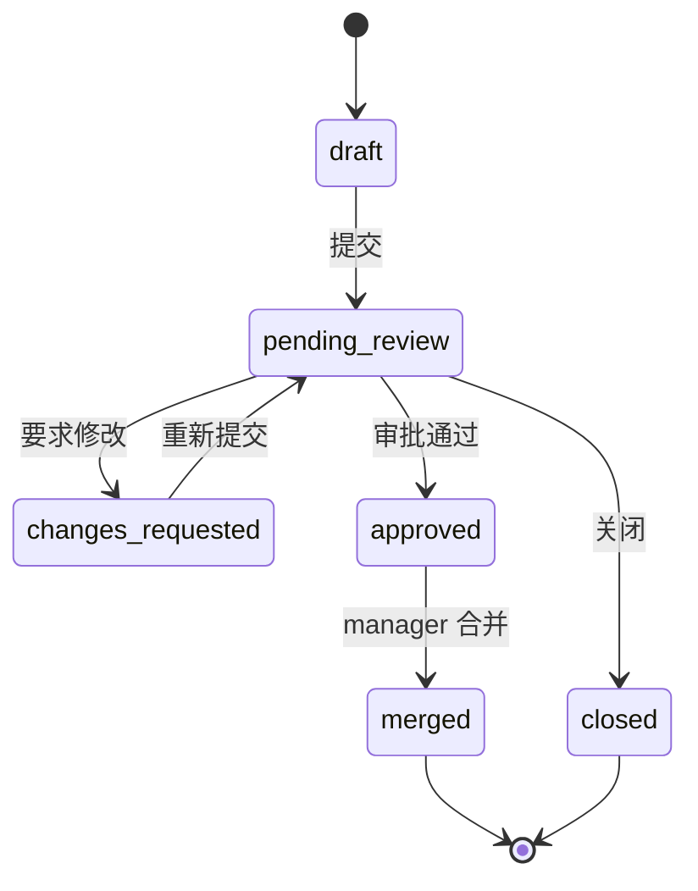

# 协作与版本控制

> 状态：优化中
> 最后更新：2026-10-28
> 目标读者：编辑、知识库管理员、部门负责人、部门审计员
> 关联：[知识库与文档管理](知识库与文档管理.md)、[角色生态位规定](../角色与权限/角色生态位规定.md)

## 1. 为什么需要

文档一旦多人维护，直接编辑会带来：

- 谁改了什么、为什么改，无法追踪。
- 正式内容被误覆盖，无法回滚。
- 审阅意见散落在群聊，无法和具体文档/段落对应。
- 部门负责人无法在不亲自读全文的情况下控制发布质量。

协作与版本控制把“改文档”变成可审阅、可回滚、可审计的过程：issue 记录问题，CR 记录变更，版本记录历史，部门审计员/审阅者负责质量，manager 负责最终合并。

## 2. 谁在什么场景用

| 角色 | 场景 | 权限 |
|---|---|---|
| editor | 修改文档、提交 CR、评论/提 issue | 提交/编辑自己的 CR，不能合并 |
| knowledge_admin | 维护内容/结构，提交 CR | 同上；可被指定 reviewer/部门审计员 |
| manager | 审批/关闭/合并 CR，维护部门审计员 | 唯一 merger |
| 部门审计员 | 审批/驳回本部门所有 CR | 不能合并/关闭/改 KB |
| 单 CR reviewer | 审批/驳回指定 CR | 不能合并 |
| viewer | 阅读 issue/CR，评论/提 issue | 不提交 CR；默认不审批，被授权审计员/reviewer 时可审批/驳回 |

角色本身不包含审批权；部门审计员与单 CR reviewer 是资源级授权，可临时扩大指定范围的审批/驳回，不改变角色矩阵，也不带来合并权。

不适用：

- company_admin 不进入 KB 协作；只看治理聚合。
- system_admin 不参与业务 CR。

## 3. 用户怎么用

### 3.1 issue

- 用户可对文档/段落提出问题、建议、错误反馈。
- issue 支持评论、关闭/重开；可与 CR 关联。
- 锚点评论绑定到文档选区/chunk，用于定位具体内容。

### 3.2 CR（变更请求）

1. 用户在文档编辑态修改内容，创建 CR 草稿。
2. 选择 reviewer（可选），提交进入待审。
3. 部门审计员/指定 reviewer/manager 审批或要求修改；提交人不能审批自己的 CR。
4. 修改后重新提交，清空上一轮审批。
5. 审批通过后由 manager 合并；manager 本人提交的 CR 也需要其他审阅者/审计员批准；也可关闭。
6. 合并后生成新版本，可对比/回滚。

### 3.3 版本

- 每次合并保留版本快照；支持版本列表、对比、回滚。
- 回滚生成新版本，不删除历史。
- 回滚在现有 chunk 上恢复内容并递增 `content_revision`，chunk ID 保持稳定，避免 issue/CR/引用锚点因回滚失效。
- 历史回答的引用内容随消息保存，并绑定回答生成时的文档版本（`version_id` + `version_label`）；跳转原文显示当前版本，引用卡展示“依据 Vx”与废止标记。

### 3.4 并发

- 同一文档的 CR 可并存；合并时按版本/冲突规则处理。
- chunk 锁用于提示“该片段正在被编辑”，不是硬性排他锁。
- 编辑冲突必须让用户看到差异，不静默覆盖。

## 4. 业务规则

- 正式文档内容只通过 CR 合并；直接编辑入口不覆盖正式版本。
- 仅 manager 可合并；审批通过不等于合并。
- 合并前至少一名“其他”审阅者或部门审计员批准；提交人本人的批准不计入。
- 部门审计员可审批/驳回本部门所有 CR；不能关闭、合并、修改 KB。
- 单 CR reviewer 仅对该 CR 生效；不要求部门编辑角色。
- 提交人不能审批自己的 CR，manager 也不例外；合并人可以是审批人之一（manager），当前不强制提交人/审批人/合并人完全三人分离。
- 关闭：提交者或 manager；审计员/reviewer 不能关闭他人 CR。
- 审批/驳回/合并/关闭/回滚写审计。
- 版本回滚保留原 chunk ID 并递增 `content_revision`；版本快照保存历史内容，不靠新 chunk ID 表示版本。
- 合并、回滚与直接编辑 chunk 后自动把文档重推检索侧（`engine_sync_status` 仍保留 pending 供失败重试），不再依赖人工点“重推”。
- 重新解析会删除旧 chunk 并生成新 chunk ID；解析前自动生成 `reparse` 来源的版本快照，可回滚到重解析前内容。
- 软删除 chunk 的回滚恢复边界仍需验证；引用已绑定版本，跳转原文显示当前版本。

## 5. 用完得到什么

- 用户能看到文档从草稿到合并的完整轨迹。
- 审阅意见与具体段落绑定，减少“群里说不清”。
- 部门负责人能在不读全文的情况下审批/合并，并对结果负责。
- 出错可回滚，历史可追溯，回答引用能对应到版本。

## 6. 界面与交互意图

- 协作工作台：入口/issue 列表、CR 工作台、CR 详情、版本历史。
- CR 详情：变更 diff、审阅者、审批状态、评论、合并/关闭动作。
- 文档抽屉：版本 tab、锚点评论、chunk 锁提示。
- 只读用户看到 issue/CR，但不显示提交/审批/合并按钮。
- 状态标签必须诚实：待审/已通过/需修改/已合并/已关闭，不用模糊“处理中”。

原型见[协作工作台](../界面与原型/协作工作台/设计说明.md)。

## 7. 与替代方案对比

| 维度 | 本系统 | 网盘/文档历史 | Git/GitHub |
|---|---|---|---|
| 面向 | 非技术员工 + 结构化文档 | 文件级版本 | 代码/文本 |
| 审批 | CR + reviewer/审计员 + manager | 无 | PR review |
| 权限 | 部门/KB/ACL/角色 | 文件权限 | 仓库权限 |
| 回滚 | 版本快照 + 新版本 | 文件历史 | Git revert |
| 代价 | 流程比直接编辑重 | 简单但不可治理 | 学习成本高 |

## 8. 当前实现与差距

已实现：

- issue/评论、CR 草稿/提交/审批/驳回/合并/关闭、reviewer、部门审计员名单。
- 版本快照/对比/回滚、锚点评论、chunk 锁、引用统计。
- manager 唯一合并；审计员/reviewer 审批不合并；权限与审计。
- 合并前至少一名其他审阅者/部门审计员批准；提交人不能审批自己的 CR，manager 也不例外。
- 审批后合并、回滚到基线已验证：合并更新 chunk 内容并生成版本；回滚恢复原内容，chunk ID 不变。
- 引用绑定版本：问答引用落库带 `version_id` / `version_label`，引用卡与悬浮卡显示“依据 Vx”，废止文档带“已废止”标记；旧消息不受后续编辑/回滚影响。
- 发布即同步：合并、回滚、直接编辑 chunk 后自动后台重推 YLSW，索引状态异步落 `engine_sync_status`；实测生命周期变更触发的重推在数秒内完成。
- 重新解析版本化：重解析前自动生成 `reparse` 来源快照，保留旧 chunk 内容用于回滚。

差距/待优化：

- 版本压实未做：每次快照保存全文 chunk，长期运行体积按“版本数×chunk 数”增长，需要内容寻址与保留策略（方案见 §10.2）。
- 三方合并未做：并发 CR 仍以“分块内容已变更，请刷新重提”收敛，没有 base/ours/theirs 冲突视图（方案见 §10.1）。
- 并发合并、版本号竞争、冲突锁的 UX 还需打磨。
- 提交人/审批人/合并人完全三人分离未强制；manager 可以是审批人之一并合并。
- 协作工作台的筛选、批量操作、差异展示还可优化。

## 9. 待决问题与验收

- [x] 合并前至少一名其他审阅者/部门审计员批准（已实施）。
- [ ] 是否要求提交人、审批人、合并人完全三人分离？当前仅强制提交人≠审批人。
- [x] 版本回滚后旧 chunk 引用如何迁移/失效？当前策略：稳定 chunk ID，引用内容随消息保存；回答引用已绑定生成时的 `version_id`，跳转仍显示当前版本。
- [x] 重新解析是否保留版本？是：解析前生成 `reparse` 快照，可回滚到重解析前内容。
- [ ] 软删除 chunk 回滚时如何恢复原 ID 与锚点？
- [ ] 审计员能否看到/处理其他部门 CR？应明确拒绝。
- [ ] 协作工作台的大文档 diff、锚点评论性能是否达标？

## 10. 待办：三方合并与版本压实（业界最优做法）

> 状态：规划。两项均未开发；本节固化目标形态与验收口径，作为后续立项依据。

### 10.1 三方合并（并发编辑冲突自动收敛）

业界做法（Git diff3、Google Docs 建议合并、SharePoint 协同）共同点是：**以不可变基线做三方比对，能自动合的自动合，只有真正重叠的修改才交给人**；任何情况下不静默覆盖他人改动。

目标形态：

1. **基线不可变**：CR 提交时冻结 `base_version_id` 与每个分块原文；合并时以基线快照（而不是草稿时刻的 `original_content`）为 base，当前线上内容为 ours，CR 建议为 theirs。
2. **行级 diff3 自动合并**：以 chunk 为合并单元、按行做三方比对。双方改动的行区间不重叠时自动合并（base + 双方修改），仅相邻但不重叠的插入/删除也自动合并；空白差异不视为冲突。
3. **冲突显式返回**：重叠行返回 409 + 结构化冲突（分块、base/ours/theirs、冲突区间），前端在 CR 详情展示三方对照，逐处选择"保留当前 / 采用建议 / 手工合并"。
4. **冲突处理走新修订**：解决冲突后生成 CR 新修订并**清空上一轮审批**，重新审批；不在合并动作里夹带未审内容。
5. **结果可追溯**：合并写 `cr_merge`（自动）或 `cr_merge_resolved`（人工解冲突）来源版本与分块修订，审计记录自动合并/冲突数；失败一律整单回滚，不产生半合并状态。
6. **并发兜底**：合并仍以分块 `content_revision` 做乐观锁；自动合并成功也要校验 ours 未在比对后被再次修改，否则按冲突返回。

验收：不重叠双改自动合并成功且保留双方内容；同行重叠返回冲突并可逐处解决；解决后需重新审批；并发窗口内二次修改不会被静默覆盖；审计与版本来源正确。

### 10.2 版本压实（快照去重与保留策略）

业界做法（Git 内容寻址对象库 + gc、SharePoint/Confluence 版本保留策略、DMS 保留与处置）共同点是：**快照按内容去重、清理按"可达性"而非单纯时间**；被引用或被合规保留的版本永不删除。

目标形态：

1. **内容寻址快照**：分块快照按内容哈希存为不可变 blob，版本文档只保存"分块 → blob"清单。跨版本、跨文档相同内容只存一份；版本列表、对比、回滚、导出的对外语义不变。
2. **引用保护优先**：清理前做可达性扫描，以下版本永不自动删除——被问答引用过的版本（`version_id`）、已合并 CR 指向的版本、回滚来源版本、里程碑/标签版本、审计或合规保留版本。
3. **保留策略**：保留最近 N 版 + 每月一版 + 全部里程碑版本；N 与月度策略租户可配，默认保守（宁可多留）。
4. **标记-清除式 GC**：先 dry-run 输出可清理版本与预计释放空间，确认后分批删除清单与无引用 blob；每批写审计，可暂停/续跑；不做物理删除直连业务请求。
5. **迁移路径**：新增 blob 表并回填历史快照 → 读路径切换为清单组装 → 校验一致后清理旧快照表；回填与切换期间旧路径保持可用，可回退。
6. **可观测**：版本数/快照体积/去重率/可回收空间进入运维台；超过阈值告警。发布（合并/回滚/编辑）触发的自动整理仅在安全窗口执行，不阻塞业务。

验收：历史数据回填后版本对比/回滚/引用跳转结果与现状一致；被引用版本在保留策略下不被清理；dry-run 估算与实际释放量偏差可解释；GC 中断可续跑且无悬挂清单。

### 10.3 推进顺序

1. 先做三方合并（协作体验问题，范围可控）；
2. 版本压实先完成 blob 表与回填，再上保留策略与 GC（受引用保护约束，需先于数据量增长落地）；
3. 两项都完成后，再评估提交人/审批人/合并人完全三人分离与版本号竞争 UX。
