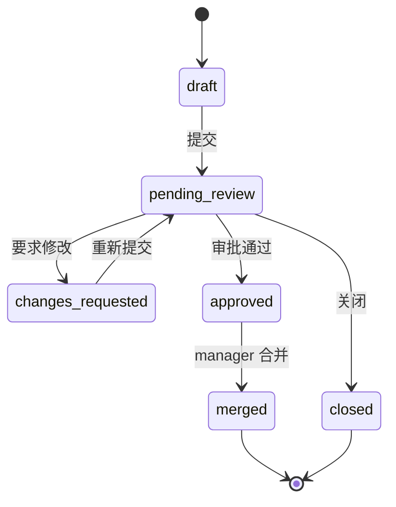

# 协作与版本控制

> 状态：优化中
> 最后更新：2026-10-26
> 目标读者：编辑、知识库管理员、部门负责人、部门审计员
> 关联：[知识库与文档管理](知识库与文档管理.md)、[角色生态位规定](../角色与权限/角色生态位规定.md)

## 1. 为什么需要

文档一旦多人维护，直接编辑会带来：

- 谁改了什么、为什么改，无法追踪。
- 正式内容被误覆盖，无法回滚。
- 审阅意见散落在群聊，无法和具体文档/段落对应。
- 部门负责人无法在不亲自读全文的情况下控制发布质量。

协作与版本控制把“改文档”变成可审阅、可回滚、可审计的过程：issue 记录问题，CR 记录变更，版本记录历史，部门审计员/审阅者负责质量，manager 负责最终合并。

## 2. 谁在什么场景用

| 角色 | 场景 | 权限 |
|---|---|---|
| editor | 修改文档、提交 CR、评论/提 issue | 提交/编辑自己的 CR，不能合并 |
| knowledge_admin | 维护内容/结构，提交 CR | 同上；可被指定 reviewer/部门审计员 |
| manager | 审批/关闭/合并 CR，维护部门审计员 | 唯一 merger |
| 部门审计员 | 审批/驳回本部门所有 CR | 不能合并/关闭/改 KB |
| 单 CR reviewer | 审批/驳回指定 CR | 不能合并 |
| viewer | 阅读 issue/CR，评论/提 issue | 不提交 CR；默认不审批，被授权审计员/reviewer 时可审批/驳回 |

角色本身不包含审批权；部门审计员与单 CR reviewer 是资源级授权，可临时扩大指定范围的审批/驳回，不改变角色矩阵，也不带来合并权。

不适用：

- company_admin 不进入 KB 协作；只看治理聚合。
- system_admin 不参与业务 CR。

## 3. 用户怎么用

### 3.1 issue

- 用户可对文档/段落提出问题、建议、错误反馈。
- issue 支持评论、关闭/重开；可与 CR 关联。
- 锚点评论绑定到文档选区/chunk，用于定位具体内容。

### 3.2 CR（变更请求）

1. 用户在文档编辑态修改内容，创建 CR 草稿。
2. 选择 reviewer（可选），提交进入待审。
3. 部门审计员/指定 reviewer/manager 审批或要求修改；提交人不能审批自己的 CR。
4. 修改后重新提交，清空上一轮审批。
5. 审批通过后由 manager 合并；manager 本人提交的 CR 也需要其他审阅者/审计员批准；也可关闭。
6. 合并后生成新版本，可对比/回滚。

### 3.3 版本

- 每次合并保留版本快照；支持版本列表、对比、回滚。
- 回滚生成新版本，不删除历史。
- 回滚在现有 chunk 上恢复内容并递增 `content_revision`，chunk ID 保持稳定，避免 issue/CR/引用锚点因回滚失效。
- 历史回答的引用内容随消息保存；跳转原文显示当前版本。引用尚未绑定 `version_id`。

### 3.4 并发

- 同一文档的 CR 可并存；合并时按版本/冲突规则处理。
- chunk 锁用于提示“该片段正在被编辑”，不是硬性排他锁。
- 编辑冲突必须让用户看到差异，不静默覆盖。

## 4. 业务规则

- 正式文档内容只通过 CR 合并；直接编辑入口不覆盖正式版本。
- 仅 manager 可合并；审批通过不等于合并。
- 合并前至少一名“其他”审阅者或部门审计员批准；提交人本人的批准不计入。
- 部门审计员可审批/驳回本部门所有 CR；不能关闭、合并、修改 KB。
- 单 CR reviewer 仅对该 CR 生效；不要求部门编辑角色。
- 提交人不能审批自己的 CR，manager 也不例外；合并人可以是审批人之一（manager），当前不强制提交人/审批人/合并人完全三人分离。
- 关闭：提交者或 manager；审计员/reviewer 不能关闭他人 CR。
- 审批/驳回/合并/关闭/回滚写审计。
- 版本回滚保留原 chunk ID 并递增 `content_revision`；版本快照保存历史内容，不靠新 chunk ID 表示版本。
- 软删除 chunk 的回滚恢复边界仍需验证；历史引用未绑定版本，跳转显示当前版本。

## 5. 用完得到什么

- 用户能看到文档从草稿到合并的完整轨迹。
- 审阅意见与具体段落绑定，减少“群里说不清”。
- 部门负责人能在不读全文的情况下审批/合并，并对结果负责。
- 出错可回滚，历史可追溯，回答引用能对应到版本。

## 6. 界面与交互意图

- 协作工作台：入口/issue 列表、CR 工作台、CR 详情、版本历史。
- CR 详情：变更 diff、审阅者、审批状态、评论、合并/关闭动作。
- 文档抽屉：版本 tab、锚点评论、chunk 锁提示。
- 只读用户看到 issue/CR，但不显示提交/审批/合并按钮。
- 状态标签必须诚实：待审/已通过/需修改/已合并/已关闭，不用模糊“处理中”。

原型见[协作工作台](../界面与原型/协作工作台/设计说明.md)。

## 7. 与替代方案对比

| 维度 | 本系统 | 网盘/文档历史 | Git/GitHub |
|---|---|---|---|
| 面向 | 非技术员工 + 结构化文档 | 文件级版本 | 代码/文本 |
| 审批 | CR + reviewer/审计员 + manager | 无 | PR review |
| 权限 | 部门/KB/ACL/角色 | 文件权限 | 仓库权限 |
| 回滚 | 版本快照 + 新版本 | 文件历史 | Git revert |
| 代价 | 流程比直接编辑重 | 简单但不可治理 | 学习成本高 |

## 8. 当前实现与差距

已实现：

- issue/评论、CR 草稿/提交/审批/驳回/合并/关闭、reviewer、部门审计员名单。
- 版本快照/对比/回滚、锚点评论、chunk 锁、引用统计。
- manager 唯一合并；审计员/reviewer 审批不合并；权限与审计。
- 合并前至少一名其他审阅者/部门审计员批准；提交人不能审批自己的 CR，manager 也不例外。
- 审批后合并、回滚到基线已验证：合并更新 chunk 内容并生成版本；回滚恢复原内容，chunk ID 不变。

差距/待优化：

- 软删除 chunk 的回滚恢复、并发版本号、CR 审阅历史进治理审计仍需处理。
- 引用没有 `version_id`：历史回答保留引用文本，但跳转原文看到当前版本；若要锁定历史版本需扩展引用模型。
- 并发合并、版本号竞争、冲突锁的 UX 还需打磨。
- 提交人/审批人/合并人完全三人分离未强制；manager 可以是审批人之一并合并。
- 协作工作台的筛选、批量操作、差异展示还可优化。

## 9. 待决问题与验收

- [x] 合并前至少一名其他审阅者/部门审计员批准（已实施）。
- [ ] 是否要求提交人、审批人、合并人完全三人分离？当前仅强制提交人≠审批人。
- [x] 版本回滚后旧 chunk 引用如何迁移/失效？当前策略：稳定 chunk ID，引用内容随消息保存；未做版本化引用。
- [ ] 软删除 chunk 回滚时如何恢复原 ID 与锚点？
- [ ] 审计员能否看到/处理其他部门 CR？应明确拒绝。
- [ ] 协作工作台的大文档 diff、锚点评论性能是否达标？
