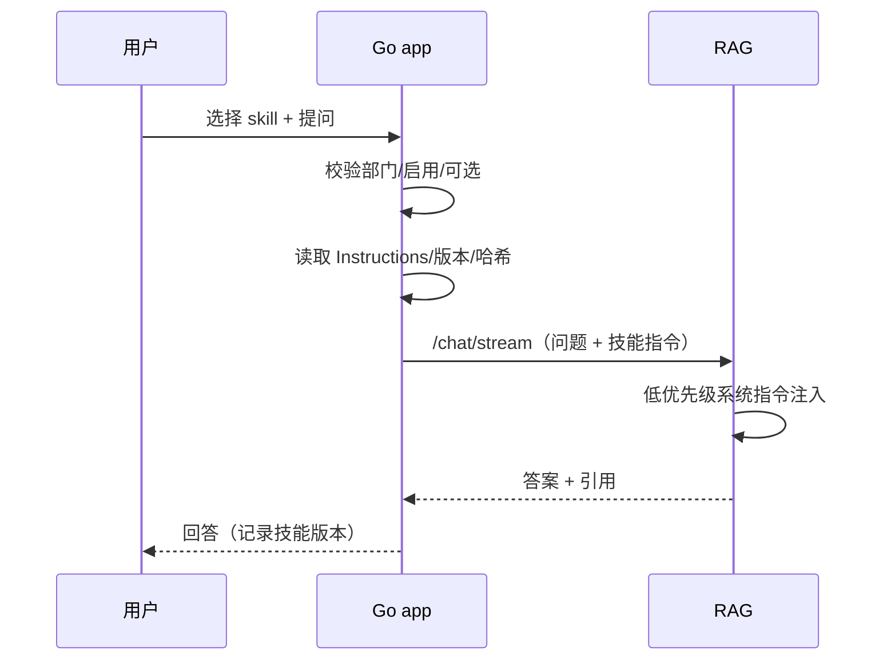

# 技能与问答注入

> 状态：当前
> 最后更新：2026-10-26
> 目标读者：部门负责人、知识库管理员、编辑、只读成员
> 关联：[问答与引用](问答与引用.md)、[交互式精读](交互式精读.md)、[角色生态位规定](../角色与权限/角色生态位规定.md)

## 1. 为什么需要

企业问答的差距往往不在检索，而在“怎么问、按什么口径答”：

- 同一部门反复解释同一套术语、格式和判断标准，答案质量依赖模型临场发挥。
- 新人的经验、评审口径、写作规范散落在群聊和个人文档里，无法复用。
- 把整套流程塞进系统提示词，会让所有问题都背同一段长文，既慢又容易跑偏。
- 通用 Agent 的“技能/插件”能执行代码和外部工具，企业知识场景不需要也不应该承担这种风险。

技能是**可版本化的过程性知识包**：把“这类问题应该怎么处理”沉淀成 `skill.md`，在用户主动选择后注入这一次问答。它不是 Agent，不执行脚本，不改变检索范围和权限。

## 2. 谁在什么场景用

| 角色 | 场景 | 权限 |
|---|---|---|
| manager | 维护本部门技能，授权编辑者 | 创建/编辑/启停/删除/授权 |
| knowledge_admin | 把部门术语、评审口径、模板沉淀为技能 | 同上 |
| editor | 使用技能；被授权后编辑指定技能 | 选择使用；per-skill grant 后可编辑 |
| viewer | 问答时选择本部门已启用技能 | 无技能管理页，不能编辑 |
| company_admin | 查看全部部门技能目录 | 全部只读，不进入问答 |
| system_admin | 不参与技能业务 | 无技能能力 |

不适用：

- 精读不使用部门技能；精读固定内置 `grill-with-docs` 策略，不可替换、不可编辑。
- 技能不授予 KB、文档、ACL、CR 或任何工具执行权限。

## 3. 用户怎么用

### 3.1 维护技能

- manager / knowledge_admin 在本部门技能目录中创建技能：名称、版本、描述、Instructions、附属文件。
- 技能属于一个部门，同名只在部门内唯一；跨部门可重名，互不影响。
- 状态：草稿 / 已启用 / 已停用。只有已启用技能出现在问答选择器中。
- 编辑产生新版本；历史版本保留，消息引用当时的版本与内容哈希。
- 创建、编辑、启停、删除、授权、撤销全部写审计。

### 3.2 授权编辑

- 默认 manager / knowledge_admin 可编辑本部门全部技能。
- 可对单个技能增加编辑授权：指定用户或指定部门；授权只对该技能生效。
- `editor` 被授权后可编辑该技能；不获得管理其他技能、授权他人或任何业务权限。
- `viewer` 即使被授权也不出现技能管理页；`skills:view` 仍决定页面可见性。
- 撤销立即失效；不提供“给整个 editor 角色开编辑权”的全局开关。

### 3.3 在问答中使用

1. 用户新建问答会话，默认“不使用技能”。
2. 在输入区选择本部门一个已启用技能，查看名称、版本、描述。
3. 技能在会话内保持，后续消息继续使用，直到改选或取消。
4. 每次问答最多 1 个技能，不支持多技能组合。
5. 技能只注入本次生成，不改变 KB 范围、ACL、检索过滤或引用编号。

### 3.4 版本与历史

- 新消息使用技能最新启用版本；停用/删除后不能新选。
- 历史消息保留当时注入的版本与内容哈希，回看时能解释“当时按哪版口径回答”。
- 技能内容变更不追溯改写历史回答。

## 4. 业务规则

- **部门隔离**：用户只能选择本部门已启用技能；company_admin 只读全部部门目录，不进入问答。
- **选择不等于授权**：有问答入口的成员都能选择技能；选择不会获得编辑、管理或工具能力。
- **过程性知识**：技能只沉淀方法、术语、格式、判断口径；不写密钥、不写个人隐私、不承诺执行动作。
- **不执行代码**：skill 内脚本不运行；有效内容是 Instructions 与受支持的声明段。
- **注入边界**：技能指令优先级低于系统安全规则与检索证据；不能要求模型忽略权限、引用或拒答规则。
- **长度约束**：创建/编辑时校验长度；问答时不静默截断。超限必须拒绝保存或明确提示。
- **失败可见**：注入失败不能静默；v1 不阻断问答，但回答标记“技能未应用”，并记录状态。
- **审计**：技能增删改、启停、授权/撤销写审计；问答记录技能 ID、版本、哈希、注入状态。
- **外部接入**：MCP 可将技能作为只读资源暴露给外部 Agent，不暴露编辑/授权，不扩大 KB 访问范围。

## 5. 用完得到什么

- 部门把“老员工怎么判断”沉淀成可复用、可版本化的知识，而不是散落在聊天记录。
- 用户按场景选择技能，答案口径更稳定，不必每次重复背景。
- 管理者能控制谁能维护、谁能使用、哪一版生效。
- 历史回答可解释：当时用了哪版技能、是否注入成功。
- 技能不会成为绕过权限或执行任意代码的后门。

## 6. 界面与交互意图

- 技能管理页：技能列表（名称/版本/状态/部门/更新时间）、详情、编辑器、版本历史、编辑授权。
- 编辑器：Instructions 为主，附属文件分开展示；保存前校验长度与必填项。
- 授权面板：用户/部门选择器、授权列表、撤销；显示授权来源和创建人。
- 问答输入区：技能选择器（仅本部门已启用）、当前选择、清除/不使用；无技能时保持简洁。
- 技能详情对只读用户隐藏编辑与授权按钮；viewer 不出现技能页。
- 精读输入区不显示部门技能选择器；固定策略在精读工作台说明。
- 空态：本部门暂无技能时引导创建；无已启用技能时选择器说明“暂无可选技能”。

## 7. 与替代方案对比

| 维度 | 本系统 | 系统提示词硬编码 | 通用 Agent 插件 | SaaS 提示词市场 |
|---|---|---|---|---|
| 归属 | 部门级、可授权 | 全局、难维护 | 账号/平台级 | 平台级 |
| 版本 | 版本 + 哈希，历史可回溯 | 无 | 部分有 | 通常有 |
| 权限 | 部门隔离 + per-skill grant | 无 | 常为账号级 | 账号级 |
| 执行风险 | 不执行代码、不调用工具 | 无 | 可执行脚本/工具 | 可调用外部服务 |
| 审计 | 增删改授权与注入均有记录 | 无 | 弱 | 弱 |
| 代价 | 需要维护技能内容 | 简单但不可治理 | 灵活但风险高 | 上手快但数据出内网 |

## 8. 当前实现与差距

已实现：

- 技能目录、部门归属、创建/编辑/启停/删除、版本与内容哈希。
- per-skill 用户/部门编辑授权与撤销、审计。
- 问答 skill 选择器、一次一个、会话内保持、`/chat/stream` 注入。
- 消息记录技能 ID、版本、哈希、注入状态。

差距/待优化：

- MCP 只读暴露尚未落地。
- 未使用 KB 默认技能；每次需手动选择。
- 技能质量与使用效果没有聚合指标（选中率、追问率、满意度）。
- 注入失败提示在部分界面不够显性。
- 技能与精读的边界需要在精读 UI 中继续说明，避免用户误以为可选。

## 9. 待决问题与验收

- [ ] 是否允许一次问答组合多个技能？当前限制 1 个。
- [ ] 是否需要 KB 级默认技能，减少重复选择？
- [ ] 技能删除后，历史消息是否仍可打开完整内容，还是只保留摘要与哈希？
- [ ] 是否引入技能评审/发布流（草稿 → 评审 → 启用）？
- [ ] 技能使用效果是否进入部门运营看板，如何避免暴露原始问题？
- [ ] MCP 暴露技能时，是否需要单独的 API Key capability？

验收基线：

- manager 可创建技能并授权 editor 编辑；撤销后立即失效。
- viewer 可在问答中选择技能，但看不到技能管理页。
- 每次问答最多 1 个技能；默认无技能；会话内改选生效。
- 技能注入不改变 KB 白名单、ACL、引用与拒答规则。
- 历史消息保留技能版本与哈希；停用后新消息不能继续选择。
