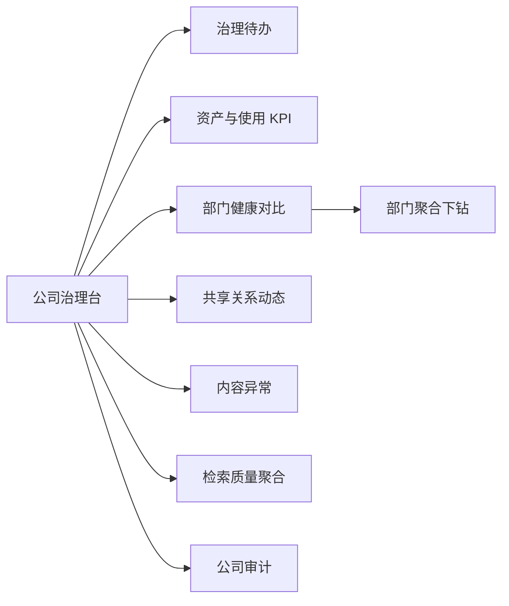

# 治理台与审计

> 状态：优化中
> 最后更新：2026-10-26
> 目标读者：公司管理员、部门负责人、知识库管理员、运维
> 关联：[部门管理工作台](部门管理工作台.md)、[协作与版本控制](协作与版本控制.md)、[系统运维台](系统运维台.md)、[角色生态位规定](../角色与权限/角色生态位规定.md)

## 1. 为什么需要

知识库系统最容易被质疑的两件事是“数据到底被谁看了”和“配置到底被谁改了”：

- 公司管理员需要判断各部门知识资产是否健康，但不能进入正文。
- 部门负责人需要向公司证明本部门的知识被用起来了，而不是只报文档数量。
- 共享、ACL、成员、角色、CR 合并、导出等高风险动作，出问题时要能还原。
- 审计如果只记录 UUID 和接口名，排障时读不懂；如果记录原始问题，又会侵犯员工隐私。

治理台与审计要解决的是“在不读取业务正文的前提下，让管理者和审计者看清资产、使用、协作和风险”。它只负责看与查；成员、部门、技能等写操作在管理入口完成。

## 2. 谁在什么场景用

| 角色 | 数据范围 | 能看什么 | 不能看什么 |
|---|---|---|---|
| company_admin | 全公司 | 公司看板、部门对比、公司审计、技能目录只读 | KB 正文、问答内容、原始问题 |
| manager | 本部门 | 部门运营看板、部门审计 | 其他部门明细、公司技术状态 |
| knowledge_admin | 本部门 | 部门运营看板 | 审计日志、成员与公司治理 |
| editor / viewer | 无 | — | 治理与审计 |
| system_admin | 平台 | 系统审计（在运维台） | 公司业务治理数据、KB 正文 |

规则：

- 数据范围由账号能力自动限定，不靠前端传部门 ID。
- 治理台是只读视图；治理动作去管理入口，避免“看板里误操作”。
- company_admin 的“穿透”只到汇总与元数据，不打开文档正文。

## 3. 用户怎么用

### 3.1 公司治理台

company_admin 登录后进入治理页，默认“运营看板”：

- 顶部治理待办：待审 CR、未处理 issue、审计异常、公开 KB 待复核；无事项时显示“暂无待办”。
- 资产 KPI：知识库（含共享出/入）、文档、摄取健康、成员、近 7 日会话、审计异常。
- 部门健康对比：部门、KB 数、文档数、成员、月活跃、内容新鲜度、近 7 日检索、健康度；可下钻到部门聚合。
- 共享关系动态：谁把哪个 KB 共享给哪个部门，新部门是否自动获得全量共享。
- 内容动态：解析失败、废止、deny 等异常置顶；正常解析折叠。
- 检索质量：命中率、无答案率、点踩等聚合指标；不展示原始问题。

### 3.2 部门运营看板

manager / knowledge_admin 看到本部门版本：

- 近 7 日检索量、无命中数/命中率、共享出 KB 被外部门检索次数。
- KB 健康：文档数、解析失败、长期未更新、生命周期分布。
- 协作：CR 平均周转、open issue、待审 CR。
- 精读：部门精读任务总数、已完成数；只展示聚合，不含阅读内容。
- 审计摘要：本部门高风险动作与异常趋势（仅 manager 可进入审计明细）。
- 不展示员工原始问题；检索只保留哈希与聚合。
- 数据为零且历史上也为零时，显示引导态而不是 0 占位。

### 3.3 审计查询

| 审计类型 | 查看者 | 范围 |
|---|---|---|
| 公司审计 | company_admin | 全公司治理动作 |
| 部门审计 | manager | 本部门治理动作 |
| 系统审计 | system_admin | 平台技术动作（运维台） |

审计记录字段：时间、可读动作、操作人、对象、结果、详情。

- 动作必须人话化，例如“把《开发测试库》共享给市场部”，而不是 `kb_share_update`。
- 对象补全名称与所属部门；UUID 不能作为唯一展示。
- 支持按时间、动作、结果、操作人筛选，支持分页与导出。
- 连续 denied、短时间批量操作等异常聚合提示，便于识别配置错误或权限探测。
- 记录拒绝访问，但只记录资源路径与动作，不记录被拒绝的正文。
- 导出审计同样写审计；导出内容不包含文档正文。

### 3.4 公司管理入口

company_admin 在“管理”页完成写操作：

- 成员：邀请、调整公司角色、部门归属、移除公司成员。
- 部门：创建、重命名、结构调整。
- 技能目录：全部部门只读，不创建/编辑/授权。
- 治理页不重复放这些动作；两个入口边界固定为“治理看、管理配”。

## 4. 业务规则

- **最小可见**：治理聚合不返回文档正文、会话内容、员工原始问题。
- **范围守卫**：company_admin 全公司；manager 本部门；knowledge_admin 无审计；system_admin 只看系统审计。
- **审计不可改**：审计记录只追加，不提供编辑/删除入口；保留期由运维配置。
- **高风险必审计**：共享、发布、ACL、成员与角色、技能授权、CR 合并/关闭/回滚、文档删除、批量操作、导出、系统配置、账号救援。
- **失败也审计**：拒绝、失败、越权尝试都要留痕；结果字段区分 success/denied/failed。
- **口径一致**：部门看板与公司看板的同名指标必须同源同口径，避免数字对不上。
- **零值不等于无数据**：没有历史数据时显示引导态；确实为零时显示 0，并标注统计周期。
- **数据新鲜度可见**：每个面板标注刷新频率或统计窗口，不让用户误以为是实时数据。
- **CR 审阅历史**：当前在 CR 详情，不进入治理审计；若纳入需要新增事件，不篡改已有记录。

## 5. 用完得到什么

- 公司管理员能看到公司知识资产、部门健康、共享关系与使用趋势，而不接触正文。
- 部门负责人能拿部门看板说明“知识有没有被用、协作是否顺畅”，而不是只报文档数。
- 审计能回答“谁在什么时候对哪个对象做了什么、结果如何”，并支持导出留档。
- 越权尝试和异常模式能被发现，而不是只留在应用日志里。
- 治理看板与管理动作分离，减少在图表页误改配置的风险。

## 6. 界面与交互意图

- 公司工作台侧栏：company_admin 只保留治理、管理；manager 增加治理、管理；knowledge_admin 有治理、管理但治理无审计页签。
- 治理页使用内部滚动容器，看板与审计都可上下滚动，不整页跳动。
- 顶部页签：公司/部门为“运营看板 / 审计日志”；knowledge_admin 只有“运营看板”。
- 看板：KPI 卡 + 待办条 + 主次两栏；异常置顶，正常流水折叠。
- 审计：异常聚合条 + 筛选器 + 表格 + 分页 + 导出；行展开显示对象详情。
- 空态/错误态：无权限、无数据、统计中、时间范围过大分别提示。
- 不出现“最近更新”式噪音流水；只保留有管理价值的动态。

## 7. 与替代方案对比

| 维度 | 本系统 | 通用 BI 工具 | 日志平台 | 网盘后台 |
|---|---|---|---|---|
| 数据范围 | 公司/部门/系统三层，按角色限定 | 需另建权限 | 需另建权限 | 文件级 |
| 业务语义 | KB、共享、ACL、CR、精读、检索聚合 | 需自定义 | 弱 | 弱 |
| 正文隔离 | 治理只看聚合与元数据 | 取决于接入数据 | 可能读到全文日志 | 可能读到文件 |
| 审计 | 高风险动作内建、可读、可导出 | 需自建 | 强但面向技术 | 弱 |
| 部署 | 本地单租户 | 常为 SaaS | 常为 SaaS | SaaS/本地 |
| 代价 | 指标口径需持续治理 | 灵活但集成成本高 | 技术门槛高 | 管理能力浅 |

## 8. 当前实现与差距

已实现：

- company_admin 公司治理看板/公司审计；manager 部门看板/部门审计；knowledge_admin 仅部门看板。
- 治理页“运营看板 / 审计日志”页签；数据范围按能力限定；业务路由对 company_admin 返回 403。
- 部门看板近 7 日检索、无命中、共享出检索、CR 周转、open issue、精读任务/完成数聚合；不记录原始问题。
- 审计记录高风险动作、拒绝访问、CR 审批；公司/部门范围隔离；支持筛选、分页、CSV 导出。
- 治理与管理分入口。

差距/待优化：

- 知识缺口 Top5、热门检索 Top5 未做：检索审计只存 query hash。
- 团队贡献榜、缺口指派闭环未进入首版。
- 部门健康对比、共享关系动态、检索质量面板仍在原型阶段。
- 审计异常自动聚合、动作人话化、对象补全仍需打磨。
- 审计保留期与导出权限尚未形成固定策略。

## 9. 待决问题与验收

- [ ] 知识缺口是否需要在不记录原始问题的前提下，用“主题簇 + 计数”表达？
- [ ] 部门看板与公司看板的指标口径由谁维护？是否需要指标字典？
- [ ] 审计导出是否允许包含操作人邮箱，还是只给姓名与 ID？
- [ ] 审计保留期多长？到期归档还是删除？
- [ ] 连续 denied 的异常聚合阈值如何设定，是否通知 manager/company_admin？
- [x] CR 审阅历史已写入治理审计（`collaboration.cr_reviewed`），对象为 CR，详情不含评论正文。
- [ ] 公司管理员是否需要“只读穿透到单文档元数据”，还是永远停在部门聚合？

验收基线：

- company_admin 只能看到公司聚合与审计，直接访问 KB/问答路由 403。
- manager 只看本部门看板与审计；knowledge_admin 看板可见、审计不可见。
- 审计动作可读、对象有名称、结果可筛选、可导出；导出本身写审计。
- 部门/公司同名指标同源同口径。
- 零数据与真实零值显示不同；每个面板标注统计窗口。
