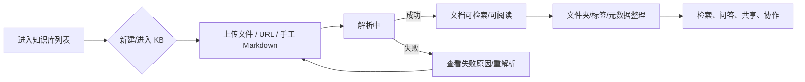

# 知识库与文档管理

> 状态：当前
> 最后更新：2026-10-26
> 目标读者：部门负责人、知识库管理员、编辑、只读成员
> 关联：[角色生态位规定](../角色与权限/角色生态位规定.md)、[共享空间与ACL](../角色与权限/共享空间与ACL.md)、[协作与版本控制](协作与版本控制.md)

## 1. 为什么需要

企业知识库的第一层问题不是“有没有文档”，而是：

- 文档散落在个人目录、群文件和网盘，找不到唯一版本。
- 上传后不知道解析到哪一步，失败后无法定位。
- 文件夹、标签、文号、机构、生命周期等元数据靠人工记。
- 部门之间的共享和权限靠口头约定，删除和覆盖不可追溯。

知识库与文档管理要解决的是“文档从进入到可检索、再到可维护”的全过程。它不负责问答生成，也不负责 CR 审批；这两部分分别由[问答与引用](问答与引用.md)和[协作与版本控制](协作与版本控制.md)承担。

## 2. 谁在什么场景用

| 角色 | 场景 | 能做什么 |
|---|---|---|
| 部门负责人 manager | 建部门知识库、调整基础信息、共享/发布、查看部门文档 | 建库、复制、删除 KB、共享/发布、ACL、文件夹 |
| 知识库管理员 knowledge_admin | 维护本部门 KB 的技术配置与内容结构 | 建库、模型/解析/分块/存储配置、文件夹、文档编辑、删除文档 |
| 编辑 editor | 日常上传、编辑本部门文档 | 上传、编辑、提交 CR、标签/元数据补充 |
| 只读成员 viewer | 阅读本部门/共享入文档 | 阅读、检索、下载/预览（按权限） |

不适用：

- company_admin 不进入知识库；只读治理聚合和审计元数据。
- system_admin 不管理业务文档；只维护模型/解析/存储等全局技术配置。
- 跨部门共享入 KB 只读，接收方不能上传、编辑、删除、共享。

## 3. 用户怎么用

### 3.1 知识库

- 创建：manager / knowledge_admin 可在本部门创建；创建时归属当前部门。
- 复制/副本：复制结构和配置到本部门；共享行按规则重建。
- 删除：仅 manager；删除前提示影响（文档、共享、协作记录）。
- 基础信息：名称、描述、封面/标识等；manager 和 knowledge_admin 可编辑。
- 共享/发布：manager 负责；共享范围和发布状态影响其他部门可见性。
- 技术设置：knowledge_admin 负责模型、解析、分块、存储、数据源；入口在管理工作台。

### 3.2 文档

- 上传方式：文件、URL、手工 Markdown。
- 解析状态：待解析/解析中/成功/失败/取消；失败可重解析，解析中可取消。
- 文档状态：启用/禁用、生命周期（草稿/生效/废止）、密级、部门。
- 元数据：文号、机构、日期、类型、产品、标签、自定义字段。
- 文件夹：新建/重命名/移动/删除；根目录不可删；有内容/引用的目录删除要确认。
- 批量操作：批量重解析、批量删除、批量打标签、移动到文件夹。
- 视图：列表/卡片/看板；筛选（状态/类型/来源/标签/时间）和搜索。
- 预览/下载：按 KB/ACL 权限；禁止下载的文档不提供下载入口。

### 3.3 知识库设置

| 设置 | 归属 | 说明 |
|---|---|---|
| 基本信息 | manager / knowledge_admin | 名称、描述、标识 |
| 共享范围 | manager | 部门多选；所属部门锁定 |
| 发布 | manager | 消费者门户可见性 |
| 库内 ACL | manager | 文件夹/文件 allow/deny |
| 模型/解析/分块/图像/高级 | knowledge_admin | 只能选已有 active 模型/引擎 |
| 存储/数据源 | knowledge_admin | 本 KB 技术配置 |

入口分工：

- manager 从知识库卡菜单进入设置；
- knowledge_admin 从“管理 → 知识库设置”进入；
- 两者看到的页签不同，避免越权。

## 4. 业务规则

- KB 归属部门不可随意变更；跨部门共享不改变归属。
- 共享入 KB 只读；接收方不能上传/编辑/删除/共享/管理 ACL。
- 删除文档、批量删除、清空 KB 需要对应角色；editor/viewer 不可删除。
- 解析未完成/失败的文档不能作为精读/问答的可靠来源；前端明确标识。
- 同一文档的正式内容修改走 CR，不直接覆盖；手工文档更新也受角色与审计约束。
- 元数据与标签是检索过滤和治理统计的基础；缺失时明确显示“未知”，不猜测。
- 所有上传、删除、共享、ACL、重解析动作写审计。
- 失败/降级：解析失败不回退到未解析全文；索引失败标记不可检索，不静默展示旧内容。

## 5. 用完得到什么

- 文档进入统一 KB，具备可检索的解析结果和元数据。
- 用户能看到文档状态、失败原因、可执行的下一步（重解析/取消/删除）。
- 部门负责人能掌握 KB 资产、共享范围和文档健康度。
- 编辑能在不破坏正式内容的前提下提交修改。
- 审计能回答“谁在什么时候上传/删除/共享/改配置”。

## 6. 界面与交互意图

- 知识库列表：卡片/列表，展示 KB 名称、文档数、部门、共享标识、更新时间。
- KB 详情：文档列表/卡片/看板；顶部筛选与搜索；批量操作条。
- 文档行：状态、类型、来源、标签、更新时间、生命周期、密级。
- 上传：文件/URL/手工三入口；上传后展示解析进度与失败原因。
- 设置：分页签，按角色裁剪；共享/ACL 高风险操作二次确认。
- 空态/错误态：明确说明“没有文档/解析失败/无权限/共享入只读”。

详细视觉规范见[界面规范](../界面与原型/界面规范.md)。

## 7. 与替代方案对比

| 维度 | 本系统 | 通用网盘/文档管理 | 通用 SaaS 知识库 |
|---|---|---|---|
| 数据位置 | 本地单租户 | 本地或云盘 | SaaS |
| 权限 | 部门 + KB + ACL | 文件/文件夹 | 账号/空间级 |
| 文档状态 | 解析/生命周期/密级/审计 | 少量版本信息 | 有版本但治理弱 |
| 检索 | 向量 + BM25 + 元数据 + SQL | 文件名/全文 | 通用向量检索 |
| 代价 | 需要本地运维与元数据治理 | 简单但无法治理 | 数据主权/合规风险 |

## 8. 当前实现与差距

已实现：

- KB 创建/复制/删除、文档上传/URL/手工、解析状态、文件夹、标签、元数据、批量操作、列表/卡片/看板。
- 共享范围、发布、ACL、部门权限；knowledge_admin 技术设置与 manager 业务设置分离。
- 解析失败重试/取消、文档预览/下载权限、审计。

差距/待优化：

- 解析失败的批量重试与错误归因还不够细。
- 文档状态/生命周期筛选与批量编辑的交互可继续收敛。
- 跨部门共享入的只读提示和权限边界需要更显性。
- 元数据字段的自定义配置与校验仍偏工程化。

## 9. 待决问题与验收

- [ ] 删除 KB 的影响预览是否包含共享/协作/精读引用？
- [ ] 解析失败是否支持“仅重试失败文档”并展示失败阶段？
- [ ] 大目录上传/批量操作的进度与取消是否统一？
- [ ] 共享入 KB 的“只读”标识是否在所有入口一致？
- [ ] 生命周期/密级变更是否要求二次确认并写审计？
