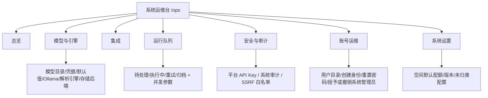

# 系统运维台

> 状态：当前
> 最后更新：2026-10-26
> 目标读者：系统管理员、运维、部署人员
> 关联：[系统总览](../../01-项目总览/系统总览.md)、[角色生态位规定](../角色与权限/角色生态位规定.md)、[治理台与审计](治理台与审计.md)、[部署手册](../../../deployments/README.md)

## 1. 为什么需要

知识库系统的业务角色解决不了底座问题：

- 模型凭据、解析引擎、存储后端、队列并发，配错一个整条问答链路就不可用。
- 公司管理员不该为了“让系统跑起来”获得数据库和密钥权限。
- 知识库管理员只应选择已启用的模型，不应管理供应商凭据。
- 出问题时如果只看应用日志和 SSH，排障慢，且无法回答“谁改了什么配置”。

系统运维台把技术运维收进一个独立工作台：看健康、配模型、管队列、查系统审计、做账号救援；不进入知识库正文、问答、精读、共享空间和公司治理。

## 2. 谁在什么场景用

| 角色 | 场景 | 说明 |
|---|---|---|
| system_admin | 部署后配置模型/解析/存储；日常看健康与队列；处理故障；账号救援 | 唯一技术运维身份 |
| 双身份账号 | 同时有公司 membership | 默认进运维台，可切换到公司工作台 |
| company_admin | 不进入运维台 | 只管成员、部门、公司治理 |
| knowledge_admin | 不进入运维台 | 只能在 KB 内选择已启用模型/引擎 |
| editor / viewer | 不进入运维台 | 只使用业务功能 |

边界：

- system_admin 不是“超级管理员”：不读 KB 正文、不参与问答、不分派公司/部门角色。
- 集成作用域、运行统计等场景只读取 KB/Agent 的名称、ID、计数等元数据，不返回正文或会话内容。
- 运维台所有写操作按技术能力判定，不能借运维身份获得业务权限。

## 3. 用户怎么用

### 3.1 登录与工作台切换

- system_admin 登录后默认进入 `/ops/overview`，即使同时拥有公司 membership。
- 只有存在有效公司 membership 时，头像菜单才显示“切换到公司工作台”。
- 公司工作台 → 运维台使用同一头像菜单的“切换到运维工作台”。
- 切换只改变路由和导航，不改变 token/principal；公司侧仍按 membership 角色计算。
- 公司工作台不再出现平台管理侧栏入口；技术配置只从运维台进入。

### 3.2 七个分区

| 分区 | 做什么 | 关键约束 |
|---|---|---|
| 总览 | 健康卡、告警待办、队列、资源水位、模型通道、最近审计 | 只展示当前真实状态，不虚构趋势 |
| 模型与引擎 | 模型目录、供应商凭据、默认模型、Ollama、解析引擎、存储后端、连通性测试 | 凭据只在此维护；知识库侧只能选 active 实例 |
| 集成 | API、CLI 接入配置；IM 管理面已下线 | 作用域只读名称/ID/计数 |
| 运行队列 | 待处理/执行中/重试/归档、worker/模型并发、失败任务处理与归档清理 | 清理/重试需确认并写审计 |
| 安全与审计 | 平台 API Key、系统审计、SSRF 白名单 | 密钥只显示掩码；高风险操作二次确认 |
| 账号运维 | 用户目录、创建身份、重置密码、授予/撤销系统管理员、注册规则 | 不改公司角色、部门归属、成员状态 |
| 系统设置 | 空间默认配额、版本与系统信息、未归类配置 | 不出现业务内容 |

### 3.3 总览页

- 顶部运维待办条：按 P1/P2/P3 汇总当前活跃告警；无告警时显示“全部正常”。
- 五张健康卡：应用、解析、存储、模型、队列；附依赖与最近检查时间。
- 队列区：待处理/执行中/重试/归档四格实时数字 + 最近 2 分钟负载趋势。
- 资源水位：存储、待处理队列、归档任务三条进度条，带阈值红线。
- 模型通道：按供应商聚合已配置模型；测试按钮跳转模型与引擎页。
- 右侧：当前告警与最近平台审计；审计显示操作人、可读动作、对象与时间。
- 底部：动作型快捷入口（刷新、处理队列、测试模型、查看安全审计），不是导航复读。
- 顶部：DEV/PROD 环境徽章、运行时长、健康检查周期、最近刷新时间。
- 每个面板标注刷新频率，避免用户误判数据新鲜度。

健康卡口径：

| 卡片 | 内容 |
|---|---|
| 应用 | 版本、启动时长、数据库迁移状态 |
| 解析 | DocReader 连接状态、可用解析引擎数量 |
| 存储 | 当前启用后端、可用性 |
| 模型 | 默认/已配置模型数量、向量引擎、Ollama 状态 |
| 队列 | 待处理、重试、失败数量 |

### 3.4 模型与引擎

- 模型目录：新增/编辑/启用/停用模型实例；配置供应商、凭据、上下文与并发。
- 默认模型：普通问答、embedding、rerank、精读模型分别指定；精读模型必须是 active 的 `KnowledgeQA` 类型。
- Ollama、解析引擎、存储后端：维护连接与可用状态。
- 连通性测试：手动触发，显示结果与耗时；不在前端伪造“最近一次成功”。
- 知识库侧只能看到启用中的实例；不能新增模型或凭据。

### 3.5 运行队列

- 查看待处理、执行中、重试、归档任务；按队列/状态/时间筛选。
- 处理失败任务：重试、取消、归档；批量操作需确认。
- 调整 worker 与模型并发；修改前提示影响（吞吐、内存、超时）。
- 清理归档任务写审计；不可恢复的数据删除要二次确认。

### 3.6 安全与审计

- 平台 API Key：创建、停用、删除；密钥只在创建时显示一次，列表只显示掩码。
- 系统审计：记录技术配置、密钥、队列清理、账号救援、系统管理员授予/撤销等动作。
- SSRF 白名单：维护允许的外部地址范围；修改写审计。
- 系统审计与公司/部门审计分开，不混用数据范围。

### 3.7 账号运维

- 用户目录：邮箱/用户名/状态/是否系统管理员，可搜索。
- 创建身份：用于救援或初始化；不自动分配公司/部门角色。
- 重置密码：生成临时密码或触发重置，操作写审计。
- 授予/撤销系统管理员：高风险，二次确认并写审计。
- 不修改公司角色、部门归属、成员状态；这些归 company_admin。
- 只返回账号运维所需字段，不返回业务数据。

## 4. 业务规则

- **技术/业务分离**：运维台不出现 KB 正文、问答、精读、共享空间、公司治理数据。
- **最小权限**：system_admin 拥有技术配置能力，但不拥有 `kb:read`、`shared_space:view` 等业务能力。
- **隐式单租户上下文**：system_admin 不需要公司 membership；后台取唯一空间作为配置目标，内部 `ops` 角色低于 viewer，不能通过业务路由。
- **双身份**：公司侧权限只按 membership 计算，运维身份不额外授予业务能力。
- **凭据保护**：密钥、密码、Token 列表只显示掩码；只在创建时展示一次；不写日志、不回显。
- **高风险确认**：删除平台 API Key、清空归档、授予/撤销系统管理员、修改 SSRF 白名单、批量清理任务必须二次确认并写审计。
- **真实数据**：没有监控数据时显示空态，不造 24h 趋势、不造通道延迟、不把 0 当有数据。
- **配置生效**：模型/解析/存储变更影响后续请求；修改前提示影响范围，不静默重启服务。
- **失败明确**：模型/解析/存储不可用时，业务侧明确失败；运维台显示失败原因与最近检查时间，不做“全绿”兜底。

## 5. 用完得到什么

- 一套系统从部署到日常运行都能在运维台完成，不必登录数据库和服务器改配置。
- 出问题时先看健康卡、告警和队列，再定位到模型/解析/存储/集成。
- 技术配置、密钥、账号救援有审计，能回答“谁改了什么”。
- 公司管理员和知识库管理员不会被技术配置干扰，职责边界清晰。
- 双身份用户可以在一个账号下切换运维与公司工作台，但权限不互相穿透。

## 6. 界面与交互意图

- 独立浅色运维工作台，不复用公司工作台侧栏；`/ops/*` 命名空间。
- 左侧七个一级分区 + 顶部状态栏（版本、运行时长、最近刷新、手动刷新）。
- 沿用 WellRead 字体与绿色主色，用健康色点区分状态；不做全暗色监控屏。
- 总览主次两栏：左侧健康与队列，右侧告警与审计；底部动作快捷入口。
- 队列用分格数字而非环形占比图；资源水位带阈值红线。
- 审计动作人话化，对象补全名称；不显示裸 UUID。
- 环境徽章区分 DEV/PROD，非生产环境使用醒目颜色。
- 空态/错误态：无告警、无队列任务、无模型、连接失败、无权限分别提示。
- 所有面板标注刷新频率；高风险操作弹窗说明影响与不可逆性。

## 7. 与替代方案对比

| 维度 | 本系统 | 通用监控平台 | 云厂商控制台 | 超级管理员混合后台 |
|---|---|---|---|---|
| 面向 | 本系统模型/解析/队列/密钥 | 指标与告警 | 云资源 | 业务 + 技术混合 |
| 业务安全 | 不进入正文，元数据例外 | 不涉及 | 不涉及 | 常可越权读正文 |
| 配置能力 | 模型、解析、存储、集成、队列 | 无 | 云资源级 | 有，但边界模糊 |
| 审计 | 技术动作内建 | 需另建 | 有 | 常混在业务审计 |
| 部署 | 本地单租户 | 常为 SaaS/自建 | 云 | 本地 |
| 代价 | 能力范围有限 | 通用但集成成本高 | 绑定云厂商 | 方便但风险高 |

## 8. 当前实现与差距

已实现：

- `/ops` 独立布局与七个分区；登录默认落地、双身份切换。
- 运维待办/告警、五健康卡、队列分格与资源阈值、模型通道、可读审计、动作快捷入口。
- 技术配置从公司 Settings 迁移到运维台；company_admin 技术设置隐藏。
- 平台 API Key、系统审计、系统设置、账号运维、用户目录。
- system_admin 隐式单租户上下文（内部 `ops` 角色，无 membership 行）。
- 普通问答、embedding、rerank 模型与全局模型目录在运维台模型与引擎页配置；精读模型在“模型与引擎 → 精读模型”页配置，只列 `KnowledgeQA` 类型。

差距/待优化：

- 告警从当前健康状态实时派生，没有独立告警表；历史告警与通知渠道未落地。
- 队列趋势仅前端最近 2 分钟滚动窗口；无 24h 趋势与通道延迟。
- 备份、证书、演练等超期事项尚未进入运维待办。
- 模型并发空态、通道级健康与手动测试的呈现还可优化。
- 系统审计的可读性、筛选、分页、导出仍需打磨。

## 9. 待决问题与验收

- [ ] 是否需要独立告警表与通知（邮件/IM/Webhook）？阈值由谁维护？
- [ ] 队列与资源趋势保留多久？是否需要历史曲线？
- [ ] 系统审计是否允许导出？导出是否包含密钥操作详情？
- [ ] 备份/证书/演练超期是否纳入运维待办？数据来源是什么？
- [ ] 多实例部署时，健康卡与队列如何按实例聚合？
- [ ] 账号救援创建的身份，是否需要强制首次登录改密？
- [x] 精读模型已迁到运维台“模型与引擎 → 精读模型”；仍使用租户 `reading_model_id`，旧配置直接回显。

验收基线：

- system_admin 登录进入 `/ops/overview`，业务路由全部 403。
- 七个分区可访问；模型/解析/存储/集成可配置并保存成功。
- company_admin 不再看到任何技术配置。
- 双身份账号可切换工作台，公司侧按 membership 显示。
- 高风险操作有确认与审计；密钥列表只显示掩码。
- 总览无数据时显示空态，不显示假趋势；每个面板标注刷新频率。
