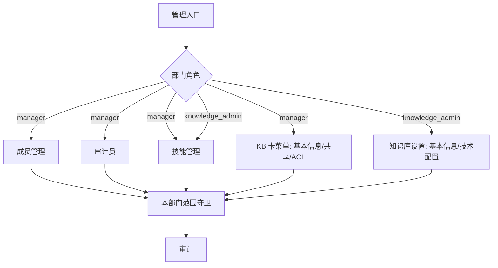

# 部门管理工作台

> 状态：当前
> 最后更新：2026-10-26
> 目标读者：部门负责人、知识库管理员、编辑、只读成员
> 关联：[角色生态位规定](../角色与权限/角色生态位规定.md)、[知识库与文档管理](知识库与文档管理.md)、[技能与问答注入](技能与问答注入.md)、[治理台与审计](治理台与审计.md)

## 1. 为什么需要

部门是这套系统的业务边界，但部门管理的动作天然分散：

- 成员在设置里、审计员在 CR 里、技能在另一个页面、KB 技术配置又在 KB 卡片菜单里。
- 公司管理员如果替部门做这些事，会越过部门负责人，且不了解部门实际。
- 知识库管理员和部门负责人共用“管理”入口时，容易看到不属于自己的页签。
- “移除成员”“降级 manager”“关闭审批权”都是高风险动作，不能靠口头约定。

部门管理工作台把部门内的管理动作收在一处，按角色裁剪：manager 管人、管审计员、管技能；knowledge_admin 管 KB 技术设置、管技能；两者都只作用于本部门。

## 2. 谁在什么场景用

| 角色 | 管理页 | 能做什么 | 不能做什么 |
|---|---|---|---|
| manager | 成员、审计员、技能 | 邀请/移出本部门成员、调整部门角色、增删 CR 审计员、维护技能 | 改公司角色、操作其他部门、技术配置 |
| knowledge_admin | 知识库设置、技能 | 选择本部门 KB 并配置技术项、维护技能 | 成员、审计员、共享/ACL、删 KB |
| editor | 无 | — | 任何部门管理 |
| viewer | 无 | — | 任何部门管理 |
| company_admin | 公司管理（另一入口） | 公司成员、部门结构 | 部门内成员/审计员/技能编辑 |

前置条件：

- 用户属于当前部门且持有对应角色；跨部门操作一律 403。
- 邀请对象必须是已注册用户；本系统不在部门侧创建新账号。
- 管理动作全部写审计。

## 3. 用户怎么用

### 3.1 管理入口

- manager 侧栏：新对话、知识库、精读、共享空间、治理、管理。
- knowledge_admin 侧栏同上，但治理只有部门看板、没有审计页签。
- 管理页是动作卡片，不是治理图表的重复：
  - manager：成员管理、审计员、技能管理。
  - knowledge_admin：知识库设置、技能管理。
- 卡片只显示当前角色可执行的入口；没有权限的卡片不渲染，而不是点击后 403。

### 3.2 成员管理（manager）

- 成员列表：姓名、邮箱、部门角色、加入时间、状态。
- 调整角色：manager / knowledge_admin / editor / viewer 四选一；保存后能力立即生效。
- 移出部门：清空部门归属与部门角色，保留公司成员身份和账号；不是删除账号。
- 待处理邀请页签：只显示本部门邀请；只能撤销本部门邀请。
- 邀请：选择已注册用户，固定写入本部门；不能邀请到其他部门。
- 最后一名 manager 且部门已有 KB 时，不允许降级或移出。
- 不能修改公司角色，不能移除公司成员身份。

### 3.3 审计员管理（manager）

- 本部门成员列表 + 开关；打开即加入部门 CR 审计员名单，关闭即移除。
- 审计员可审批/驳回本部门所有 KB 的 CR；不能合并、关闭他人 CR、修改 KB。
- 候选为本部门任意 active 成员，不要求编辑角色；viewer 也可以被授权。
- 审计员是资源级授权，不改变成员角色和能力码矩阵。
- 增删立即生效并写审计；被移除后未处理的审批动作不能再执行。

### 3.4 技能管理（manager / knowledge_admin）

- 进入本部门技能目录：创建、编辑、启停、删除、版本、per-skill 编辑授权。
- 授权只对指定技能生效；viewer 不出现技能页，但问答仍可选择已启用技能。
- 详见[技能与问答注入](技能与问答注入.md)。

### 3.5 知识库设置入口（knowledge_admin）

- 从“管理 → 知识库设置”选择本部门 KB，打开设置。
- 页签：基本信息、模型、解析、分块、图像、高级、存储、数据源。
- 模型/解析/存储只能选择 system_admin 已启用的全局实例；不能新增凭据或全局模型。
- 音频处理与知识图谱已停用，不显示入口。
- 不出现共享管理、发布、库内 ACL、删除 KB。

### 3.6 KB 设置入口（manager）

- manager 从知识库卡菜单进入设置，只看到基本信息、共享管理、库内权限。
- 不出现模型、解析、分块、存储等技术页签。
- 共享/ACL 属高风险操作，二次确认并写审计。
- 两个角色的 KB 设置入口分开，避免同页多页签导致越权。

## 4. 业务规则

- **仅本部门**：所有查询与写入使用当前 `department_id`；前端传其他部门 ID 必须 403。
- **角色不叠加**：同一用户在同一空间只有一个部门角色；换角色是替换，不是追加。
- **最后一名 manager 保护**：部门已有 KB 时，不能把最后一名 manager 降级或移出。
- **移除是移出部门**：不删除账号、不改变公司成员身份；账号救援归 system_admin，公司成员治理归 company_admin。
- **邀请限制**：只能邀请已注册用户加入本部门；只能撤销本部门邀请。
- **审计员与角色分离**：审计员是 CR 审批授权，不带来合并、关闭、KB 管理或审计日志查看权。
- **技能授权与角色分离**：per-skill grant 只扩大指定技能编辑权，不改变角色矩阵。
- **KB 设置分工**：manager 管业务（共享/发布/ACL），knowledge_admin 管技术（模型/解析/分块/存储），两者都看不到对方的页签。
- **高风险动作**：改角色、移出成员、增删审计员、共享、ACL 变更、删除类操作必须二次确认并写审计。
- **失败明确**：越权、最后一名 manager、邀请不存在用户等情况返回明确错误，不静默忽略。

## 5. 用完得到什么

- 部门负责人不离开本部门就能完成成员、审批授权、技能和 KB 业务设置。
- 知识库管理员只看到技术配置，不会被共享/ACL 等业务动作干扰。
- 角色变化立即生效，审计可还原“谁在什么时候把谁改成了什么”。
- 公司管理员不必替部门做日常管理，职责边界清晰。
- 编辑和只读成员不会误入管理页，减少误操作。

## 6. 界面与交互意图

- 管理页：动作卡片 + 一句职责说明；卡片按角色渲染，不显示灰色不可用入口。
- 成员页：表格 + 角色下拉 + 移出按钮；待处理邀请独立页签；空态引导邀请。
- 审计员页：成员表格 + 开关；显示“可审批/驳回本部门 CR，不能合并”的说明。
- 技能页：列表 + 详情 + 编辑器 + 授权面板。
- KB 设置：manager 与 knowledge_admin 看到的页签不同；技术项只列已启用实例。
- Settings 弹窗不重复成员/部门管理；成员管理只从管理页进入。
- 危险动作使用确认弹窗，说明影响范围；成功后给出可读结果。
- 空态/错误态：无成员、无待处理邀请、无 KB、无技能、无权限分别提示。

## 7. 与替代方案对比

| 维度 | 本系统 | 公司级统一后台 | 每个 KB 单独管理员 | 表格/群聊约定 |
|---|---|---|---|---|
| 管理边界 | 部门内聚，按角色裁剪 | 集中但离业务远 | 分散、易漏权 | 无强制 |
| 角色变更 | 即时生效、写审计 | 通常可做 | 常需逐库配置 | 靠人工同步 |
| CR 审批授权 | 审计员名单 + 单 CR reviewer | 需定制 | 需逐库配置 | 无 |
| KB 技术/业务分权 | manager / knowledge_admin 分离 | 常合并为超级管理员 | 常合并 | 无 |
| 审计 | 内建 | 有 | 弱 | 无 |
| 代价 | 需要维护部门角色 | 灵活但重 | 灵活但治理弱 | 低成本、高风险 |

## 8. 当前实现与差距

已实现：

- manager 管理页成员管理、审计员、技能入口；本部门邀请/撤销、角色调整、移出部门。
- knowledge_admin 管理页知识库设置、技能；KB 设置按技术页签裁剪。
- 最后一名 manager 保护、跨部门 403、角色即时生效、审计。
- 成员页“成员 / 待处理邀请”页签；审计员开关；Settings 不重复成员管理。

差距/待优化：

- manager 管理页当前为两张卡，审计员入口与成员入口的呈现方式尚未完全统一为目标的三卡结构。
- 成员批量操作、邀请结果回执、角色变更影响预览仍偏基础。
- 审计员名单没有角色下限，viewer 也可被授权；是否符合治理要求待定。
- 部门审计员与单 CR reviewer 的关系在 UI 上解释不足。
- 知识库管理员从管理页选择 KB 的交互仍可收敛（搜索、最近使用、空态）。

## 9. 待决问题与验收

- [ ] 审计员是否要求至少 editor 角色，还是保持任意成员？
- [ ] 成员角色变更是否需要“影响预览”（例如降级 manager 前提示唯一负责人风险）？
- [ ] 是否支持批量邀请/批量调整角色？
- [ ] 部门管理动作是否需要在部门看板出现待办提醒？
- [ ] manager 与 knowledge_admin 的管理卡片是否允许自定义排序？
- [ ] 最后一名 manager 的判定是否只在“部门已有 KB”时生效，还是始终生效？

验收基线：

- manager 只能看到并操作本部门成员；跨部门邀请返回 403。
- 最后一名 manager 在部门已有 KB 时不能被降级或移出。
- 审计员增删立即生效；被授权者可审批/驳回，但合并返回 403。
- knowledge_admin 看不到共享/ACL/删除 KB；manager 看不到技术配置页签。
- 所有管理动作写审计，对象有可读名称。
