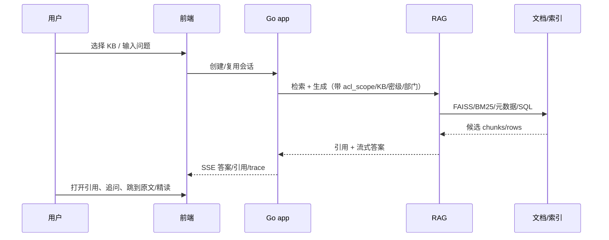

# 问答与引用

> 状态：当前
> 最后更新：2026-10-26
> 目标读者：部门成员、知识库管理员、部门负责人
> 关联：[知识库与文档管理](知识库与文档管理.md)、[技能与问答注入](技能与问答注入.md)、[RAG 检索与生成](../../../rag/docs/检索与生成.md)

## 1. 为什么需要

企业问答不是“接一个模型回答”：

- 回答必须基于公司文档，而不是模型记忆。
- 部门、共享、ACL、密级必须进入检索范围；不能先答再过滤。
- 用户需要知道答案依据哪份文档、哪一段；不能只给结论。
- 多轮追问、指代、时间限定、数值计算需要稳定处理。

问答与引用要解决的是“在权限范围内，用可追溯的证据回答问题”。它不负责文档上传/入库，也不负责 CR 修改。

## 2. 谁在什么场景用

| 角色 | 场景 |
|---|---|
| manager / knowledge_admin / editor / viewer | 本部门 KB 问答、共享入 KB 问答、追问、查看引用 |
| 部门负责人 | 查看高频问题/阅读使用情况（聚合，不展示原始问题） |
| company_admin | 不进入问答；只看治理聚合 |
| system_admin | 不进入业务问答；只维护模型与运行状态 |

前置条件：

- 用户已登录、属于当前部门、对目标 KB 有读权限。
- 目标 KB 已完成解析并可检索；解析失败的文档不作为依据。
- 部门共享入 KB 只读，但可问答；ACL deny 的文档不可进入上下文。

## 3. 用户怎么用

### 3.1 提问

- 新建会话或进入已有会话，选择 KB（共享入 KB 在共享空间/选择器中可见）。
- 输入问题；支持多轮追问。
- 问题改写会保留时间、文号、产品、机构等硬约束；前端可展开查看改写结果。
- 用户可在问答中选择本部门已启用 skill（见[技能与问答注入](技能与问答注入.md)）。

### 3.2 回答

- 答案流式输出；引用先/随答案返回。
- 引用卡展示文档名、章节/片段、文号/机构/日期、生命周期；可跳转原文/引用面板。
- 无可靠证据时明确拒答或说明“未找到”，不编造。
- 多文档/多步问题可展示检索 trace；详细技术细节见 RAG 文档。

### 3.3 追问与引用

- 追问沿用会话上下文；指代消解由 app 侧处理。
- 引用面板可多选文档，跳转“精读这些文档”（详见[交互式精读](交互式精读.md)）。
- 引用统计用于知识库健康度/文档影响力，不暴露用户原始问题文本。

## 4. 业务规则

- **权限**：`acl_scope`、KB 白名单、密级、部门过滤必须进入检索；缺 `acl_scope` fail-closed。
- **共享入**：只读、可问答；不能编辑、不能把正文复制到其他 KB。
- **拒答**：没有证据或问题与业务完全无关时拒答；不能把模型记忆当公司事实。
- **引用**：每条关键结论应能回溯到引用；没有引用的判断不能作为正式结论。
- **时间/文号**：多版本问题必须核对文号/生效时间，不能混用。
- **数值**：求和/百分比必须列算式并自查；资料没有的数不推算。
- **会话**：普通问答和精读会话分开；精读从引用跳转时新建会话，不污染原问答。
- **失败**：RAG/模型不可用时明确失败；不回退到未过滤检索或伪造答案。

## 5. 用完得到什么

- 一个带引用的答案，而不是一段不可验证的文本。
- 引用可定位到文档/章节/原文，支持后续阅读、精读和审计。
- 会话可回看、继续追问；检索 trace 可解释“为什么是这个答案”。
- 部门负责人能从聚合数据看到检索量、无命中、KB 健康，而不是员工原始问题。

## 6. 界面与交互意图

- 对话页：消息流 + 输入区 + 引用面板；回答身份与引用样式统一。
- 引用：悬浮卡/侧栏；显示来源、文号、机构、日期、生命周期；点击跳转。
- 改写：可折叠卡片，显示原句、改写、实体高亮；支持原文重搜/编辑改写。
- trace：检索阶段、候选数、耗时；默认折叠，调试/验收可见。
- 空态/错误态：无 KB、无权限、解析中、无命中、模型失败分别提示。

详细视觉规范见[界面规范](../界面与原型/界面规范.md)。

## 7. 与替代方案对比

| 维度 | 本系统 | 通用聊天机器人 | 通用 RAG 工具 |
|---|---|---|---|
| 权限 | 部门 + KB + ACL + 密级 | 账号级 | 常见为空间级 |
| 引用 | 文档/章节/片段 + 跳转 | 常无或仅链接 | 有 chunk 引用但治理弱 |
| 可追溯 | 会话、引用、检索 trace、审计 | 弱 | 中等 |
| 数据位置 | 本地单租户 | SaaS | 可本地但集成浅 |
| 代价 | 需要语料/索引/权限治理 | 上手快但不可信 | 质量依赖调参 |

## 8. 当前实现与差距

已实现：

- 普通问答、流式 SSE、引用、改写、trace、多轮追问、部门/ACL/密级过滤。
- 共享入 KB 问答；RAG 混合检索/重排/生成；引用可跳转原文。
- 技能注入、会话历史、检索审计（聚合）。

差距/待优化：

- 每 KB 语义缓存（常问知识桶）尚未作为正式能力落地，当前只在规划中。
- 无命中/低置信度的反馈闭环还不完整。
- 引用面板的批量操作、跨文档对比阅读仍依赖精读能力。
- Agent 问答/外部 MCP 的边界与产品入口未完全开放，不作为当前主问答路径。

## 9. 待决问题与验收

- [ ] 无命中时是否提供“放宽范围/换 KB/转人工”的标准动作？
- [ ] 引用多选后进入精读的选择上限/去重规则是否统一？
- [ ] 语义缓存是否进入下一阶段，还是继续只做检索优化？
- [ ] 多轮指代的失败提示和人工纠正入口是否足够清晰？
- [ ] 问答审计是否需要记录更多“答案质量”信号，而不只是检索命中？
