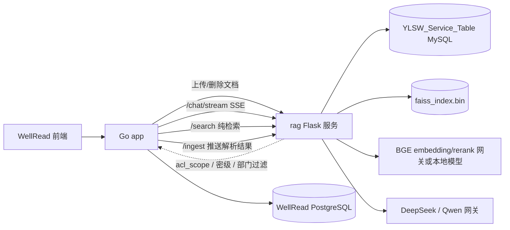

# WellRead RAG 检索引擎

`rag/` 是 WellRead 的检索与生成侧车：接收 Go 后端推送的文档和用户问题，完成分词/规划、多路召回、融合、精排、上下文组装与答案生成。它不管理用户、部门、知识库权限和文档生命周期，这些属于 `app/`。

## 模块生态位



| 层 | 归属 |
|---|---|
| 文档、知识库、成员、部门、ACL、审计 | `app/` |
| 分块、元数据、向量/BM25 索引、检索融合、重排、答案生成 | `rag/` |
| 语料、BGE 模型、FAISS 索引 | 仓库内 `data/rag/`（gitignore） |

## 快速开始

```bash
cd rag
cp .env.example .env
# 填写 MySQL、BGE/DeepSeek 密钥
docker compose up -d --build
curl http://localhost:6151/health
```

不使用 Docker 时：

```bash
python -m venv .venv
source .venv/bin/activate        # Windows: .venv\Scripts\activate
pip install -r requirements.txt
export RAG_DATA_DIR=../data/rag/Data
python src/app.py
```

入口与依赖细节见[配置与运维](docs/配置与运维.md)，服务器部署见[服务器部署](docs/服务器部署.md)。

## 代码地图

| 路径 | 作用 |
|---|---|
| `src/app.py` | Flask API、检索编排、ACL/密级/部门过滤、SSE 输出 |
| `src/retrieval/` | 查询规划、FAISS、BM25、元数据、Text-to-SQL、RRF、精排 |
| `src/ingest/` | 解析、分块、元数据、OCR、摘要、入库管线 |
| `src/llm/` | 提示词组装、答案生成、多步综合、图片描述 |
| `src/prompts/` | 按问题类型加载的提示词模板 |
| `src/config.py` | 环境变量、路径、检索与超时参数 |
| `src/server_bench.py` | 模型/端到端基准脚本 |
| `init.sql` | MySQL 表结构 |
| `entrypoint.sh` | 等 MySQL、建表、入库、建索引、启动 API |
| `test/` | 单元、冒烟、E2E、性能与质量评测 |

## 文档地图

| 文档 | 内容 |
|---|---|
| [系统架构](docs/系统架构.md) | 组件、数据流、部署拓扑、设计取舍 |
| [检索与生成](docs/检索与生成.md) | 规划、四路召回、RRF、精排、上下文、引用 |
| [数据入库与元数据](docs/数据入库与元数据.md) | 解析、分块、元数据、MySQL/FAISS、Text-to-SQL |
| [接口与集成](docs/接口与集成.md) | app → rag 的 API、SSE 事件、鉴权、幂等与对账 |
| [配置与运维](docs/配置与运维.md) | 环境变量、清库重入、索引重建、故障排查 |
| [服务器部署](docs/服务器部署.md) | 服务器拓扑、BGE 混合部署、发布与回滚 |
| [测试与评测](docs/测试与评测.md) | Stage 1/2/3 结果、图表、结论与复现 |

## 测试结果速览

- Stage 1：串行 50 题端到端均值约 3.35s，并发 50 题均值约 3.50s；并发 60 时 QPS 稳定在约 9.8。
- Stage 2：重排后 Recall@10 = 0.936，混合检索 MRR = 0.940；主要短板是相关/不相关区分度（AUC-PR 0.31）。
- Stage 3：修复记录口径正确率 92.5%（111/120），错误 1 道；原始裁判结果 109 正确 / 10 部分 / 1 错误。

完整图表与口径见[测试与评测](docs/测试与评测.md)。

## 边界

- 语料、模型、FAISS 索引不进入仓库，必须通过 `RAG_DATA_DIR` / `LOCAL_MODELS_DIR` 或挂载提供。
- `/chat`、`/chat/stream`、`/search` 都要求 `acl_scope`；缺失直接 400，不会回退到全库检索。
- 服务间鉴权用 `YLSW_ENGINE_TOKEN`；生产环境不要直接暴露 RAG 端口到公网。
- 修改分块或 embedding 来源后必须重建索引；旧 FAISS 向量不会自动删除。
