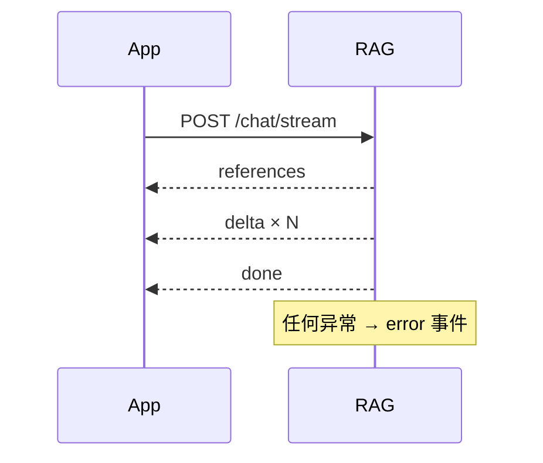
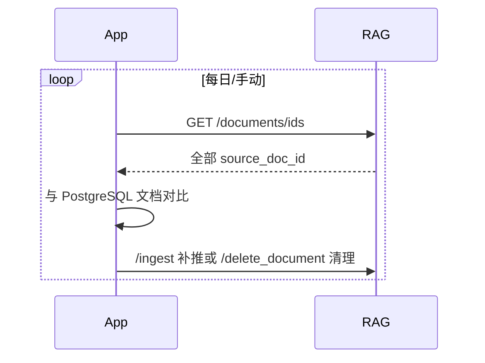

# 接口与集成

本文描述 `app/` 与 `rag/` 之间的接口契约、鉴权、SSE 事件和幂等/对账规则。算法链路见[检索与生成](检索与生成.md)。

## 1. 鉴权

- 配置 `YLSW_ENGINE_TOKEN` 后，除 `/health` 外所有请求必须带 `X-Engine-Token`。
- 缺少或错误返回 401：`{"error":"invalid or missing X-Engine-Token"}`。
- 未配置 token 时跳过校验，仅用于本地开发；生产必须配置。
- RAG 端口不直接暴露公网；app 通过内网/compose 网络访问。

## 2. 接口总览

| 方法 | 路径 | 用途 |
|---|---|---|
| POST | `/chat` | 非流式问答，返回 `{answer}`，可带 `timings`/`trace` |
| POST | `/chat/stream` | SSE 问答，app 融合链路使用 |
| POST | `/search` | 纯检索，无生成，供 Agent `knowledge_search` |
| POST | `/ingest` | app 推送 markdown/xlsx 解析结果 |
| POST | `/delete_document` | 按 app `document_id` 删除文档 |
| GET | `/documents/ids` | 对账：返回全部 `source_doc_id` |
| GET | `/health` | 健康检查 |

## 3. `/chat`

请求：

```json
{
  "question": "跨境支付合规要求是什么？",
  "knowledge_base_ids": ["kb-uuid"],
  "allowed_sensitivities": ["internal"],
  "department": "dept-uuid",
  "acl_scope": {"mode": "allow", "document_ids": ["..."], "scope_version": 1},
  "skill": {"id": "skill-id", "name": "合规问答", "instructions": "按合规审查口径回答"},
  "timing": true,
  "trace": true
}
```

- `question` 必填；空问题返回提示。
- `knowledge_base_id` 与 `knowledge_base_ids` 二选一：单值优先；空表示全库检索（仅限有权限的部署，不建议外部直接调用）。
- `allowed_sensitivities`、`department` 由 app 按角色计算后传入；RAG 不做角色推导。
- `acl_scope` 必填；缺失返回 400，不允许回退全库。
- `skill` 可选，`instructions` 为空时技能注入会被跳过；有效 payload 才会注入提示词。
- `timing`/`trace` 用于评测；生产可关闭。

响应：

```json
{
  "answer": "...",
  "timings": {"规划改写": 800, "精排rerank": 1000, "总计": 3300},
  "trace": {"query_type": "single_doc", "faiss_hits": [], "reranked": []}
}
```

## 4. `/chat/stream`

SSE 事件（每行 `data: {json}`）：

| `type` | 载荷 | 说明 |
|---|---|---|
| `references` | `references: [YLSWReference]` | 检索完成先发 |
| `stage` | `stage/t_ms/counts/detail` | 阶段进度，可选 |
| `delta` | `content` | 答案增量 |
| `done` | `references` | 结束，携带最终引用 |
| `error` | `message` | 错误，终止流 |

`YLSWReference` 包含：`chunk_id`、`app_chunk_id`、`document_id`、`source_doc_id`、`knowledge_base_id`、`file_name`、`doc_number`、`org_name`、`doc_type`、`product_name`、`doc_title`、`content`（≤400 字）、`doc_date`、`lifecycle_status`、`source`。



## 5. `/search`

请求：

```json
{
  "queries": ["问题一", "问题二"],
  "knowledge_base_ids": ["kb-uuid"],
  "top_k": 10,
  "allowed_sensitivities": ["internal"],
  "department": "dept-uuid",
  "acl_scope": {"mode": "all", "scope_version": 1}
}
```

- 纯检索，不生成答案；合并多查询结果并按重排分排序。
- `acl_scope` 缺失或非法时返回 `{"results":[]}` 并记录警告，不执行未过滤检索。
- 返回 `{results:[{chunk_id, document_id, file_name, content, score, rerank_score, org_name, doc_type, product_name, doc_number, doc_date, source}]}`。

## 6. `/ingest`

请求关键字段：

| 字段 | 必填 | 说明 |
|---|---|---|
| `knowledge_base_id` | 是 | app 侧 KB UUID |
| `document_id` | 是 | app 侧文档 UUID，幂等键 |
| `file_name` / `file_type` | 是 | 文件名/类型 |
| `markdown` | 常规文档必填 | 解析后的正文 |
| `file_bytes` | xlsx 可用 | base64 原始文件，缺则回退 markdown |
| `doc_number` / `org_name` / `doc_date` / `doc_title` / `doc_type` / `product_name` | 否 | 元数据 |
| `lifecycle_status` / `effective_date` / `expiry_date` / `superseded_by` / `sensitivity` / `department` | 否 | 企业级元数据 |
| `chunks` | 否 | app 已有 chunk 映射 |
| `custom_metadata` | 否 | 受控 KV |

返回 `{status, document_id, ...}`；失败返回 500 和错误信息。重复推送同一 `document_id` 会删旧重建。

## 7. 删除与对账

### `/delete_document`

```json
{"document_id": "app-doc-uuid"}
```

返回 `{"deleted":1,"document_id":"..."}` 或 `deleted:0`。级联清 MySQL；FAISS 残留由检索过滤，物理清理用 `rebuild_faiss.py`。

### `/documents/ids`

返回 `{"ids":["app-doc-uuid", ...]}`，供 app 做双向对账：app 侧有而 RAG 无 → 重新推送；RAG 有而 app 无 → 删除。



## 8. 错误语义

| HTTP | 场景 |
|---|---|
| 400 | `acl_scope` 缺失/非法、必填字段缺失、base64 解码失败 |
| 401 | `X-Engine-Token` 缺失/错误 |
| 500 | 入库、解析、索引或生成异常 |
| 200 + 空结果 | 检索无命中；不是错误 |

检索/生成超时不返回统一业务码；调用方应结合 HTTP 状态、`error` 事件和超时预算处理。

## 9. 超时预算

配置默认面向 30s 作答硬约束：

| 阶段 | 超时 |
|---|---|
| Planner 快试/救援 | 5s / 5s |
| Rerank | 5s |
| Generate | 20s |
| Keepalive | 480s 间隔 |

Planner 挂起回退类1检索；精排挂起回退 RRF；生成超时该题失败。详见[配置与运维](配置与运维.md)。

## 10. 安全要点

- `acl_scope`、密级、部门过滤必须在检索分支和融合后各校验一次。
- 不允许因前端未传 `acl_scope` 而回退全库。
- API 只暴露给 app 内网；引擎 token 不进前端。
- `/ingest` 的 `knowledge_base_id`/`document_id` 由 app 生成，RAG 不信任客户端任意值做越权写入。
