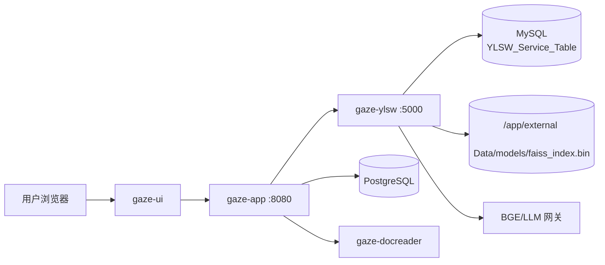

# 服务器部署

本文是 RAG 在服务器上的发布手册，覆盖依赖、目录、启动、BGE 混合配置、验收和回滚。日常维护见[配置与运维](配置与运维.md)。

## 1. 部署拓扑



app 栈内 `ylsw` 是检索侧车。独立部署时 RAG 自带 MySQL 容器，端口默认 6151。

## 2. 前置条件

- Docker Engine + Compose 插件。
- 可用的 MySQL 8（独立容器或外部实例）。
- 本地数据目录：语料、BGE 模型、可写索引目录。
- 网关访问：BGE embedding/rerank、DeepSeek、Qwen（按启用项）。
- 足够的磁盘与内存；本地 BGE 需要模型文件和 CPU 线程预算。

## 3. 推荐部署方式：从仓库构建

```bash
git clone <repo> WellRead
cd WellRead
cp deployments/.env.example deployments/.env
# 填写 DB、YLSW_MYSQL_*、BGE/LLM key

mkdir -p data/rag/{Data,models}
# 放入语料与 bge-m3 / bge-reranker-v2-m3

docker compose -f deployments/docker-compose.yml up -d --build
```

app 栈会把 `../data/rag` 挂载到 ylsw 容器的 `/app/external`，并设置：

```text
RAG_DATA_DIR=/app/external/Data
LOCAL_MODELS_DIR=/app/external/models
RUN_OFFLINE_INGEST=0
```

文档由 app 上传后通过 `/ingest` 推送，不跑离线全量摄取。

## 4. 独立 RAG 栈部署

适合只发布 RAG 或对接已有 MySQL。

```bash
cd rag
cp .env.example .env
# MYSQL_PASSWORD、BGE/LLM、RERANK/生成超时
docker compose -f docker-compose.yml -f docker-compose.local.yml up -d --build
```

独立栈默认 `RUN_OFFLINE_INGEST=1`，启动时会扫描 `RAG_DATA_DIR` 做幂等摄取。

## 5. 外部目录与权限

```text
data/rag/
├── Data/                 # 只读语料
├── models/               # 只读模型
└── faiss_index.bin       # 可写；容器需要创建/更新
```

- 语料和模型可以只读挂载；索引目录必须可写。
- 不要让整个仓库或宿主根目录进入容器。
- FAISS 对中文路径敏感，优先使用 ASCII 路径或容器内路径。

## 6. BGE 混合部署

推荐配置：

```dotenv
BGE_EMBED_BACKEND=local
BGE_RERANK_BACKEND=gateway
LOCAL_MODEL_THREADS=24
```

- 本地 embedding：编码约 73–87ms，省网关往返。
- 网关 rerank：本地 reranker 实测延迟不达标，生产走网关。
- 切换 embedding 来源后必须清库并重建 `faiss_index.bin`；本地与网关向量不同源。

30s 作答硬约束下的超时预算：

```dotenv
PLANNER_TIMEOUT=5
PLANNER_LONG_TIMEOUT=5
RERANK_TIMEOUT=5
GENERATE_TIMEOUT=20
KEEPALIVE_INTERVAL=480
```

## 7. 发布后验收

```bash
curl http://localhost:6151/health
docker logs -f <rag-container>
```

检查：

- 启动日志：MySQL ready、建表、ingest 幂等、FAISS 索引就绪、API 启动。
- `documents.parse_status` 全部 success。
- `chunks.status` 中 child 全部 embedded。
- `faiss_index.bin` 存在且大小合理。
- app 侧问答可用，引用有文件名/文号。

端到端延迟：

```bash
python src/server_bench.py e2e
# 或在容器内
docker exec <rag-container> python -u src/server_bench.py e2e
```

重点看精排约 1s、编码无网关调用、总耗时在预算内。

## 8. 更新发布

```bash
# 拉代码/构建新镜像
docker compose -f deployments/docker-compose.yml build ylsw
docker compose -f deployments/docker-compose.yml up -d --force-recreate ylsw
```

`restart` 不会换镜像；改代码必须 build + force-recreate。重建后观察 entrypoint 是否触发索引自愈。

## 9. 回滚

- 镜像回滚：切回上一个 `gaze-ylsw:<tag>`，`force-recreate`。
- embedding 回滚：改回 `BGE_EMBED_BACKEND=gateway`，清空索引并重建，否则向量不同源。
- 数据回滚：同时恢复 MySQL 备份与对应 `faiss_index.bin`；只回滚其中一个会错位。

## 10. 验收清单

- [ ] `/health` 返回 200。
- [ ] app → RAG `/chat/stream` 正常，引用完整。
- [ ] `/search` 支持多 query + KB 白名单。
- [ ] `/ingest` 幂等，重复推送不重复。
- [ ] `/delete_document` 后检索不再返回。
- [ ] FAISS 索引可持久化，容器重建不丢。
- [ ] 30s 预算内完成典型单步/多步问题。
- [ ] 引擎 token 已配置，RAG 端口未直接暴露公网。

## 11. 常见部署问题

| 问题 | 处理 |
|---|---|
| 容器起不来 | 先看 `MYSQL_PASSWORD`、MySQL 连通性、`init.sql` 日志 |
| 索引丢失 | 检查 `data/rag` 挂载和写权限 |
| 本地模型加载失败 | 检查 `LOCAL_MODELS_DIR` 与模型目录结构 |
| 本地编码很慢 | 检查 `LOCAL_MODEL_THREADS` 与 CPU 配额；共享宿主机勿拉满 |
| 网关冷启动超时 | keepalive 是否开启；首问前预热 |
| 发布后仍旧代码 | `restart` 不换镜像；必须 build + force-recreate |
| 端口冲突 | 清理旧容器/孤儿 docker-proxy；确认 6151/6152 或 5000 映射 |
