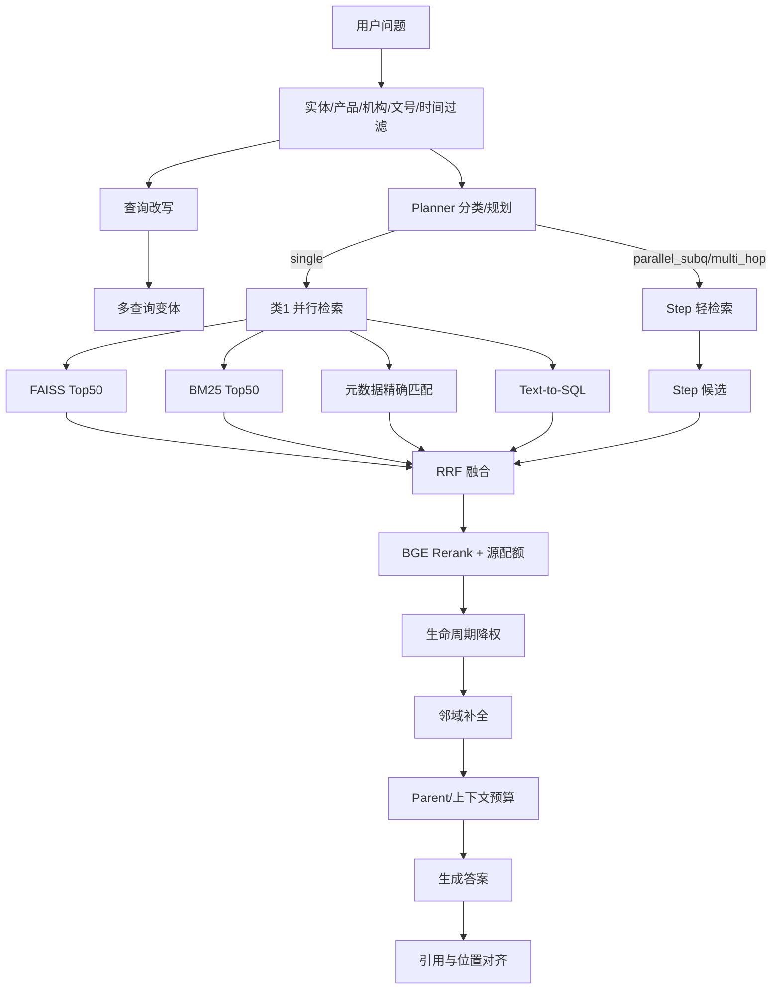

# 检索与生成

本文描述从用户问题到答案引用的完整链路：规划、四路召回、融合、精排、上下文组装、生成。系统组件见[系统架构](系统架构.md)，评测数据见[测试与评测](测试与评测.md)。

## 1. 总体链路

## 2. 查询理解

### 2.1 实体与过滤

`query_filter.py` 从问题中抽取：

- 产品/机构/文号/时间/表名/字段名等实体。
- 业务问题命中已知产品/机构时，可覆盖 LLM 的误拒答。
- 时间限定与文号是强约束，规划改写必须保留。

### 2.2 规划器

`planner.py` 将问题分类为：

| 类型 | 处理 |
|---|---|
| `single` | 单步问题，类1完整并行检索；可生成多查询变体 |
| `parallel_subq` | 多个子问题并行检索，最后综合 |
| `multi_hop` | 串行多跳，前一步结果作为后一步上下文 |

规划器输出 JSON，经 `_validate_plan` 校验；LLM 超时或非法 JSON 回退类1检索。`generate_query_variants` 生成 2~3 条语义变体，扩大召回面。

### 2.3 异常问题

- 提示词注入/明显无关问题可拒答。
- 闲聊判定放行到正常管线，检索为空时由生成层空上下文文案兜底。
- 拒答不进入检索，响应固定拒答文案。

## 3. 四路召回

### FAISS 向量路

- BGE-M3 embedding，1024 维截断到 768 维。
- HNSW：`M=32`，`ef_search=192`，Top K=50。
- 多查询变体分别检索后合并。
- embedding 可走网关或本地模型；切换来源必须重建索引。

### BM25 关键字路

- jieba 分词 + BM25Okapi，`k1=1.5`、`b=0.75`。
- 文号、版本、产品名等 token 有保护/加权。
- 与 FAISS 对称 Top K=50。

### 元数据路

- 按文号、机构、产品、文档类型、标题等精确/模糊匹配。
- 元数据命中是强信号，但精排分数低于 `RERANK_META_MIN_SCORE` 时不强制占源配额。
- 修复记录中曾出现 `_light_retrieve` 丢弃 metadata bucket 导致“有答案却未找到”，现已放行。

### Text-to-SQL 路

- 识别结构化表/数值问题，走模板或 LLM 生成 SQL。
- SQL 必须带 `knowledge_base_id` 行级条件，禁止跨 KB。
- 计数题优先 `_try_count_template`，再走 DISTINCT 模板。
- SQL 结果候选 `chunk_id=-1`，合并去重时带 step id，避免多条查询结果互相覆盖。

## 4. RRF 融合

- 四路候选去重后按 RRF（`k=60`）融合。
- 保留来源标记，重排按源配额分配候选。
- 类1并行路径在融合前对 FAISS/BM25/Meta 各分支做 ACL 过滤，避免被拒文档贡献分数；规划路径在合并后过滤。融合后统一按 KB、ACL、密级、部门再过滤，精排后和邻域补全后再复核一次。
- `_select_diverse` 控制同文档/相邻 chunk 过度聚集。

## 5. 精排

- BGE-Reranker 对候选打分；每源最多 `RERANK_MAX_CANDIDATES_PER_SOURCE=100`。
- 最终取 `FINAL_TOP_K=10`，并留补位余量。
- 多步题对原问题和各 step query 多路打分取最大值，防止第二问被稀释。
- `RERANK_SKIP_SINGLE=1` 可对单步题跳过精排 API，用于 A/B。
- 精排超时/失败回退 RRF 顺序。

Stage 2 数据显示精排的主要价值是“把正确文档压进 Top-3”：K=3 召回从 0.723 提升到 0.872（+14.9pp），但 K=1 首位命中略降（0.681→0.660），平均排名从 2.61 前移到 1.64。详见[测试与评测](测试与评测.md)。

## 6. 生命周期与上下文

### 生命周期

- `lifecycle_status`、`effective_date`、`expiry_date` 在精排后调整：废止文档降权，时间敏感问题优先有效版本。
- 生成提示词要求多版本逐份核对文号/时间，不能混用。

### 邻域补全

- 入选 chunk 的同文档相邻块（默认 ±2）若被精排裁掉，按融合顺序补入尾部。
- 法规条款、补贴标准等细节题的正确答案通常与已选 chunk 相邻。

### Parent 上下文

- child 负责召回，parent（约 1200 token）负责生成上下文。
- `_assemble_contexts` 按字符预算装配，跳过与已选 parent 重叠的 child。
- 数据查询类问题 SQL 命中时上下文收紧到 `SQL_CONTEXT_CAP=4`，减少噪声。
- 多步题可前置文档摘要（`doc_summary`），控制 prompt 体积。

## 7. 生成

`generator.py` 负责：

- 按问题类型选择提示词（`src/prompts/*.json`）。
- 注入业务规则：拒答、时间核对、数值计算、字段/表格、结论自查。
- 数值题必须列完整算式，禁止心算；多版本题必须核对文号/生效时间。
- 多步题用 `generate_synthesis_answer` 汇总各步中间答案。

关键规则：

- 参考资料与问题存在实体重叠时必须作答；只有主题完全无关才拒答。
- 资料给出的分量求和/求差属于应做计算，不是凭空推算。
- 结论必须能从依据直接推出，避免“结论与论据矛盾”。

## 8. 引用

`_build_refs` 将精排结果转成 app 期望的引用结构：

- `chunk_id` 字符串化，附 `source_chunk_id`/`source_doc_id`。
- 文件、文号、机构、类型、产品、日期、生命周期。
- 正文摘要最多 400 字，供前端引用卡悬浮展示。
- SQL 候选没有文档元数据，跳过引用。
- app 侧可进一步做引用位置对齐和高亮。

## 9. 参数与调优

| 参数 | 默认 | 作用 |
|---|---|---|
| `FAISS_TOP_K` | 50 | 向量路候选 |
| `BM25_TOP_K` | 50 | 词法路候选 |
| `RRF_K` | 60 | RRF 融合常数 |
| `FINAL_TOP_K` | 10 | 送入 LLM 的 chunk 数 |
| `RERANK_MAX_CANDIDATES_PER_SOURCE` | 100 | 每源精排候选上限 |
| `RERANK_META_MIN_SCORE` | 0.1 | 元数据源最低精排分 |
| `CHILD_CHUNK_SIZE` / `PARENT_CHUNK_SIZE` | 300 / 1200 | 分块粒度 |
| `CHUNK_OVERLAP` | 128 | 固定窗口重叠 |
| `SQL_CONTEXT_CAP` | 4 | SQL 题上下文上限 |
| `PLANNER_TIMEOUT` / `RERANK_TIMEOUT` / `GENERATE_TIMEOUT` | 5 / 5 / 20s | 30s 预算分段 |

## 10. 失败模式

| 现象 | 根因 | 表现/处理 |
|---|---|---|
| 有答案却“未找到” | 拒答条件过松、候选 bucket 被丢 | 收紧/放宽提示词；planner 放行 metadata |
| 多版本文号混用 | 时间/文号未保留 | 规划规则 + 生成时间核对 |
| 求和错误 | LLM 心算 | 强制列算式、代回自查 |
| SQL 结果互相覆盖 | `chunk_id=-1` 去重键冲突 | 带 step id 合并 |
| 精排后首位下降 | 元数据强候选被其他高分取代 | 接受 K=3+ 增益，K=1 用融合结果兜底 |
| 指代消解失败 | “该机构/这家公司”丢失主体 | 后续可在规划器做指代回填 |
