# 测试与评测

本文汇总 RAG 的测试体系与历史评测结果。数据与脚本都在 `rag/test/`；图表路径相对本文为 `../test/...`。

## 1. 测试体系

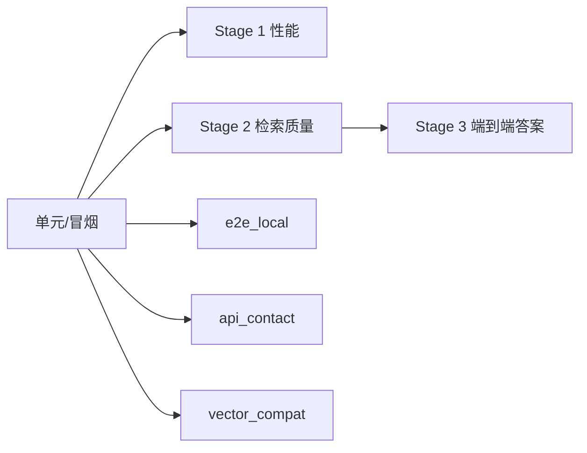

| 类别 | 文件 | 作用 |
|---|---|---|
| 冒烟 | `test/smoke_local.py` | 本机依赖/模型/服务快速检查 |
| 端到端 | `test/e2e_local.py` | 本机 venv + MySQL + 服务，11 项接口/检索/SQL 回归 |
| 接口契约 | `test/api_contact/test_api.py` | HTTP 接口连通与响应 |
| 向量兼容 | `test/vector_compat.py` | embedding 维度/索引一致性 |
| 数据准备 | `test/produce_question/` | 120 题测试集与文档 chunk 清单 |
| Stage 1 | `test/Stage_1/` | 延迟、吞吐、阶段耗时 |
| Stage 2 | `test/Stage_2/` | Recall/排序/区分度/分块/噪声 |
| Stage 3 | `test/Stage_3/` | 120 题端到端答案评测与修复记录 |

## 2. 复现方式

```bash
cd rag
python -m venv .venv
source .venv/bin/activate
pip install -r requirements.txt

# 本机服务 + MySQL 后
python test/smoke_local.py
python test/e2e_local.py
python test/api_contact/test_api.py
```

Stage 1/2/3 脚本依赖真实服务和测试数据，运行前需确认：

- `RAG_DATA_DIR` 指向语料。
- MySQL 可连接。
- BGE/LLM 网关 key 可用。
- `test/produce_question/qa_testset_120.json` 与 `doc_chunk_inventory.json` 完整。

历史评测结果来自 2026-09 的本机/服务环境；更换模型、语料、分块或索引后应重跑，不要直接沿用。

## 3. Stage 1：性能与吞吐

50 题串行/并发测试；数据在 `test/Stage_1/*.json`。

### 串行端到端（50 题）

| 指标 | 值 |
|---|---:|
| 均值 | 3354.9 ms |
| 中位数 | 3439.1 ms |
| P95 | 4937.3 ms |
| 最大 | 5811.6 ms |

阶段均值（ms）：

| 阶段 | 均值 |
|---|---:|
| 规划改写 | 838.0 |
| FAISS/BM25/Meta | 151.4（并行分支） |
| SQL | 189.1 |
| RRF 融合 | 312.2 |
| 精排 rerank | 1066.4 |
| LLM 生成 | 929.5 |
| 首 token | 568.2 |

### 并发端到端（50 题）

| 指标 | 值 |
|---|---:|
| 均值 | 3497.4 ms |
| P95 | 5698.7 ms |
| 最大 | 10198.3 ms |

### 吞吐

| 并发 | QPS | 平均延迟 | P95 |
|---:|---:|---:|---:|
| 10 | 3.00 | 3427.7 ms | 5139.7 ms |
| 20 | 6.43 | 3193.4 ms | 4958.0 ms |
| 30 | 8.37 | 3684.9 ms | 5953.6 ms |
| 40 | 9.38 | 4441.1 ms | 7044.5 ms |
| 60 | 9.80 | 6425.5 ms | 10557.2 ms |
| 80 | 9.75 | 8684.1 ms | 14024.9 ms |
| 100 | 9.65 | 11112.9 ms | 16590.8 ms |

结论：QPS 在并发 60 左右达到平台（~9.8），继续加并发只增加排队延迟；错误率全程 0%。

### 图表

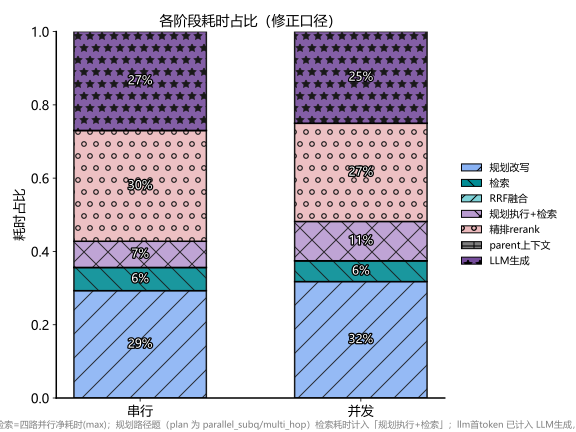

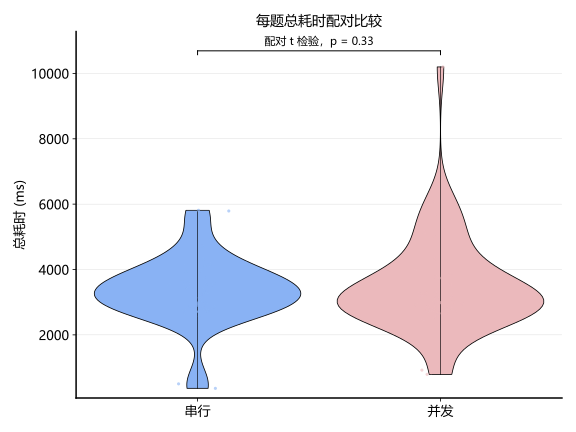

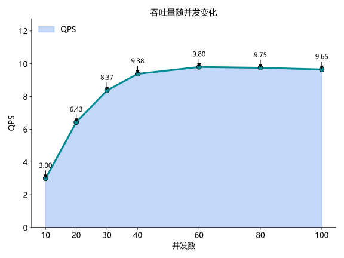

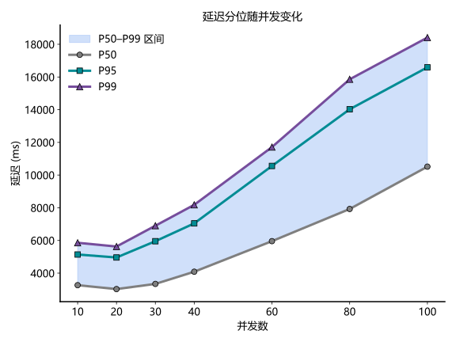

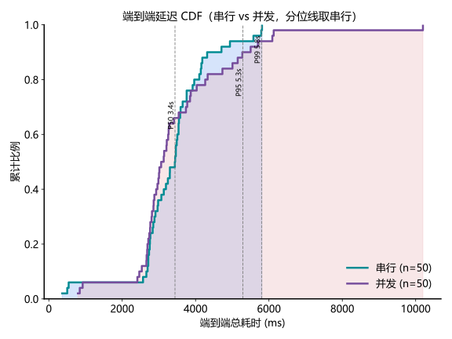

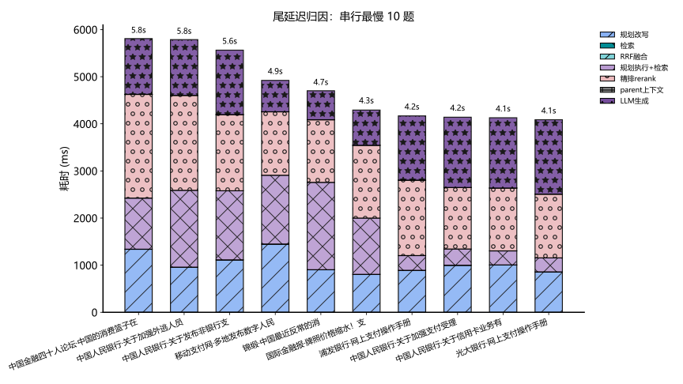

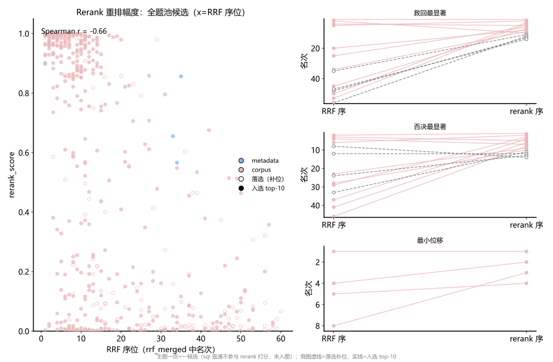

## 4. Stage 2：检索质量

47 题（单文档 30、多文档 12、数值 5）；[Stage 2 原始总结](../test/Stage_2/SUMMARY.md) 保留了当时的口径，本文使用实际 JSON 与现有图表文件。

### Recall@K

| K | RRF 融合后 | 重排后 |
|---:|---:|---:|
| 1 | 0.6809 | 0.6596 |
| 3 | 0.7234 | 0.8723 |
| 5 | 0.7447 | 0.8936 |
| 8 | 0.7872 | 0.9149 |
| 10 | 0.8936 | 0.9362 |
| 15 | 0.9149 | 0.9362 |
| 20 | 0.9362 | 0.9362 |

- 重排在 K=3 带来 +14.9pp；K=1 略降，因为元数据强候选被其他高分候选取代。
- 工程建议：送 LLM 的 `FINAL_TOP_K=10` 合理。

### 排序质量

62 个正确文档中 59 个进入重排候选：排名 ≤1 占 69.4%，≤2 占 85.5%，≤3 占 88.7%，≤5 占 90.3%，中位排名 1。

### 区分度

重排候选相关 244 / 不相关 306，AUC-PR = **0.3124**。相关与不相关分数重叠明显，是当前主要优化点。

### 分块矩阵

| Size | Overlap | Recall@10 |
|---:|---:|---:|
| 300 | 128 | 0.8936（基线） |
| 500 | 128 | 0.9149 |
| 300 | 256 | 0.8723 |
| 500 | 256 | 0.9149 |

500/128 或 500/256 最优；overlap 增大到 256 无额外收益。当前基线 300/128 已接近最优。

### 噪声鲁棒性

10 题变体，Recall@5：

| 变体 | Recall@5 | 衰减 |
|---|---:|---:|
| 标准 | 1.000 | — |
| 错别字 | 1.000 | 0 |
| 口语化 | 1.000 | 0 |
| 截断 | 1.000 | 0 |
| 指代 | 0.900 | -0.10 |

错别字/口语化/截断零衰减；指代消解是唯一短板。

### 三策略 MRR

| 策略 | 平均 RR |
|---|---:|
| BM25 | 0.532 |
| 向量 | 0.521 |
| 混合 + 重排 | 0.940 |

单路都不稳定，混合 + 重排是质量支柱。

### 图表


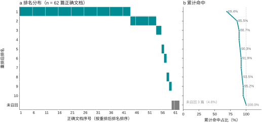

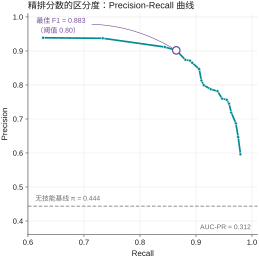

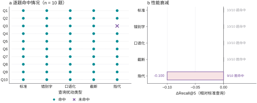


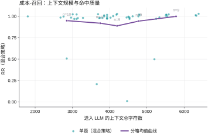

数据文件：`recall_at_k.json`、`rank_distribution.json`、`pr_curve.json`、`chunk_matrix.json`、`noise_decay.json`、`mrr.json`、`rank_migration.json`、`traces_47.json`。

## 5. Stage 3：端到端答案

120 题：单文档 72、多文档并行 12、多文档串行 12、数值计算 12、提示词注入 4、SQL 注入 4、闲聊 4。

### 修复前后

| 题型 | 修复前 | 修复后 |
|---|---:|---:|
| 单文档 | 93% | 97% |
| 多文档-并行 | 67% | 67%（0 错误，4 部分） |
| 多文档-串行 | 75% | 83% |
| 数值计算 | 58% | 92% |
| 安全类 | 100% | 100% |

`test/Stage_3/fix_report.md` 记录：整体正确率 86% → **92.5%**（103 → 111/120），错误 9 → 1，部分正确 8，含部分正确 99%。

原始裁判文件 `answer_judge_result.json` 的计数为 109 正确 / 10 部分 / 1 错误；与修复记录的 111/8 存在人工复核/二轮修复口径差异，引用时需注明来源。

详细记录：[fix_report](../test/Stage_3/fix_report.md)、[wrong_cases](../test/Stage_3/wrong_cases.md)、[full_eval_result](../test/Stage_3/full_eval_result.json)、[answer_judge_result](../test/Stage_3/answer_judge_result.json)。

### 修复主题

- 拒答条件过松 → 主题完全无关才拒答。
- planner 丢弃 metadata bucket → 放行。
- 时间/文号未保留 → 规划与生成双重约束。
- 数值心算 → 强制列算式、代回自查。
- Excel 计数/DISTINCT 模板 → 计数模板优先、SQL 结果去重键修复。
- 多文档候选被挤出 top-K → 保序去重、邻域扩展、扩大 planner 轻检索规模。

### 剩余问题

- 1 道错误：商圈魔盒题编造参考未提及的服务。
- 8 道部分正确：编造补充信息、覆盖不全、时点表述、求和尾差。
- 详见 `test/Stage_3/wrong_cases.md`。

## 6. 总体结论

- 性能：单问约 3.3–3.5s；并发 60 时 QPS ~9.8；精排约占端到端 1/4–1/3。
- 检索：R@10 0.936，混合 MRR 0.940；重排对 Top-3 增益最大。
- 质量：修复记录正确率 92.5%；数值计算提升最明显。
- 主要短板：相关/不相关区分度（AUC-PR 0.31）、指代消解、少量编造/覆盖不全。
- 工程建议：优先优化 rerank 阈值/二次校验，保持混合检索不降级；任何分块/embedding 变更后重跑 Stage 2/3。
