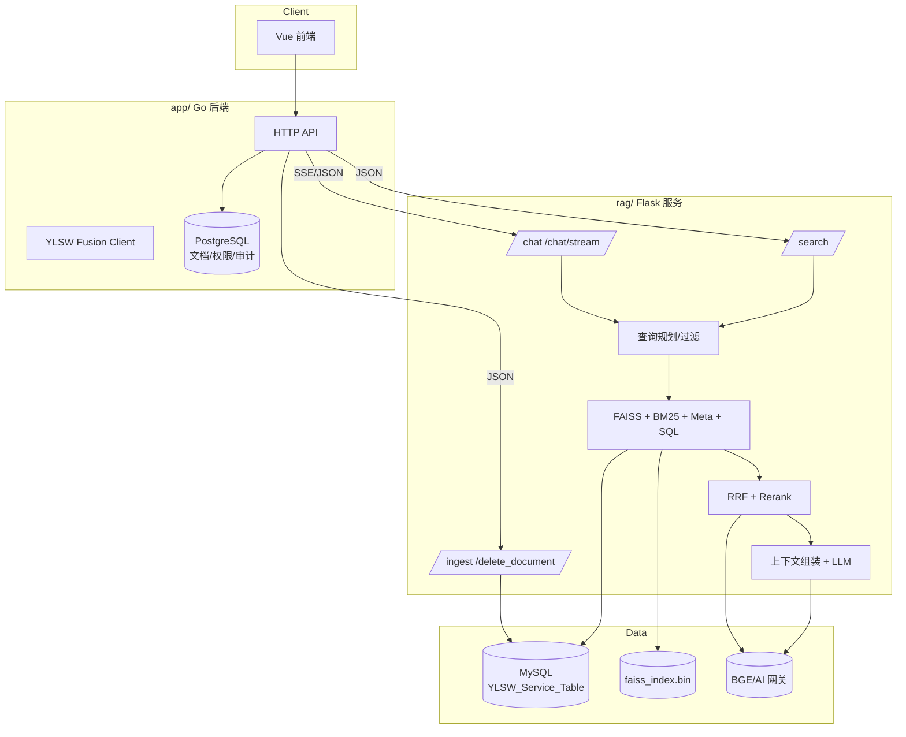
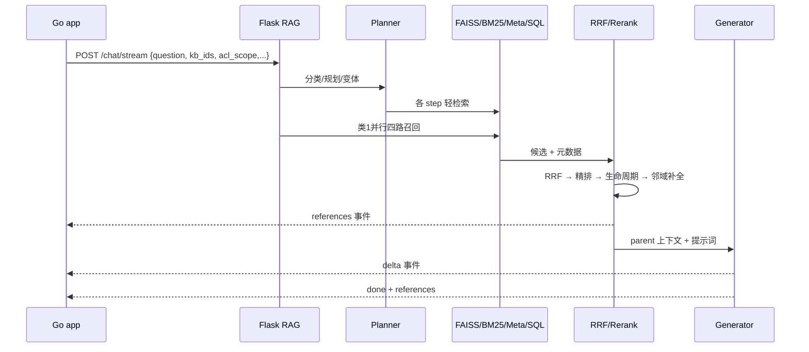
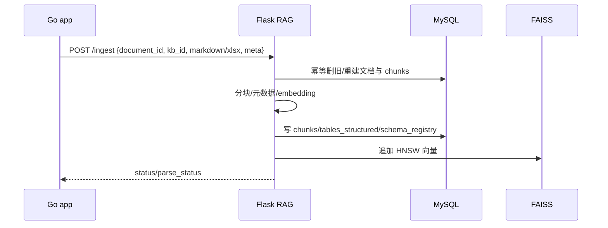

# 系统架构

本文描述 RAG 服务的定位、运行时组件、数据流和关键设计取舍。检索算法细节见[检索与生成](检索与生成.md)，入库细节见[数据入库与元数据](数据入库与元数据.md)。

## 1. 定位与边界

RAG 是 WellRead 的**检索与生成侧车**，不是文档管理系统。

| 关注点 | 归属 |
|---|---|
| 用户、部门、知识库、文档生命周期、共享、ACL、审计 | `app/`（Go） |
| 解析结果接收、分块、索引、召回、重排、生成、引用 | `rag/` |
| 语料、模型权重、FAISS 索引 | 仓库内 `data/rag/`（gitignore） |

`app/` 在推送文档时传入 `knowledge_base_id`、`document_id` 和权限过滤上下文；RAG 只负责在给定范围内检索，不自行判断员工角色。

## 2. 运行时拓扑

部署时 RAG 与 app、MySQL、docreader 同属本地栈；也可以单独用 `rag/docker-compose.yml` 起 RAG + MySQL。

## 3. 代码组件

| 文件/目录 | 职责 |
|---|---|
| `src/app.py` | Flask 路由、查询编排、ACL/密级/部门过滤、SSE、产品提及刷新 |
| `src/config.py` | 环境变量、外部路径、检索参数、超时预算 |
| `src/retrieval/planner.py` | 问题分类、单步/并行/多跳规划、变体生成、轻检索 |
| `src/retrieval/query_filter.py` | 实体、产品、机构、文号、时间等查询特征抽取 |
| `src/retrieval/query_rewriter.py` | 查询改写与实体覆盖 |
| `src/retrieval/faiss_search.py` | BGE embedding、HNSW 向量检索 |
| `src/retrieval/bm25_search.py` | jieba 分词、BM25 关键字检索 |
| `src/retrieval/fusion.py` | RRF 融合、去重/多样性、精排与源配额 |
| `src/retrieval/text_to_sql.py` | 结构化表识别、SQL 模板/LLM 生成、行级 KB 过滤 |
| `src/retrieval/chunk_store.py` | 内存 chunk/文档元数据映射、BM25 语料 |
| `src/llm/generator.py` | 提示词组装、答案生成、多步综合、数值/时间规则 |
| `src/ingest/` | 解析、分块、元数据、OCR、图片描述、入库、索引构建 |
| `src/models_singleton.py` | BGE/本地模型单例 |
| `src/prompt_guard.py` | 提示词注入防护 |
| `src/trace_logging.py` | 检索链 trace |
| `entrypoint.sh` | 容器启动管线：等 MySQL → 建表 → ingest → 建索引 → API |

## 4. 数据存储

### MySQL（RAG 自有）

| 表 | 用途 |
|---|---|
| `documents` | 文档元数据、生命周期、密级、部门、解析状态、摘要 |
| `chunks` | child/parent chunk、FAISS `vector_id`、反范式过滤字段 |
| `tables_structured` | xlsx/PDF 表格行数据，Text-to-SQL 使用 |
| `schema_registry` | 表/列/类型/示例值/别名，供 SQL 路由 |
| `parse_log` | 解析、分块、嵌入、索引阶段日志 |
| `product_mentions` | 产品提及倒排，实体覆盖与召回辅助 |

### FAISS

- HNSW，768 维（BGE-M3 1024 维截断）。
- `faiss_index.bin` 是运行时文件，放仓库内 `data/rag` 数据目录；容器内挂载到 `/app/external`。
- 删除文档时 HNSW 向量不物理删除，靠 `vector_id` 映射和重建清理。

### 内存态

启动时加载 chunk 文本、文档元数据、BM25 语料和产品提及；`/ingest`、`/delete_document` 或重嵌后会重载/重建内存镜像。

## 5. 请求生命周期

### 问答

### 入库

## 6. 失败与降级

- `acl_scope` 缺失：`/chat`、`/chat/stream`、`/search` 直接拒绝，不回退全库。
- planner LLM 超时/异常：回退类1完整并行检索；规划器多跳失败时不强行编造。
- 批量 embedding 失败：逐条回退；失败的 chunk 状态保留为 pending，由重嵌 daemon 重试。
- 精排失败/超时：回退 RRF 顺序，不阻断问答。
- 生成失败：该题失败，没有规则兜底答案。
- 文档删除后 FAISS 残留：检索层通过映射过滤，`rebuild_faiss.py` 物理重建。
- 发送端中断：SSE 流结束，worker 线程不继续写结果。

## 7. 可观测性

- 响应 `timing: true` 返回各阶段耗时（规划、FAISS、BM25、Meta、SQL、RRF、精排、LLM 首 token、总计）。
- 响应 `trace: true` 返回检索链中间候选，评测脚本依赖该字段。
- 日志包含 kb_ids、规划改写、各路候选数量、精排 top、引用文件。
- `/health` 只返回 `{"status":"ok"}`，容器健康检查使用。
- `src/server_bench.py` 提供模型和端到端基准命令。

## 8. 关键设计取舍

| 选择 | 原因 | 代价 |
|---|---|---|
| RAG 独立 MySQL，而非直接读 app PG | 检索字段/反范式/FAISS 映射与业务库解耦 | 需要 `/ingest` 同步与对账 |
| `knowledge_base_id` 反范式到 chunks | 检索过滤免 JOIN，支持多 KB 白名单 | 文档换 KB 时需要重建/迁移 |
| Parent-Child chunk | child 精准召回，parent 提供上下文 | 存储和上下文预算更高 |
| 多路召回 + RRF + 精排 | 单一召回不稳定；Stage 2 显示混合 MRR 0.94 | 精排延迟约 1s |
| 本地数据目录 | 语料/模型/索引体积大，不进入 git/镜像 | 部署必须正确挂载 |
| SSE 聚合后交给 MCP/客户端 | 与 app 流式协议对齐 | MCP 侧不是增量输出 |
