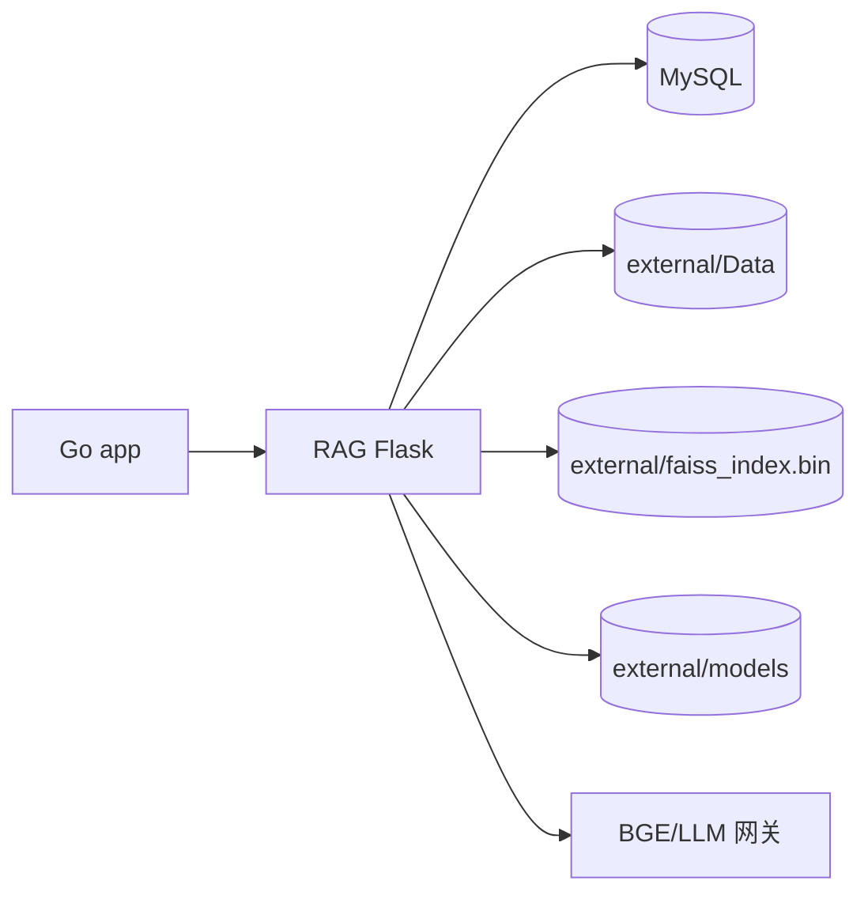

# 配置与运维

本文覆盖 RAG 的环境变量、本地数据、启动管线、清库重建、索引维护和故障排查。服务器发布流程见[服务器部署](服务器部署.md)。

## 1. 运行形态

RAG 是 Flask 服务，通常作为 app 栈的 `ylsw` 侧车运行：

- app 通过 `/chat/stream`、`/search`、`/ingest` 调用。
- MySQL 保存文档/chunk/表格/schema，FAISS 保存向量索引。
- 语料、模型、索引都在仓库内 `data/rag/`（从 `rag/` 看是 `../data/rag/`）。



## 2. 配置来源

`src/config.py` 启动时读取 `rag/.env`，已存在的环境变量优先。生产由 compose `env_file` 注入。

### 核心连接

| 变量 | 默认 | 说明 |
|---|---|---|
| `MYSQL_HOST` / `MYSQL_PORT` | `localhost` / `3306` | RAG MySQL |
| `MYSQL_USER` / `MYSQL_PASSWORD` | `root` / 空 | 必须由 env 提供密码 |
| `MYSQL_DATABASE` | `YLSW_Service_Table` | 库名 |
| `PORT` | `6151` | Flask 端口 |
| `YLSW_ENGINE_TOKEN` | 空 | app→RAG 共享密钥，生产必填 |
| `RAG_DATA_DIR` | `rag/Data` | 本地语料目录 |
| `LOCAL_MODELS_DIR` | `rag/models` | 本地 BGE 模型目录 |

### Embedding / Rerank

| 变量 | 默认 | 说明 |
|---|---|---|
| `BGE_EMBEDDING_URL` / `BGE_API_KEY` | 网关 | BGE embedding |
| `BGE_RERANKER_URL` | 网关 | BGE reranker |
| `BGE_EMBED_BACKEND` | `gateway` | `gateway` / `local` |
| `BGE_RERANK_BACKEND` | `gateway` | 建议 `gateway` |
| `LOCAL_MODEL_THREADS` | `24` | 本地编码线程；共享宿主机勿拉满 |

切换 embedding 来源（网关 ↔ 本地）必须重建索引。

### 生成

| 变量 | 默认 | 说明 |
|---|---|---|
| `DEEPSEEK_URL` / `DEEPSEEK_API_KEY` / `DEEPSEEK_MODEL` | 网关 | 通用生成 |
| `QWEN_URL` / `QWEN_API_KEY` / `QWEN_MODEL` | 网关 | 图片/多模态 |
| `LLM_MAX_TOKENS` / `LLM_TEMPERATURE` | 4096 / 0 | 生成参数 |
| `MAX_CONTEXT_CHARS` | 12000 | 上下文预算 |

### 超时与后台任务

| 变量 | 默认 | 说明 |
|---|---|---|
| `PLANNER_TIMEOUT` / `PLANNER_LONG_TIMEOUT` | 5s / 5s | 规划器快试/救援 |
| `RERANK_TIMEOUT` | 5s | 精排挂起回退 RRF |
| `GENERATE_TIMEOUT` | 20s | 生成超时=该题失败 |
| `KEEPALIVE_INTERVAL` | 480s | 网关保温，0=关闭 |
| `REEMBED_INTERVAL_MINUTES` | 30min | pending chunk 重嵌，≤0=关闭 |
| `API_TIMEOUT` / `API_MAX_RETRIES` | 30s / 3 | 外部 API |

### 检索参数

| 变量 | 默认 | 说明 |
|---|---|---|
| `CHILD_CHUNK_SIZE` / `PARENT_CHUNK_SIZE` | 300 / 1200 | 分块 |
| `CHUNK_OVERLAP` | 128 | 重叠 |
| `EMBEDDING_DIM` | 768 | BGE-M3 截断维度 |
| `HNSW_M` / `HNSW_EF_SEARCH` | 32 / 192 | HNSW 参数 |
| `FAISS_TOP_K` / `BM25_TOP_K` | 50 / 50 | 两路候选 |
| `RRF_K` | 60 | RRF |
| `FINAL_TOP_K` | 10 | 送入 LLM |
| `RERANK_MAX_CANDIDATES_PER_SOURCE` | 100 | 每源精排上限 |
| `RERANK_META_MIN_SCORE` | 0.1 | 元数据源最低分 |
| `SQL_CONTEXT_CAP` | 4 | SQL 题上下文 |

## 3. 本地数据目录

仓库不携带语料、模型、索引。推荐结构：

```text
d:/GitHub项目学习/WellRead/data/rag/
├── Data/                 # 语料
├── models/               # bge-m3 / bge-reranker-v2-m3
└── faiss_index.bin       # 运行时索引
```

- app 栈 compose 把该目录挂到 `/app/external`，注入 `RAG_DATA_DIR=/app/external/Data`、`LOCAL_MODELS_DIR=/app/external/models`。
- 独立 `rag/docker-compose.yml` 挂载 `../data/rag:/app/external`。
- 裸机运行在 `rag/` 下设置 `RAG_DATA_DIR=../data/rag/Data`。

## 4. 启动管线

`entrypoint.sh` 每次启动：

1. 等 MySQL 就绪（30×2s）。
2. 建库（无权限则假定已建）。
3. 执行 `init.sql` 建表（幂等）。
4. 创建本地数据目录；缺失 `faiss_index.bin` 时建空 HNSW。
5. `RUN_OFFLINE_INGEST=1` 时跑离线 ingest；app 栈设 `0`。
6. 启动 Flask API。

## 5. 构建与启动

### 独立栈

```bash
cd rag
docker compose -f docker-compose.yml -f docker-compose.local.yml up -d --build
curl http://localhost:6151/health
```

`docker-compose.local.yml` 需要 `MYSQL_PASSWORD`，从 `rag/.env` 或 shell 注入。

### app 栈内

从仓库根：

```bash
docker compose -f deployments/docker-compose.yml up -d ylsw
```

`ylsw` 只做检索侧车，`RUN_OFFLINE_INGEST=0`；文档由 app 上传推送。

### 裸机

```bash
cd rag
python -m venv .venv
source .venv/bin/activate
pip install -r requirements.txt
RAG_DATA_DIR=../data/rag/Data python src/app.py
```

## 6. 清库与重建

以下情况必须清库并重建索引：

- 改分块策略/参数。
- 切换 embedding 模型或来源。
- 批量换语料导致旧文档残留。
- FAISS 与 DB vector_id 错位。

步骤：

```sql
SET FOREIGN_KEY_CHECKS=0;
DELETE FROM documents;
DELETE FROM schema_registry;
SET FOREIGN_KEY_CHECKS=1;
```

同时删除/重建 `faiss_index.bin`。容器内可 `--force-recreate` 让 entrypoint 自愈；裸机直接删文件后重跑 ingest。

重建命令：

```bash
# 裸机
RAG_DATA_DIR=../data/rag/Data python -m src.ingest.pipeline
# 或
RAG_DATA_DIR=../data/rag/Data python rebuild_faiss.py
```

## 7. 索引维护

- 新增/更新文档：`/ingest` 追加向量。
- 删除文档：MySQL 级联 + 内存重载；FAISS 残留靠映射过滤。
- 长期运行或大量删除后：`rebuild_faiss.py` 全量重建。
- 空索引：entrypoint 自动创建 HNSW；有 embedded chunk 但索引缺失时会重置 pending 重嵌。
- 索引文件必须与 DB 同生命周期；只删 DB 不删索引会错位。

## 8. 日志与健康

```bash
docker compose logs -f app          # 独立栈服务名为 app
docker logs -f Gaze-ylsw            # app 栈内
curl http://localhost:5000/health   # app 栈映射端口
```

日志重点：

- `[PLANNER]`：分类、改写、拒答。
- `[MULTI-QUERY]`：查询变体。
- `[并行检索]`：faiss/bm25/meta/sql 候选数。
- `精排:`：最终候选、来源、文件。
- `embedding 进度`：全量重嵌。
- `[ingest]` / `[ingest:xlsx]`：入库。

`timing: true`/`trace: true` 可返回阶段耗时和中间候选，用于评测。

## 9. BGE 混合部署

推荐：

- `BGE_EMBED_BACKEND=local`：编码 73–87ms，降低网关往返。
- `BGE_RERANK_BACKEND=gateway`：本地 reranker 实测延迟不达标，网关约 1s。

本地模型目录在 `data/rag/models`；切换后必须重建索引。CPU 编码会吃满 `LOCAL_MODEL_THREADS`，共享宿主机不要设满核。

## 10. 常见故障

| 现象 | 排查 |
|---|---|
| 启动即退出 | `MYSQL_PASSWORD` 未设置；MySQL 不可达；`init.sql` 失败 |
| `/health` 通但检索空 | 语料未 ingest、索引缺失、`RAG_DATA_DIR` 挂载错 |
| 检索结果全错 | DB 与 FAISS vector_id 错位；清库并重建索引 |
| embedding 失败 | API key/额度/网关；检查 `chunks.status=failed` 与日志 |
| 精排慢 | 网关冷启动；keepalive 是否开启；`RERANK_TIMEOUT` |
| 30s 超时 | 规划器/精排/生成分段预算；看 `timings` 定位 |
| 中文路径错误 | FAISS C++ 不支持中文路径；用 ASCII 路径或临时文件 copy2 |
| 端口占用 | 检查旧容器/孤儿进程；`docker ps -a`、`ss -tlnp` |
| 删除后仍检索到 | FAISS 残留；确认映射过滤，必要时 rebuild |

## 11. 安全与备份

- `YLSW_ENGINE_TOKEN` 生产必填，RAG 端口只开给 app。
- `.env`、语料、模型不入仓库；备份 MySQL 与 `faiss_index.bin` 同步做，避免版本错位。
- 清库前确认目标库（3306/3307/6152 三套环境），不要误删生产。
- `docker compose down -v` 会删除 MySQL 数据卷，禁止在生产随手使用。

## 12. 相关文档

- [服务器部署](服务器部署.md)
- [数据入库与元数据](数据入库与元数据.md)
- [接口与集成](接口与集成.md)
- [测试与评测](测试与评测.md)
